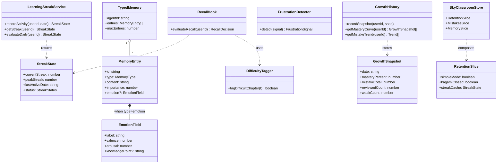
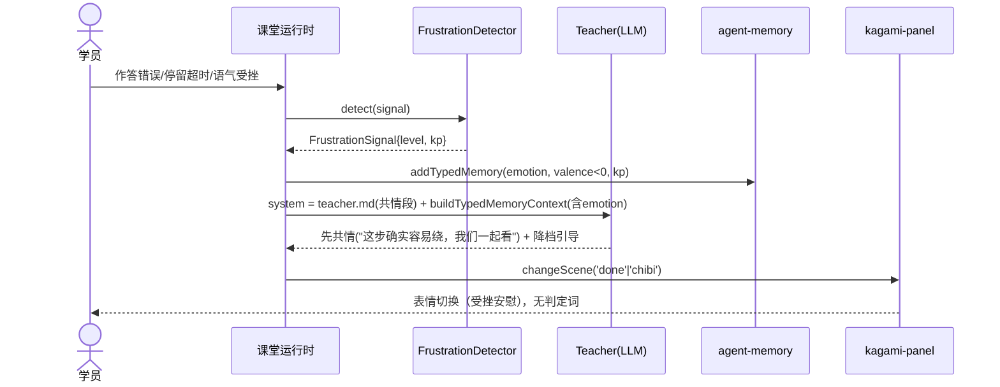
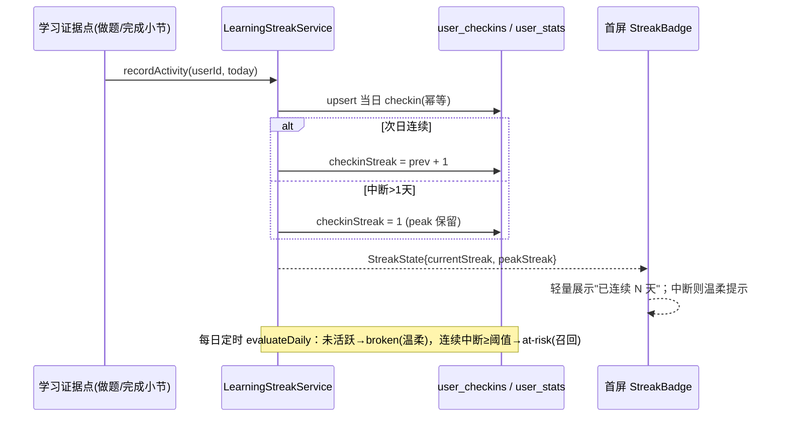
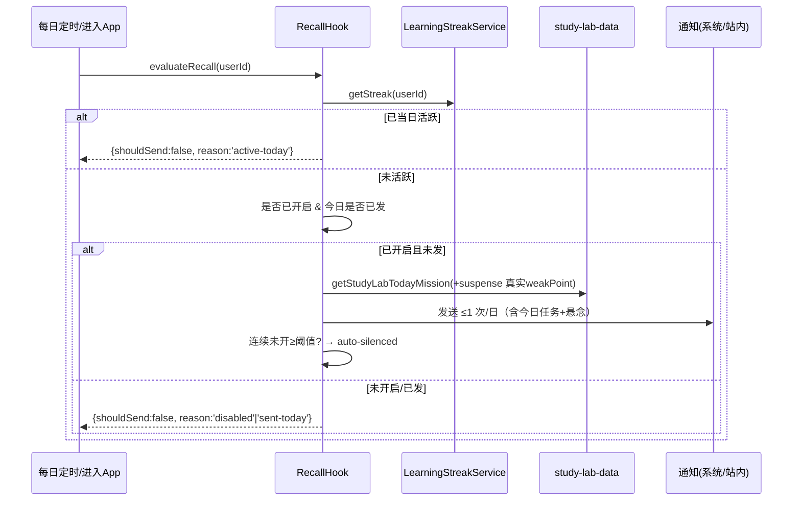
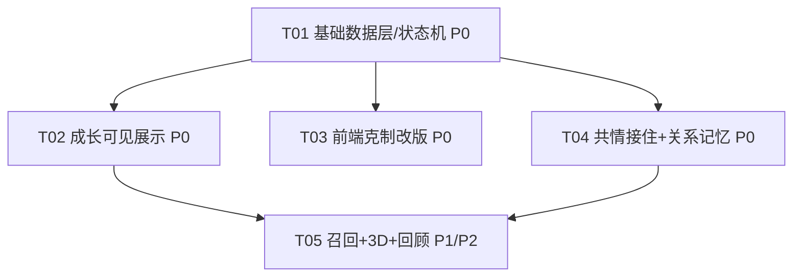

# 智眸无界（sky-classroom）· 学习留存模块 — 增量系统设计与任务分解

> 作者：高见远（软件架构师） · 日期：2026-10-02 · 依据 PRD：`docs/sky-retention-prd.md`
> 性质：**增量设计**（在现有 Next.js 16 + React 19 + TS 5 monorepo 上改），非从零搭建。
> 本次仅产出设计，**不修改任何源码文件**；所列文件路径均为设计结论，待 Engineer 落地。

---

## 0. 已拍板待确认问题（设计直接采纳）

| 编号 | 结论 | 设计落地 |
| --- | --- | --- |
| Q1 连续天数门槛 | 当日完成 ≥1 个知识点的有效学习（做题或完成小节）即计活跃，不以纯停留时长判定 | `LearningStreakService.recordActivity()` 在学习"证据写入"点触发；复用现有 `user_checkins` / `checkinStreak` 字段，仅改触发语义 |
| Q2 3D 难点标签 | 章节内答错率 > 40%，或单张幻灯片停留超时（> 同课平均 2 倍）且伴随答错/跳过 → "听不懂高发" | `DifficultyTagger` 纯函数，双阈值判定，输出章节标签 |
| Q3 角色人设 | 复用现有 `lib/prompts/student-personas/{curious,analytical,creative,note-taker}.md`，**不新建目录** | FR-09 引用真实文件；`kagami-panel.tsx` 不引入新人设目录 |

---

## 1. 实现方案 + 框架选型

### 1.1 技术研判

| 难点 | 现有可复用资产 | 判定 |
| --- | --- | --- |
| 成长可见（掌握度/错题趋势） | `lib/knowledge-graph`（`buildKnowledgeGraph`/`getMasterySummary`，总览已用）、`lib/mistakes`、`lib/sky/learning-insights.ts` | 直接复用 + 补"时间序快照"即可出曲线 |
| 连续天数 | `user_stats.checkinStreak` + `user_checkins` 表 + `streakDays` 显示字段 | **改触发语义**（签到→有效学习），不另造轮子 |
| 情感记忆 | `lib/orchestration/agent-memory.ts`（`MemoryEntry.type` 联合类型） | 联合类型加 `'emotion'`，向后兼容 |
| 课堂共情 | `lib/prompts/roles/teacher.md` + 课堂运行时 | 指令增强 + `FrustrationDetector` 信号钩子 |
| 表情联动 | `components/ai/kagami-panel.tsx`（已有 idle/thinking/teaching/done，缺 chibi） | 增加 chibi 场景映射（`/avatars/kagami/chibi.png` 已存在） |
| 3D 探究 | `lib/prompts/templates/visualization3d-content/system.md`（Three.js 生成 HTML） | 复用生成管线 + 懒加载 iframe 容器 |
| 前端克制 | `app/sky/page.tsx`（TodayFocusPanel 等）、`app/page.tsx`（SkyBackground/HomeLive2DPet/DailyStrip） | 重排首屏 + `simpleMode` 开关门控装饰 |
| 状态管理 | `lib/store/use-sky-classroom-store.ts`（Zustand `persist`） | 新增 `RetentionSlice`，持久化 + 自动跨端同步 |

### 1.2 选型结论

- **沿用**：Next.js 16 + React 19 + TypeScript 5 + Zustand + Tailwind；3D 沿用现有 Three.js HTML 生成管线（不引入 react-three-fiber 等重框架）。
- **零新增运行时依赖**：本模块所有能力均可由现有库 + 自写轻量纯函数/服务实现。
- **架构模式**：以"纯函数派生 + Zustand 客户端状态 + 服务端轻量存储"分层；提示词（prompt）与指令改造为主，最大化复用。
- **克制原则贯穿**：所有情感/成长/3D 设计都先过"是否服务学习"门槛；装饰元素一律可降级关闭；不做奖励徽章/红点轰炸/上瘾机制。

---

## 2. 文件列表（增量标注）

> 图例：【修改】在现有文件上改　【新增】新建文件

### 2.1 数据层 / 状态机（T01）

| 文件 | 类型 | 改什么 |
| --- | --- | --- |
| `lib/orchestration/agent-memory.ts` | 【修改】 | `MemoryEntry.type` 联合加 `'emotion'`；新增 `EmotionMemory` 字段（valence/arousal/label）；`addTypedMemory` 支持 emotion；`buildTypedMemoryContext` 增加 `emotions` 摘要分支（向后兼容 preference/fact/progress） |
| `lib/retention/streak.ts` | 【新增】 | `LearningStreakService`：活动触发记录、连续天数状态机、峰值保留、温柔中断；复用 `user_checkins` 与 `user_stats.checkinStreak`（`lib/storage/dao/user-stats.ts` 的 `setStreak`） |
| `lib/store/use-sky-classroom-store.ts` | 【修改】 | 新增 `RetentionSlice`：`simpleMode`、`kagamiClosed`、`streakCache`、`growthLocalCache`；纳入 `persist` 的 `partialize` → 自动跨端同步 |
| `lib/retention/growth-history.ts` | 【新增】 | 成长数据时间序快照：每日 `recordSnapshot`（masteryPercent/mistakeTotal/reviewedCount）；`getMasteryCurve` / `getMistakeTrend`；服务端轻量表 `user_growth_snapshots`（每日一条）+ 本地缓存 |
| `lib/retention/types.ts` | 【新增】 | 留存模块共享类型：`StreakState`、`EmotionMemory`、`GrowthSnapshot`、`TodayMissionWithSuspense`、`DifficultyTag`、`RecallDecision` |

### 2.2 成长可见展示（T02）

| 文件 | 类型 | 改什么 |
| --- | --- | --- |
| `components/sky/dashboard/progress-overview-card.tsx` | 【新增】 | FR-05 进度概览卡：连续天数（轻，一行）+ 掌握度% + 错题趋势摘要；首屏核心区 2 |
| `components/sky/dashboard/mastery-curve-card.tsx` | 【新增】 | FR-01 掌握度曲线（按周/按知识点，三态 已掌握/薄弱/未学），联动错题本 |
| `components/sky/dashboard/mistake-trend-card.tsx` | 【新增】 | FR-02 错题总数↓趋势 + 每题状态（待复习/已攻克），攻克用中性回顾样式 |
| `lib/sky/learning-insights.ts` | 【修改】 | 暴露 `buildGrowthCurve(mistakes, history)` 派生曲线数据；复用 `buildKnowledgeGraph` |
| `app/sky/learning/stats/page.tsx` `app/sky/learning/graph/page.tsx` | 【修改】 | 接入 MasteryCurveCard / MistakeTrendCard |

### 2.3 前端克制改版（T03）

| 文件 | 类型 | 改什么 |
| --- | --- | --- |
| `app/sky/page.tsx` | 【修改】 | FR-05/06 重排：首屏仅「问候+连续天数(一行) / 今日任务卡(TodayFocusPanel) / 进度概览卡(ProgressOverviewCard)」+「更多」折叠；卡片 ≤3 |
| `app/page.tsx` | 【修改】 | FR-07 用 `simpleMode` 门控 `<SkyBackground/>` 与 `<HomeLive2DPet/>`（默认静默/浅色） |
| `components/sky/home/sky-background.tsx` `components/sky/home/home-live2d-pet.tsx` | 【修改】 | 接收 `simpleMode` prop，开启时降级为静态/不渲染 |
| `components/sky/layout/simple-mode-toggle.tsx` | 【新增】 | FR-07 "简洁模式"开关 + 单元素关闭（背景静默/宠物收起），写入 `RetentionSlice.simpleMode` |
| `app/m/sky/page.tsx` | 【修改】 | 移动端与桌面共用同一 `simpleMode` + 首屏信息架构（§8 兼容） |

### 2.4 课堂共情接住 + 关系记忆（T04）

| 文件 | 类型 | 改什么 |
| --- | --- | --- |
| `lib/prompts/roles/teacher.md` | 【修改】 | FR-04 新增"受挫共情接住"段：先共情（"这步确实容易绕，我们一起看"）+ 再降一档引导；禁用"你错了/不对"等判定词；FR-09 增加"引用跨课记忆"约束（仅基于真实条目） |
| `lib/orchestration/frustration-detector.ts` | 【新增】 | FR-04 受挫信号检测：作答错误 / 停留超时 / 用户语气 → 输出 `FrustrationSignal`；纯函数，课堂运行时调用 |
| `components/ai/kagami-panel.tsx` | 【修改】 | FR-10 新增 `chibi` 场景映射（`/avatars/kagami/chibi.png`）；受挫时优先 `done/chibi` 而非 `idle`；尊重 `kagamiClosed` |
| `lib/orchestration/agent-memory.ts` | 【修改】 | FR-08 见 2.1（同文件，合并实现） |
| `lib/prompts/student-personas/*.md` | 【复用】 | 不修改；FR-09 人设感知引用（Q3 拍板复用） |

### 2.5 召回钩子 + 3D 探究 + 胜任感回顾（T05，方向级）

| 文件 | 类型 | 改什么 |
| --- | --- | --- |
| `lib/sky/study-lab-data.ts` | 【修改】 | FR-11 `getStudyLabTodayMission` 增加 `suspense` 字段（基于真实 `weakPoints`/`focusTopic` 生成"未掌握点小悬念"） |
| `lib/retention/recall-hook.ts` | 【新增】 | FR-12 轻提醒决策：已当日活跃？已开启？生成今日任务+悬念；≤1 次/日；连续 N 日未开自动静默（R-3） |
| `lib/retention/difficulty-tagger.ts` | 【新增】 | FR-13 按 Q2 双阈值给章节打"听不懂高发"标签（纯函数，输入课堂 telemetry） |
| `components/sky/learning/three-d-explorer.tsx` | 【新增】 | FR-13/14 3D 懒加载容器（iframe 承载现有 Three.js HTML），加载失败回退静态图，尊重 `simpleMode` |
| `lib/retention/competence-review.ts` | 【新增】 | FR-15 中性胜任感回顾（"这周攻克 N 道错题、掌握 M 个知识点"），复用 milestone 逻辑但**去除"徽章"奖励话术**（R-1/R-2 兼容修正） |
| `lib/mistakes/suggestions.ts` | 【修改】 | FR-15 兼容修正：streak 里程碑去"徽章"奖励表述，改中性回顾 |

---

## 3. 数据结构与接口（类型 / 类图）

### 3.1 连续天数状态机（StreakState）

```ts
// lib/retention/types.ts
export type StreakStatus = 'inactive' | 'active' | 'broken' | 'at-risk' | 'peak';

export interface StreakState {
  currentStreak: number;   // 当前连续天数
  peakStreak: number;      // 历史峰值（中断保留）
  lastActiveDate: string;  // YYYY-MM-DD（本地时区，避免 SSR 时区错配）
  status: StreakStatus;
}

// lib/retention/streak.ts
export class LearningStreakService {
  /** 当日有效学习（≥1 知识点：做题或完成小节）触发，幂等：同日多次只记一次 */
  recordActivity(userId: string, date?: string): Promise<StreakState>;
  getStreak(userId: string): Promise<StreakState>;
  /** 每日定时评估：未活跃→broken（温柔），连续中断≥阈值→at-risk */
  evaluateDaily(userId: string): Promise<StreakState>;
}
```

**状态机语义（Q1 落地）**：`inactive → active`（当日完成最小活跃门槛）；`active → active`（次日继续，+1）；`active → broken`（当日未活跃，峰值保留）；`broken → active`（重新学习，currentStreak 重置为 1，peak 保留）；`broken → at-risk`（连续中断≥阈值，进入召回）；`active → peak`（达个人里程碑，中性回顾非奖励）。

### 3.2 情感记忆类型扩展（agent-memory，向后兼容）

```ts
// lib/orchestration/agent-memory.ts（修改后）
export type MemoryType =
  | 'preference' | 'fact' | 'progress' | 'question' | 'decision'
  | 'emotion';                       // ← 新增

export interface MemoryEntry {
  id: string;
  type: MemoryType;                  // 联合扩展，既有 5 类不受影响
  content: string;
  turnNumber: number;
  importance: number;                // 0-1
  source: string;
  // ── emotion 专用轻量字段（仅 type==='emotion' 时填）──
  emotion?: {
    label: 'frustrated' | 'excited' | 'confused' | 'confident';
    valence: number;                 // -1..1
    arousal: number;                 // 0..1
    knowledgePoint?: string;         // 关联知识点（用于"记得你"）
  };
}

export function addTypedMemory(
  memory: TypedMemory, type: MemoryType, content: string,
  turnNumber: number, importance?: number,
  emotion?: MemoryEntry['emotion'],
): MemoryEntry;                      // 重载/可选参数，旧调用方无需改

export function buildTypedMemoryContext(memory: TypedMemory): string {
  // 既有 preference/decision/progress 分支不动；新增：
  const emotions = memory.entries.filter((e) => e.type === 'emotion');
  if (emotions.length)
    lines.push(`Emotions: ${emotions.slice(-3).map((e) => `${e.emotion?.label}(${e.content})`).join('; ')}`);
  return lines.join('\n');
}
```

### 3.3 召回钩子与今日任务（含悬念）

```ts
// lib/sky/study-lab-data.ts（修改后）
export interface StudyLabTodayMission {
  title: string; detail: string; href: string;
  sourceLabel: string; durationLabel: string; reason: string;
  successCriteria: string[];
  state: 'ready' | 'completed' | 'buffer-day' | 'starter';
  suspense?: string;   // ← 新增：未掌握点小悬念（如"昨天那道函数题，今天换个角度试试？"）
}

// lib/retention/recall-hook.ts（新增）
export interface RecallDecision {
  shouldSend: boolean;        // 未当日活跃 && 已开启
  mission: StudyLabTodayMission;
  reason: 'active-today' | 'disabled' | 'sent-today' | 'auto-silenced' | 'due';
  nextSendAt?: number;
}
export function evaluateRecall(userId: string): Promise<RecallDecision>;
```

### 3.4 成长可见数据派生（来源与计算）

```ts
// lib/retention/growth-history.ts（新增）
export interface GrowthSnapshot {
  date: string;             // YYYY-MM-DD
  masteryPercent: number;   // 来自 getMasterySummary(graph).overallMastery
  mistakeTotal: number;     // mistakes.length
  reviewedCount: number;    // reviewed === true 的数量
  weakCount: number;        // graph.weakPoints.length
}
export function recordSnapshot(userId: string, snap: GrowthSnapshot): Promise<void>;
export function getMasteryCurve(userId: string): GrowthSnapshot[];   // 真实历史，禁止插值膨胀
export function getMistakeTrend(userId: string): { date: string; total: number; resolved: number }[];

// 派生来源（全部复用现有）：
// 掌握度曲线  ← buildKnowledgeGraph(mistakes) + getMasterySummary（按知识点维度）
// 错题减少趋势 ← MistakeRecord.reviewed 时间序（markReviewed 时间戳）
// 连续天数     ← LearningStreakService（见 3.1）
```

### 3.5 3D 难点标签（DifficultyTagger）

```ts
// lib/retention/difficulty-tagger.ts（新增）
export interface ChapterTelemetry {
  chapterId: string;
  errorRate: number;          // 章节内答错率 0..1
  slideDwells: { slideId: string; ms: number; wrongOrSkipped: boolean }[];
  courseAvgDwellMs: number;   // 同课平均单页停留
}
export function tagDifficultChapter(t: ChapterTelemetry): boolean {
  const overError = t.errorRate > 0.4;                       // Q2 阈值 1
  const overDwell = t.slideDwells.some(
    (s) => s.ms > t.courseAvgDwellMs * 2 && s.wrongOrSkipped  // Q2 阈值 2
  );
  return overError || overDwell;
}
```

### 3.6 类图（mermaid classDiagram）



---

## 4. 程序调用流程（mermaid 时序图）

### 4.1 课堂共情接住流（FR-04 / FR-09 / FR-10）



### 4.2 连续天数状态机流（FR-03）



### 4.3 召回钩子触发流（FR-11 / FR-12）



---

## 5. 任务列表（有序 / 含依赖 / 文件级 / 验收点）

> 约束：≤5 个任务；T01 为基础共享层；P0（FR-01~07）细化到文件级，P1/P2 给方向。

### T01 — P0｜基础数据层与状态机（共享）　【依赖：无】

| 项 | 内容 |
| --- | --- |
| 涉及文件 | `lib/orchestration/agent-memory.ts`【改】、`lib/retention/streak.ts`【新】、`lib/retention/growth-history.ts`【新】、`lib/retention/types.ts`【新】、`lib/store/use-sky-classroom-store.ts`【改】、`lib/storage/dao/user-stats.ts`【改·复用 setStreak】 |
| 内容 | ① agent-memory 加 emotion 类型（向后兼容）② LearningStreakService 活动触发 + 状态机 + 峰值保留（复用 checkin 表）③ growth-history 每日真实快照（服务端轻量表 + 本地缓存）④ RetentionSlice（simpleMode/kagamiClosed/streakCache）入 persist |
| 验收点 | emotion 写入不破坏既有 5 类；streak 同日幂等、中断保留峰值；growth 快照为真实值无插值；simpleMode 跨端（桌面/移动）一致 |

### T02 — P0｜成长可见展示（FR-01/02/03 首屏呈现）　【依赖：T01】

| 项 | 内容 |
| --- | --- |
| 涉及文件 | `components/sky/dashboard/progress-overview-card.tsx`【新】、`components/sky/dashboard/mastery-curve-card.tsx`【新】、`components/sky/dashboard/mistake-trend-card.tsx`【新】、`lib/sky/learning-insights.ts`【改】、`app/sky/learning/stats/page.tsx`【改】、`app/sky/learning/graph/page.tsx`【改】 |
| 内容 | 进度概览卡（连续天数+掌握度+错题摘要）；掌握度曲线（三态，联动错题本）；错题减少趋势 + 攻克中性样式；曲线数据来自 growth-history + buildKnowledgeGraph |
| 验收点 | 曲线/趋势与实际做题记录一致（R-2）；薄弱点可跳错题本；首屏进度卡点击率达标（§2.4） |

### T03 — P0｜前端克制改版（FR-05/06/07）　【依赖：T01】

| 项 | 内容 |
| --- | --- |
| 涉及文件 | `app/sky/page.tsx`【改】、`app/page.tsx`【改】、`components/sky/home/sky-background.tsx`【改】、`components/sky/home/home-live2d-pet.tsx`【改】、`components/sky/layout/simple-mode-toggle.tsx`【新】、`app/m/sky/page.tsx`【改】 |
| 内容 | 首屏收敛为「问候+连续天数(一行)/今日任务卡/进度概览卡」+「更多」折叠（卡片 ≤3）；simpleMode 门控动态背景/Live2D 宠物/吉祥物（默认静默可关）；kagami 仅右下角小标可关；移动端共用同一架构 |
| 验收点 | 首屏卡片 ≤3；关闭装饰后 LCP < 2.0s（移动 4G）；简洁模式跨端同步（§8） |

### T04 — P0｜课堂共情接住 + 关系记忆（FR-04/08/09/10）　【依赖：T01】

| 项 | 内容 |
| --- | --- |
| 涉及文件 | `lib/prompts/roles/teacher.md`【改】、`lib/orchestration/frustration-detector.ts`【新】、`components/ai/kagami-panel.tsx`【改】、`lib/orchestration/agent-memory.ts`【改·同 T01】、`lib/prompts/student-personas/*.md`【复用】 |
| 内容 | teacher.md 加受挫共情段（禁用判定词）+ 跨课记忆引用约束；FrustrationDetector 信号钩子；kagami 加 chibi 场景，受挫优先 done/chibi；emotion 记忆写入与召回引用（仅真实条目） |
| 验收点 | 受挫后继续率提升（§2.4）；兜底语料无"你错了"；角色引用 100% 来自记忆（FR-09）；表情映射无闪烁 |

### T05 — P1/P2｜召回钩子 + 3D 探究 + 胜任感回顾（FR-11/12/13/14/15，方向级）　【依赖：T01, T02, T04】

| 项 | 内容 |
| --- | --- |
| 涉及文件 | `lib/sky/study-lab-data.ts`【改】、`lib/retention/recall-hook.ts`【新】、`lib/retention/difficulty-tagger.ts`【新】、`components/sky/learning/three-d-explorer.tsx`【新】、`lib/retention/competence-review.ts`【新】、`lib/mistakes/suggestions.ts`【改】 |
| P1 方向 | FR-11 今日任务加 suspense（真实 weakPoint）；FR-12 轻提醒决策（≤1/日、可降频、自动静默）；FR-15 中性胜任感回顾（去"徽章"话术） |
| P2 方向 | FR-13/14 难点小节插入 3D（懒加载 iframe + 失败回退静态）；DifficultyTagger 按 Q2 双阈值打标 |
| 验收点 | 悬念引用真实未掌握点（非随机）；提醒不触发红点轰炸；3D 仅难点小节出现、帧率≥30fps、不进首屏；回顾内容来自真实数据无奖励化 |

### 任务依赖图（mermaid graph）



---

## 6. 依赖包列表（尽量零新增）

| 包 | 必要性 | 结论 |
| --- | --- | --- |
| 现有：next / react / zustand / tailwindcss / motion / lucide-react | 已装 | 复用，不新增 |
| three（Three.js） | 3D 由 `visualization3d-content/system.md` 以 CDN `<script>` 方式在生成的 HTML 内加载，**不进应用依赖** | 零新增 |
| 任何图表库（recharts/visx 等） | 掌握度/错题曲线可用 SVG + Tailwind 自绘（首屏克制、体积小） | **零新增**（避免 LCP 拖累 R-4） |
| 定时/推送框架 | FR-12 MVP 走"进入 App 本地评估 + 系统通知"，不引入后端 cron 框架 | 零新增（灰度后再评估） |

**结论：本模块运行时零新增 npm 依赖。** 仅新增若干内部 `lib/retention/*` 纯函数/服务与少量组件。

---

## 7. 共享知识（跨文件约定）

1. **日期口径**：连续天数与成长快照的"日"统一用**本地时区 `YYYY-MM-DD`**（`getTodayStr` 模式），避免服务端 UTC 与浏览器 UTC+8 的水合错配（参考 `app/sky/page.tsx` 的 `getGreeting` 不读 `new Date()` 的先例）。
2. **"当日活跃"触发点**：统一在"学习证据写入"调用 `LearningStreakService.recordActivity`——即 `syncMistakesFromQuizzes`、章节完成、测验完成时；不在纯登录/停留时触发（满足 Q1）。
3. **真实数据铁律**：曲线/趋势/里程碑全部来自 `growth-history` 真实快照与 `buildKnowledgeGraph`，**禁止插值膨胀与奖励数值**（R-2）。
4. **情感记忆合规**：emotion 为敏感衍生数据，默认本地/服务端加密存储、可删除；**引用前需用户授权"关系记忆"开关**（§11）；读取失败降级通用鼓励语（§12）。
5. **克制/降级**：所有装饰（动态背景、Live2D 宠物、吉祥物、kagami）一律受 `RetentionSlice.simpleMode` / `kagamiClosed` 门控；3D 不进首屏、加载失败回退静态（R-4）。
6. **人设复用**：FR-09 引用 `lib/prompts/student-personas/{curious,analytical,creative,note-taker}.md`，**不新建目录**（Q3）。
7. **跨端同步**：装饰/简洁模式/连续天数 UI 缓存走同一 Zustand `persist` store → 桌面（`app/sky`、`app/page`）与移动（`app/m/sky`）自动一致（§8）。

---

## 8. 待明确事项（需主理人/PM 拍板或 Engineer 落地前确认）

1. **连续天数触发总线**：是统一在"证据写入"点调用 `recordActivity`，还是新增统一学习活跃事件？建议前者（最小改动），但需确认 `syncMistakesFromQuizzes`、章节完成、测验完成三处是否都已是被稳定调用的落点。
2. **成长历史快照存储**：服务端是否允许新增轻量表 `user_growth_snapshots`（每日一条）？还是仅本地快照？PRD §11 要求跨端 → 倾向服务端轻量；需 DBA/后端确认是否开表或复用 `user_stats` 扩展 JSON 列。
3. **FR-12 推送通道**：纯前端（`Service Worker` + `Notification`）还是服务端 cron 推送？本设计按"进入 App 本地评估 + 系统通知"MVP，服务端推送留灰度后；需确认是否接受首版无服务端推送。
4. **3D 遥测字段**：FR-13 的"单页停留时长"与"答错/跳过"是否已在课堂运行时采集？若未采集，T05 需先补埋点（影响 P2 排期）。
5. **kagami chibi 场景**：现有 `Scene` 类型无 `chibi`（仅 idle/thinking/teaching/done），`/avatars/kagami/chibi.png` 已存在；T04 需在 `kagami-panel.tsx` 增加 `chibi` 映射（已记入 T04）。
6. **移动端复用**：`app/m/sky/page.tsx` 是否复用同一 `SkyDashboardPage`/首屏组件？需确认以便"简洁模式"两端同步的实现路径（T03）。
7. **现有 streak 里程碑话术冲突**：`lib/mistakes/suggestions.ts` 当前用"解锁XX徽章"奖励表述，与 PRD R-1/R-2「不做奖励徽章」冲突 → T05 已规划去奖励化，但需 PM 确认是否同步改首页/总览现有展示。

---

*文档结束 · 增量架构设计 v1 · 高见远 · 2026-10-02*
