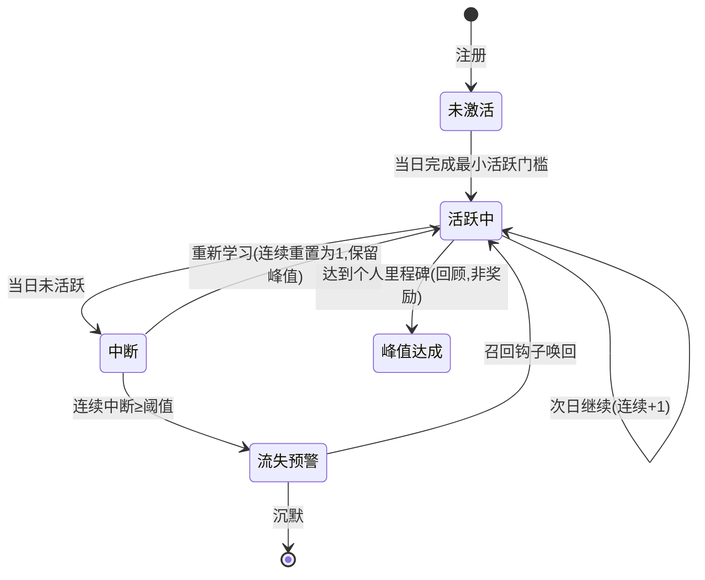
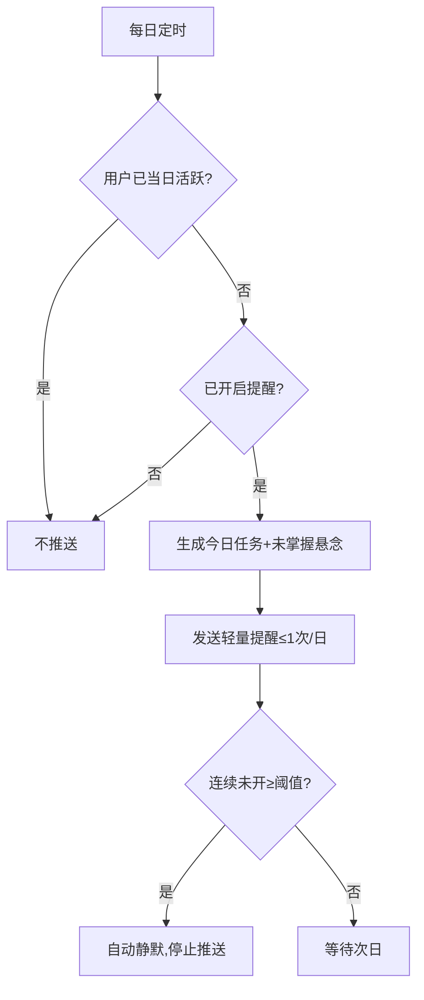

# 智眸无界（sky-classroom）· 学习留存模块产品设计文档（PRD）

> 以教育价值为核心，用克制的情感温度提升用户留存（retention）。

---

## 1. 文档信息

| 字段 | 内容 |
| --- | --- |
| 文档名称 | 智眸无界·学习留存模块 PRD |
| 版本 | v0.1（草稿） |
| 作者 | 许清楚（产品经理） |
| 日期 | 2026-10-02 |
| 项目代号 | sky-classroom（对外品牌：智眸无界） |
| 关联工程 | Next.js + React + TypeScript；AI 多智能体互动课堂 |
| 状态 | 草稿，待评审 |

### 变更记录

| 版本 | 日期 | 作者 | 变更说明 |
| --- | --- | --- | --- |
| v0.1 | 2026-10-02 | 许清楚 | 初稿 |

### 评审记录

| 评审轮次 | 日期 | 评审人 | 结论 | 主要意见 |
| --- | --- | --- | --- | --- |
| — | — | — | — | — |

---

## 2. 背景与目标

### 2.1 背景（项目上下文）

智眸无界是一个 **AI 多智能体互动课堂**平台（Next.js + React + TypeScript 工程化产品）。核心能力包括：AI 老师 + AI 同学多智能体实时互动讲课、幻灯片生成、白板/聚光灯/激光笔动作引擎、3D 教学可视化。

平台已具备以下基础资产：

- **学习留存模块（较完整）**：学习总览（今日任务 / 错题复习条 / 继续探索）、学习路径、错题本、复习计划、学习画像、统计页、个性化实验室。
- **人情味资产（已存在，但散落）**：星野老师等动漫人设角色；`kagami` 多状态图（idle/teaching/thinking/done/chibi，带表情状态的 AI 助手图像）；首页 Live2D 陪伴宠物（白猫/黑猫）；吉祥物图（黑猫/猫/人）；动态天空背景；3D Three.js 教学可视化（太阳系/分子/解剖/几何/物理）。
- **关键缺口**：
  1. 课堂对话只有"鼓励温暖"的脚本语气，**没有真正的情感机制**——读不懂用户情绪、不记情感、答错不温柔兜底。
  2. **前端首屏元素偏多偏杂**，认知负荷高，用户"没有使用欲望"。

### 2.2 要解决的问题

| 编号 | 问题 | 影响 |
| --- | --- | --- |
| P-1 | 课堂答错/卡壳时仅机械鼓励，无共情兜底 | 受挫高峰直接流失，教育中断 |
| P-2 | 用户情绪无人读取、跨课情感无记忆 | 人情味沦为装饰，关系感弱 |
| P-3 | 进步"看不见"，无连续成长感 | 胜任感缺失，缺少回访理由 |
| P-4 | 首屏信息过载（动态背景+宠物+吉祥物+多栏卡片） | 认知负荷高，核心价值被淹没 |
| P-5 | 留存无清晰引擎，缺"被轻轻唤回"的机制 | 一次性使用，无长期习惯回路 |

### 2.3 核心目标（三条铁律，贯穿全文）

1. **教育为主，人情味是辅助手段，不是目的**：人情味只服务于"让用户学得更好、不孤单、不放弃"，绝不喧宾夺主。
2. **砍掉一切"靠新奇刺激留存"的设计**：不做宠物随机惊喜、不做可变奖励引擎、不做上瘾机制。
3. **前端必须克制、简洁、首屏聚焦核心价值**：界面降低认知负荷，首屏只突出"今天学什么、我进步了吗"，装饰性元素只能适度、服务于功能。

### 2.4 成功指标与口径（量化，基线为上线前埋点校准的假设值）

| 指标 | 统计口径 | 假设基线 | 目标值 | 优先级 |
| --- | --- | --- | --- | --- |
| 7 日回访率 | 注册/激活后第 7 日仍有访问的 UV / 总 UV | 35% | 50% | P0 |
| 连续学习天数留存率（D7） | 连续学习 ≥7 天且第 7 日仍活跃的用户 / 启动学习的用户 | 20% | 35% | P0 |
| 连续学习天数留存率（D30） | 连续学习 ≥30 天且第 30 日仍活跃的用户 / 启动学习的用户 | 8% | 18% | P1 |
| 课程完成率 | 完成课程末节/结业测验的用户 / 进入课程的用户 | 45% | 60% | P0 |
| 错题攻克率 | 进入错题本后 7 日内重做正确的错题数 / 该批错题总数 | 30% | 50% | P0 |
| 课堂受挫后继续率 | 答错或卡壳后仍继续当前小节学习的次数 / 受挫总次数 | 50% | 70% | P0 |
| 首屏核心价值点击率 | 首屏"今日任务 + 进度"卡片点击 UV / 首屏曝光 UV | — | ≥60% | P0 |
| 首屏 LCP（性能） | 首屏最大内容绘制耗时（移动端 4G 模拟） | 3.5s | <2.0s | P0 |

> 注：基线为基于同类教育产品的假设值，需在灰度上线前以埋点真实值校准（见 §10、§15）。

---

## 3. 名词与术语定义

| 术语 | 定义 |
| --- | --- |
| 智眸无界 / sky-classroom | 本 AI 多智能体互动课堂产品（对外品牌名 / 内部代号） |
| kagami | 带表情状态的 AI 助手形象，含 idle/teaching/thinking/done/chibi 多状态图 |
| 知识图谱 | 由 `lib/knowledge-graph` 的 `buildKnowledgeGraph` 构建的学科知识点掌握度网络 |
| 错题攻克 | 用户对历史错题在复习后重做正确，记为"已攻克" |
| 连续学习天数 | 用户连续多日（每日满足最小活跃门槛）学习的计数，中断则归位但保留历史峰值 |
| 蔡格尼克悬念 | 利用"未掌握点"制造轻度未完成感，引导次日回访（蔡格尼克效应） |
| 拟人化角色 | 有名字、有表情状态的 AI 老师/同学/kagami，产生拟人化联结 |
| 3D 教学可视化 | 由 `lib/prompts/templates/visualization3d-content/system.md` 驱动的 Three.js 可触摸 3D 内容 |
| 关系记忆 | 跨课程记住用户事实/偏好/进度/**情感**的记忆系统 |
| 受挫高峰 | 用户答错、卡壳、想放弃的高流失风险时刻 |

---

## 4. 需求范围（包含 / 不包含）

### 4.1 本期包含

| 模块 | 说明 |
| --- | --- |
| 成长可见引擎 | 知识掌握度曲线、错题减少趋势、连续学习天数、胜任感回顾 |
| 关系记忆引擎 | 跨课情感记忆（新增 emotion 类型）、角色"记得你"、表情状态联动 |
| 召回钩子引擎 | 基于知识图谱的专属今日任务 + 未掌握点小悬念、可配置轻提醒 |
| 课堂共情接住 | 答错/卡壳时共情兜底再引导 |
| 3D 难点探究 | 听不懂高发难点章节插入 3D 可触摸可视化 |
| 前端克制改版 | 首屏聚焦、信息层级收敛、装饰元素降级可关闭 |

### 4.2 本期明确不做

| 不做的设计 | 原因 |
| --- | --- |
| 宠物随机惊喜 / 彩蛋掉落 | 靠新奇刺激留存，新鲜感过后必衰减 |
| 可变奖励引擎 / 抽卡 / 随机掉落 | 稀释教育本质，短期有效长期衰减 |
| 纯游戏化模块（经验值/排行榜/成就抽奖） | 喧宾夺主，娱乐化偏离教育核心 |
| 上瘾机制（无限下拉/红点轰炸） | 违背"克制"铁律与未成年人保护 |
| 动态背景/宠物/吉祥物强化堆砌 | 首屏装饰降级，非本期重点 |
| 社交裂变 / 邀请拉新玩法 | 超出留存模块范围，另立项评估 |

---

## 5. 设计原则（重点章节）

### 5.1 (a) 教育核心价值优先

| 原则 | 落地要求 |
| --- | --- |
| 人情味服务于学习 | 任何情感/角色/可视化设计，必须能回答"它让用户学得更好/更不放弃了吗"，否则删除 |
| 进步先于娱乐 | 首屏与总览第一位永远是"我学到了什么、还差什么"，不是宠物/背景 |
| 受挫即兜底 | 答错是教学机会，不是失败判定；先共情、再引导、不扣分羞辱 |

### 5.2 (b) 情感温度克制应用

| 引擎 | 克制应用方式 | 不做什么 |
| --- | --- | --- |
| 成长可见（留存第一引擎） | 把掌握度曲线、错题减少、连续天数做成"看得见的进步"（胜任感） | 不做虚假增长、不做数值膨胀 |
| 关系记忆（人情味真内核） | kagami/老师/同学跨课"记得你"（上次卡在 X、这次进步了） | 不做宠物卖萌、不做无意义闲聊 |
| 召回钩子 | 今日任务 = 专属任务 + 一个未掌握点小悬念，每天轻轻唤回 | 不做强 push、不做红点轰炸 |

> 心理学依据（点到为止）：自我决定理论（胜任感/关系感/自主性）、峰终定律、蔡格尼克效应、损失厌恶、习惯回路、拟人化/具身认知。

### 5.3 (c) 前端克制设计规范（结合现有 sky 首页/总览页）

**改法总纲**：首屏只回答两个问题——"今天学什么？""我进步了吗？"

| 维度 | 当前问题（app/page.tsx、app/sky/page.tsx） | 克制改法 |
| --- | --- | --- |
| 首屏聚焦 | Live2D 宠物 + 动态天空 + 吉祥物 + 多栏卡片同时出现 | 首屏仅保留「今日任务卡 + 进度概览卡」两块核心；宠物/背景降级为可一键关闭（见 FR-07） |
| 信息层级 | 总览页卡片多达 6+（今日任务/错题条/继续探索/路径/画像/统计） | 首屏信息卡片 ≤ 3 块；其余收入「更多」入口或二级页（见 FR-06） |
| 装饰元素降级 | 动态天空背景、吉祥物图常驻占用首屏注意力 | 动态背景默认静默/浅色，提供"简洁模式"开关；吉祥物仅在总览页底部小微标，不进入首屏主视觉 |
| 认知负荷控制 | 多栏堆砌、装饰动效分散 | 单列流式布局优先；动效仅用于"进度变化"等有意义反馈，禁用装饰性无限动效 |
| 移动端一致 | app/m/sky/page.tsx 与桌面端体验可能分叉 | 移动端与桌面端共用同一克制信息架构与组件（见 §8 兼容）；"简洁模式"两端同步 |

**首屏布局约定（草案）**

```
┌─────────────────────────────┐
│ 顶部：问候 + 连续天数（轻）   │   ← 仅一行，损失厌恶轻提示
├─────────────────────────────┤
│ 今日任务卡（专属任务+悬念）   │   ← 核心区 1：今天学什么
├─────────────────────────────┤
│ 进度概览卡（掌握度/错题趋势） │   ← 核心区 2：我进步了吗
├─────────────────────────────┤
│ 「更多」入口（路径/画像/统计）│   ← 折叠次要
└─────────────────────────────┘
（右下角：kagami 小标，可关闭；底部可开"简洁模式"）
```

---

## 6. 用户角色与使用场景

| 角色 | 特征 | 典型场景 |
| --- | --- | --- |
| 学员（新手） | 刚激活，知识图谱稀疏，易受挫 | 首屏看到"今日任务"引导起步；答错时 kagami 共情兜底；连续天数建立早期习惯 |
| 学员（熟练） | 有路径与画像，追求进步可视化 | 查看掌握度曲线与错题攻克趋势；被"未掌握点悬念"轻轻唤回；3D 探究攻克难点 |
| 访客 | 未激活/流失回流 | 召回钩子（今日任务+小悬念）引导回访；首屏克制降低重新上手门槛 |

---

## 7. 功能需求（FR-xx，含 Given/When/Then 验收标准）

优先级图例：**P0** 本期必须 / **P1** 本期应做 / **P2** 本期深化。

### 7.1 P0 — 成长可见 + 课堂接住 + 前端克制

#### FR-01 知识掌握度曲线（成长可见）
- **复用**：`lib/knowledge-graph`（`buildKnowledgeGraph`，总览页已用）
- **Given** 用户已完成至少 1 节课程或 1 次测验
- **When** 进入"学习总览/统计页"
- **Then** 展示基于知识图谱的掌握度曲线（按周/按知识点维度），明确标注"已掌握/薄弱/未学"三态，且与错题本联动
- **验收**：曲线数据与实际做题记录一致；薄弱点与错题本可互跳。

#### FR-02 错题减少趋势 + 错题攻克状态（成长可见）
- **复用**：`lib/mistakes`（`syncMistakesFromQuizzes`）
- **Given** 用户有历史错题
- **When** 查看错题本或总览"错题复习条"
- **Then** 展示"错题总数 ↓ 趋势"与每题状态（待复习/已攻克）；"已攻克"以中性回顾样式呈现，非奖励徽章
- **验收**：重做正确后状态变更为"已攻克"并计入 §2.4 错题攻克率。

#### FR-03 连续学习天数（成长可见 + 损失厌恶，温柔）
- **Given** 用户满足当日最小活跃门槛（定义见 §15 待确认）
- **When** 当日完成学习
- **Then** 连续天数 +1，首屏轻量展示"已连续 N 天"；中断时展示温柔提示（"没关系，今天重新出发就好"），不羞辱、不弹窗强提醒
- **验收**：天数计算准确；中断提示文案符合 §12 温柔规范。

#### FR-04 课堂共情接住（受挫兜底）
- **Given** 用户在课堂中答错、卡壳或显式表达受挫
- **When** 系统识别受挫信号（作答错误 / 停留超时 / 用户语气）
- **Then** 先共情（"这步确实容易绕，我们一起看"）+ 再引导（降一档讲解/换例子），不扣分、不评判；kagami 切到 thinking/done 表情
- **验收**：受挫后继续率（§2.4）可量化；兜底语料不出现"你错了/不对"等负面判定词。

#### FR-05 首屏聚焦改版（前端克制）
- **复用**：`app/sky/page.tsx`（今日任务/错题条）、`app/page.tsx`
- **Given** 用户进入首屏
- **When** 页面渲染
- **Then** 首屏仅呈现「今日任务卡 + 进度概览卡」两块核心 + 一行连续天数；其余入口折叠至「更多」
- **验收**：首屏信息卡片 ≤ 3 块；核心价值点击率（§2.4）达标。

#### FR-06 信息卡片数量与层级约束（前端克制）
- **Given** 总览/首页任意聚合页
- **When** 设计/渲染卡片
- **Then** 首屏卡片总数 ≤ 3；二级页卡片 ≤ 6；单卡只承载一个核心动作；标题层级 ≤ 3 级
- **验收**：UI 走查通过卡片计数与层级校验。

#### FR-07 装饰元素降级可关闭（前端克制）
- **复用**：`app/page.tsx`（Live2D 宠物、动态天空）、`public/avatars/kagami/*`
- **Given** 用户首次进入首屏
- **When** 看到动态背景/宠物/吉祥物
- **Then** 提供"简洁模式"开关与单元素关闭（背景静默、宠物收起）；选择记忆到本地；kagami 仅保留右下角小标（可关闭）
- **验收**：关闭后首屏 LCP（§2.4）< 2.0s；设置跨端同步。

### 7.2 P1 — 关系记忆 + 召回钩子

#### FR-08 跨课情感记忆（关系记忆·数据层）
- **复用**：`lib/orchestration/agent-memory.ts`（现有 `MemoryEntry.type` 缺 emotion）
- **Given** 用户在课堂中产生情绪（受挫/兴奋/困惑）
- **When** 触发记忆写入
- **Then** 在 `MemoryEntry` 新增 `emotion` 类型（含 valence/arousal 轻量字段），跨课持久化；`buildTypedMemoryContext` 输出情感摘要
- **验收**：类型扩展不破坏既有 preference/fact/progress；情感条目可被检索与脱敏。

#### FR-09 角色"记得你"（关系记忆·表现层）
- **复用**：`lib/prompts/roles/teacher.md`、`student.md`、`components/ai/kagami-panel.tsx`
- **Given** 用户再次进入课堂
- **When** kagami/老师/同学开场
- **Then** 引用跨课记忆（"上次你卡在 X，这次我们换个方式" / "你上周攻克了 3 道错题，厉害"），仅基于真实记录，不编造
- **验收**：引用内容 100% 来自记忆条目；无虚构进度。

#### FR-10 角色表情状态联动（关系记忆·拟人化）
- **复用**：`public/avatars/kagami/*`（idle/teaching/thinking/done/chibi）
- **Given** 课堂状态变化（讲解中/思考中/完成/受挫）
- **When** 触发表情切换
- **Then** kagami 按状态切图：teaching（讲解）、thinking（等待作答）、done（完成鼓励）、chibi（轻量安慰）；受挫时优先 done/chibi 而非 idle
- **验收**：状态映射正确；切换无闪烁；尊重"简洁模式"关闭。

#### FR-11 今日任务 = 专属任务 + 未掌握悬念（召回钩子）
- **复用**：`app/sky/learning/today/page.tsx`、`lib/knowledge-graph`
- **Given** 用户有知识图谱与历史错题
- **When** 生成每日今日任务
- **Then** 任务基于知识图谱薄弱点生成 1 个专属任务 + 1 个"未掌握点小悬念"（如"昨天那道函数题，今天换个角度试试？"），轻量未完成感
- **验收**：任务与个人图谱相关；悬念引用真实未掌握点，非随机。

#### FR-12 可配置轻提醒（召回钩子·防骚扰）
- **Given** 用户开启召回提醒
- **When** 到达约定时间且无当日活跃
- **Then** 发送 1 条轻量提醒（含今日任务+悬念）；频率 ≤ 1 次/日；提供"免打扰/减少提醒"入口
- **验收**：不触发红点轰炸；用户可一键降频；超阈值（连续 N 日未开）自动静默（见风险 R-3）。

### 7.3 P2 — 3D 探究深化

#### FR-13 3D 难点探究（降低认知负荷）
- **复用**：`lib/prompts/templates/visualization3d-content/system.md`（Three.js 生成）
- **Given** 当前章节命中"听不懂高发难点"标签（由历史停留/答错数据标注）
- **When** 进入该难点小节
- **Then** 提供 3D 可触摸可视化（如分子/几何），支持旋转/缩放/标注，作为讲解辅助而非噱头
- **验收**：3D 仅在难点小节出现；帧率 ≥ 30fps（见 §8）；不进入首屏。

#### FR-14 3D 与课堂动作引擎联动（深化）
- **复用**：白板/聚光灯/激光笔动作引擎
- **Given** 用户在 3D 探究模式
- **When** 老师/同学使用聚光灯或激光笔
- **Then** 高亮 3D 模型对应部位，讲解与可视化同步
- **验收**：高亮命中准确；移动端可触控替代激光笔。

#### FR-15 胜任感回顾（成长可见深化，非奖励）
- **Given** 用户完成一周/一阶段学习
- **When** 进入回顾视图
- **Then** 以中性回顾呈现"这周你攻克了 N 道错题、掌握了 M 个知识点"，强调真实进步，无抽奖/排行
- **验收**：内容来自真实数据；视觉克制，不与游戏化混淆。

---

## 8. 非功能需求

| 类别 | 要求 |
| --- | --- |
| 性能 | 首屏 LCP < 2.0s（移动 4G 模拟）；3D 可视化帧率 ≥ 30fps，低端机可降级为静态图 |
| 可访问性 | 文本对比度达标；装饰动效提供"减弱动态效果"开关；情绪提示不依赖单一色彩 |
| 兼容 | 桌面端（app/sky）与移动端（app/m/sky）共用克制信息架构与组件库；iOS/Android/主流浏览器一致 |
| 隐私 | 情感记忆本地/加密存储，可删除（见 §11）；默认关闭个性化情感引用开关可由用户开启 |
| 降级 | 3D/动态背景加载失败时回退静态内容，不阻塞首屏核心（今日任务+进度） |

---

## 9. 业务流程与状态流转

### 9.1 连续学习天数状态机



### 9.2 召回钩子触发流



---

## 10. 数据与埋点需求

| 埋点事件 | 触发 | 关联指标 | 字段 |
| --- | --- | --- | --- |
| streak_day_complete | 当日满足活跃门槛 | 连续学习天数留存率 | user_id, date, streak_count |
| streak_broken | 当日未活跃导致中断 | 同上 / 流失预警 | user_id, last_active_date |
| return_dN | 第 N 日回访 | 7 日回访率 | user_id, d |
| course_complete | 课程结业 | 课程完成率 | user_id, course_id |
| mistake_resolved | 错题重做正确 | 错题攻克率 | user_id, mistake_id |
| frustrated_event | 答错/卡壳信号 | 课堂受挫后继续率 | user_id, lesson_id, signal |
| frustrated_continue | 受挫后继续学习 | 课堂受挫后继续率 | user_id, lesson_id |
| today_task_click | 首屏今日任务卡点击 | 首屏核心价值点击率 | user_id, card |
| first_screen_lcp | 首屏绘制完成 | 首屏 LCP | device, network, lcp_ms |
| emotion_memory_write | 情感记忆写入 | 关系记忆覆盖 | user_id, emotion_type, valence |

---

## 11. 权限与安全

| 项 | 要求 |
| --- | --- |
| 学习数据隐私 | 知识图谱/错题/进度仅本人可见；跨端同步加密；提供"清除我的学习数据"入口 |
| 情感记忆合规 | 情感类型为敏感衍生数据，默认本地存储、可删除；引用前需用户授权"关系记忆"开关 |
| 未成年人保护 | 面向教育、含未成年用户：禁推送诱导消费/上瘾内容；提醒频率受限；guardian 可管理提醒与简模 |
| 内容安全 | 共情/悬念/回顾文案过审，不含负面判定、不泄露他人数据 |
| 最小化 | 仅采集留存必需埋点（§10），不采集无关行为用于画像变现 |

---

## 12. 异常处理清单

| 场景 | 处理（温柔，不冷冰冰） |
| --- | --- |
| 首屏/数据加载失败 | 展示"今天先挑一道题热热身？"轻提示 + 重试，不弹错误码 |
| 网络断开 | 进入离线简版（今日任务缓存 + 本地进度），恢复后静默同步 |
| 连续天数中断 | "没关系，学习不是比赛，今天重新出发就好"，不羞辱、不弹窗 |
| 3D 资源加载失败 | 回退静态图/文字讲解，不阻塞课堂 |
| 情感记忆读取失败 | 降级为通用鼓励语，不暴露错误、不编造记忆 |
| 召回提醒发送失败 | 静默重试一次，失败则次日补，不重复轰炸 |

---

## 13. 上线计划与依赖

| 阶段 | 内容 | 依赖（现有模块） |
| --- | --- | --- |
| 阶段一（P0） | 成长可见（FR-01~03）+ 课堂接住（FR-04）+ 前端克制（FR-05~07） | buildKnowledgeGraph、lib/mistakes、app/sky/page.tsx、app/page.tsx、kagami-panel |
| 阶段二（P1） | 关系记忆（FR-08~10）+ 召回钩子（FR-11~12） | agent-memory.ts（扩 emotion）、teacher/student.md、kagami 多状态图、today 页 |
| 阶段三（P2） | 3D 探究（FR-13~14）+ 胜任感回顾（FR-15） | visualization3d-content/system.md、动作引擎 |

- **实现方式**：以纯前端/提示词（prompt）与指令改造为主，最大化复用现有模块，不另造轮子。
- **灰度**：先小流量验证 §2.4 指标，再全量。

---

## 14. 风险与遗留问题（风险登记册）

| 编号 | 风险 | 概率 | 影响 | 应对 |
| --- | --- | --- | --- | --- |
| R-1 | 人情味盖过教育（娱乐化） | 中 | 高 | 每条情感设计须过"是否服务学习"门槛（§5.1）；评审红线 |
| R-2 | 成长反馈造假失去信任 | 中 | 高 | 曲线/攻克率严格来自真实数据（FR-01/02/15）；禁止数值膨胀 |
| R-3 | 过度提醒变骚扰 | 中 | 中 | 频率 ≤1/日、可降频、连续未开自动静默（FR-12） |
| R-4 | 3D 性能拖累首屏 | 中 | 中 | 3D 不进首屏、帧率降级、加载失败回退（FR-13/§8） |
| R-5 | 情感记忆误读/编造 | 低 | 高 | 引用仅基于真实条目（FR-09）；读取失败降级通用语（§12） |
| R-6 | 前端克制改版降低活力感 | 低 | 中 | A/B 验证首屏点击率与回访率（§2.4）；保留简洁模式兜底 |

---

## 15. 附录：待确认问题

| 编号 | 问题 | 影响范围 | 建议默认 |
| --- | --- | --- | --- |
| Q-1 | "连续学习天数"当日最小活跃门槛如何定义？（完成 1 题 / 1 小节 / 5 分钟？） | FR-03、§2.4 口径、§9 状态机 | 完成 ≥1 个小节或 ≥1 次测验 |
| Q-2 | 3D 难点探究的"听不懂高发难点"标签由谁/何数据标注？（停留超时？答错率？） | FR-13、FR-14 | 由历史答错率 + 停留超时双阈值自动标注 |
| Q-3 | `lib/prompts/roles/student-personas/*` 目录在工程中未找到（仅有 `student.md`/`assistant.md`），角色人设目录是否需新建或复用现有？ | FR-09、FR-10 引用准确性 | 复用 `student.md`，personas 以数据字段承载，不新建目录 |

---

*文档结束 · v0.1（草稿）· 许清楚 · 2026-10-02*
