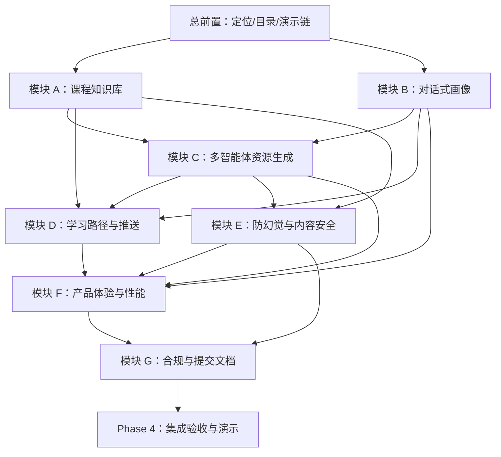

# 软件杯参赛落地执行计划

> 来源方案：`docs/software-cup-solution-plan.md`  
> 参考格式：`docs/OPTIMIZATION-PLAN.md`  
> 执行方式：单人开发，不做团队分工  
> 任务编号：`[Module]-[序号]`  
> 状态标记：`未开始` → `进行中` → `已完成`

---

## 一、目标总览

本计划用于把软件杯三组要求落到可执行任务：

1. 核心功能：对话式学习画像、多智能体资源生成、个性化学习路径、智能辅导、学习评估。
2. 产品质量：现代 AI 产品交互、开源合规、防幻觉与内容安全、流式输出和进度追踪。
3. 数据底座：自行构造至少一门完整高校专业课程的初始知识库/文档集。

最终交付目标：

- 一个可演示的“个性化学习生成台”。
- 一套完整《人工智能导论》课程知识库。
- 一条完整演示链路：画像构建 → 知识库检索 → 多智能体资源生成 → 安全核验 → 学习路径推送 → 练习评估 → 画像更新。
- 一套参赛提交材料：方案说明、开源合规说明、防幻觉说明、演示脚本、课程知识库说明。

---

## 二、整体模块安排

| 模块 | 方向 | 建议周期 | 目标 |
| --- | --- | --- | --- |
| 总前置 | 材料整理与项目定位 | Week 1 | 明确参赛叙事、材料清单、演示路线 |
| 模块 A | 《人工智能导论》课程知识库 | Week 1-2 | 构造完整课程文档集，作为系统输入 |
| 模块 B | 对话式学习画像 | Week 2 | 支持自然语言构建不少于 8 维画像 |
| 模块 C | 多智能体资源生成 | Week 3-4 | 生成至少 5 类个性化学习资源 |
| 模块 D | 学习路径与资源推送 | Week 4 | 根据画像和知识图谱生成动态学习路径 |
| 模块 E | 防幻觉与内容安全 | Week 4-5 | 增加引用、核验、置信度、安全过滤 |
| 模块 F | AI 产品体验与性能 | Week 5 | 统一工作台、流式输出、进度追踪、卡片展示 |
| 模块 G | 开源合规与提交文档 | Week 5 | 补齐协议、第三方来源、项目说明 |
| Phase 4 | 集成验收与演示准备 | Week 6 | 跑通完整演示链路，修复体验问题 |

---

## 三、需要准备的材料清单

### 3.1 课程知识库材料

| 材料 | 用途 | 建议位置 |
| --- | --- | --- |
| 课程元信息 | 声明课程名称、对象、学时、先修要求 | `data/course-knowledge/ai-intro/course-meta.json` |
| 课程大纲 | 作为课程整体规划和路径生成依据 | `data/course-knowledge/ai-intro/syllabus.md` |
| 章节讲义 | RAG 检索、讲义生成、PPT 生成、防幻觉核验 | `data/course-knowledge/ai-intro/chapters/*.md` |
| 知识点图谱 | 学习路径、前置知识、掌握度评估 | `data/course-knowledge/ai-intro/knowledge-graph.json` |
| 初始题库 | 诊断测试、练习生成、效果评估 | `data/course-knowledge/ai-intro/question-bank.json` |
| 代码实操案例 | 生成项目材料、代码讲解、实践任务 | `data/course-knowledge/ai-intro/cases/*.md` |
| 拓展阅读 | 推荐阅读、来源引用、内容可信度 | `data/course-knowledge/ai-intro/readings.md` |
| 视频/动画脚本 | 多模态教学资源生成参考 | `data/course-knowledge/ai-intro/media-scripts/*.md` |
| 评价 rubric | 学习效果评估、项目评分 | `data/course-knowledge/ai-intro/assessment-rubric.md` |

### 3.2 系统演示材料

| 材料 | 用途 | 建议位置 |
| --- | --- | --- |
| 演示学生画像样例 | 一键演示画像构建结果 | `data/demo/software-cup/student-profile-sample.json` |
| 演示输入脚本 | 答辩时复制输入，避免现场 improvisation | `docs/software-cup-demo-script.md` |
| 演示资源样例 | 无 API key 或模型慢时可展示 fallback | `data/demo/software-cup/generated-resources.json` |
| 评委讲解稿 | 5-8 分钟完整答辩路线 | `docs/software-cup-presentation-notes.md` |
| 功能截图清单 | 报告和 PPT 使用 | `docs/software-cup-screenshot-list.md` |

### 3.3 合规与安全材料

| 材料 | 用途 | 建议位置 |
| --- | --- | --- |
| 开源项目说明 | 显著标注 OpenMAIC 和依赖协议 | `OPEN_SOURCE_NOTICE.md` |
| 第三方许可证说明 | 汇总主要依赖来源和协议 | `THIRD_PARTY_LICENSES.md` |
| 防幻觉机制说明 | 解释 RAG、核验、引用、置信度 | `docs/software-cup-safety-and-trust.md` |
| 内容安全策略 | 说明敏感内容过滤和拒答边界 | `docs/software-cup-content-safety.md` |
| 性能说明 | 说明流式、异步、进度追踪和响应目标 | `docs/software-cup-performance.md` |

### 3.4 开发运行材料

| 材料 | 用途 |
| --- | --- |
| 至少一个可用 LLM Provider key | 支持画像、生成、核验、答疑 |
| 图片/视频模型配置，可选 | 支持多模态增强，不作为第一优先级 |
| 本地或内置 fallback 数据 | 保证现场网络/API 不稳定时仍能演示 |
| 测试账号 | 演示登录、画像、学习记录、题库 |
| 测试问题集 | 覆盖正常、低置信度、敏感、安全拒答场景 |

---

## 四、总前置任务 · Week 1

> 目标：先把比赛叙事、材料目录和最小演示路线固定下来，避免后续边做边改方向。

***

### `P0-001` 参赛定位与命名统一

> 将项目定位从“泛课堂工具”收拢为“面向高校专业课程的多智能体个性化学习资源生成系统”。

- **前置任务**：无
- **状态**：已完成

**验收标准：**

- [ ] 在参赛方案中统一系统名称和一句话定位。
- [ ] 明确主演示课程为《人工智能导论》。
- [ ] 明确核心闭环：画像 → 知识库 → 多智能体生成 → 路径 → 评估。
- [ ] 明确非遗/其他原型只作为可选案例，不作为主线。

**产出文件：**

```text
docs/software-cup-solution-plan.md          # 已有，可继续完善
docs/software-cup-execution-plan.md         # 本执行计划
```

***

### `P0-002` 创建比赛材料目录

> 建立统一材料存放位置，后续所有课程知识库、演示样例、提交文档都放到固定目录。

- **前置任务**：`P0-001`
- **状态**：已完成

**验收标准：**

- [ ] 创建 `data/course-knowledge/ai-intro/`。
- [ ] 创建 `data/demo/software-cup/`。
- [ ] 创建 `docs/software-cup-*` 系列文档。
- [ ] 所有材料路径在本计划中可追踪。

**产出文件：**

```text
data/course-knowledge/ai-intro/
data/demo/software-cup/
docs/software-cup-demo-script.md
docs/software-cup-safety-and-trust.md
docs/software-cup-performance.md
```

***

### `P0-003` 确定最小可演示闭环

> 单人开发要避免一开始铺太大，先确定必须跑通的一条演示链。

- **前置任务**：`P0-001`
- **状态**：已完成

**验收标准：**

- [ ] 准备一段固定学生输入：
  `我是软件工程大二学生，正在学人工智能导论，想两周内掌握机器学习基础和大模型智能体，Python 基础还可以，但过拟合、模型评估、RAG 不太懂，喜欢代码案例和图解。`
- [ ] 系统能生成学习画像。
- [ ] 系统能从《人工智能导论》知识库检索相关内容。
- [ ] 系统能生成至少 5 类资源。
- [ ] 系统能生成学习路径。
- [ ] 系统能展示审核结果和来源引用。

**产出文件：**

```text
docs/software-cup-demo-script.md
data/demo/software-cup/student-input.txt
```

---

## 五、模块 A · 《人工智能导论》课程知识库 (Week 1-2)

> 目标：满足“自行构造至少一门完整高校专业课程初始知识库/文档集”的硬性要求。

***

### `A-001` 课程知识库目录与元信息

> 建立课程知识库基本结构，声明课程名称、专业方向、适用对象、先修要求和知识库版本。

- **前置任务**：`P0-002`
- **状态**：已完成

**验收标准：**

- [ ] 创建 `data/course-knowledge/ai-intro/course-meta.json`。
- [ ] 包含课程名称、课程类型、适用专业、学时建议、先修知识。
- [ ] 包含知识库版本、更新时间、作者说明。
- [ ] 包含可用于系统导入的 `courseId`。

**产出文件：**

```text
data/course-knowledge/ai-intro/
  course-meta.json
```

***

### `A-002` 课程大纲 `syllabus.md`

> 编写完整课程大纲，作为学习路径规划和课程资源生成的总入口。

- **前置任务**：`A-001`
- **状态**：已完成

**验收标准：**

- [ ] 包含课程目标。
- [ ] 包含适用对象和先修要求。
- [ ] 包含 12 个章节安排。
- [ ] 包含每章学习目标、重点、难点。
- [ ] 包含课程考核方式和项目要求。

**产出文件：**

```text
data/course-knowledge/ai-intro/
  syllabus.md
```

***

### `A-003` 12 章章节讲义

> 每章准备一份 Markdown 讲义，用于 RAG 检索、讲义生成、PPT 生成和事实核验。

- **前置任务**：`A-002`
- **状态**：已完成

**验收标准：**

- [ ] 每章包含概念解释、关键公式/流程、例子、常见误区。
- [ ] 每章至少 800-1500 字，保证有足够检索内容。
- [ ] 技术术语中英对照，如 Transformer、RAG、Agent。
- [ ] 章节之间结构一致，便于后续自动切块。
- [ ] 每章末尾包含 3-5 个可检索知识点标签。

**产出文件：**

```text
data/course-knowledge/ai-intro/chapters/
  01-ai-overview.md
  02-search-and-problem-solving.md
  03-knowledge-representation.md
  04-machine-learning-basics.md
  05-supervised-learning.md
  06-neural-networks.md
  07-natural-language-processing.md
  08-computer-vision.md
  09-reinforcement-learning.md
  10-large-models-and-agents.md
  11-ai-safety-and-ethics.md
  12-course-project.md
```

***

### `A-004` 知识点图谱 `knowledge-graph.json`

> 把课程知识组织成可用于路径规划和掌握度评估的结构化图谱。

- **前置任务**：`A-003`
- **状态**：已完成

**验收标准：**

- [ ] 至少 40 个知识点节点。
- [ ] 每个节点包含 `id`, `name`, `chapter`, `difficulty`, `prerequisites`, `masteryCriteria`, `commonMisconceptions`。
- [ ] 至少 50 条前置/关联边。
- [ ] 能覆盖机器学习、大模型、智能体、安全伦理等重点。
- [ ] JSON 可被程序直接解析。

**产出文件：**

```text
data/course-knowledge/ai-intro/
  knowledge-graph.json
```

***

### `A-005` 初始题库 `question-bank.json`

> 准备诊断、练习和学习效果评估需要的初始题库。

- **前置任务**：`A-004`
- **状态**：已完成

**验收标准：**

- [ ] 至少 120 道题，平均每章不少于 10 道。
- [ ] 题型包含单选、多选、判断、简答、代码题、项目题。
- [ ] 每题包含答案、解析、知识点、难度、错因标签。
- [ ] 至少 20 道题覆盖机器学习基础。
- [ ] 至少 10 道题覆盖大模型与智能体。

**产出文件：**

```text
data/course-knowledge/ai-intro/
  question-bank.json
```

***

### `A-006` 代码实操案例

> 准备可用于“代码类实操案例”和“实践项目学习材料”的案例库。

- **前置任务**：`A-003`
- **状态**：已完成

**验收标准：**

- [ ] KNN 分类案例。
- [ ] 决策树鸢尾花分类案例。
- [ ] 简单神经网络 MNIST 案例。
- [ ] RAG 课程问答助手案例。
- [ ] 每个案例包含目标、前置知识、步骤、代码、思考题、评分标准。

**产出文件：**

```text
data/course-knowledge/ai-intro/cases/
  knn-classification.md
  decision-tree-iris.md
  neural-network-mnist.md
  rag-course-assistant.md
```

***

### `A-007` 拓展阅读、媒体脚本与评价标准

> 补齐多模态资源和学习评估需要的辅助材料。

- **前置任务**：`A-003`
- **状态**：已完成

**验收标准：**

- [ ] `readings.md` 包含教材、论文、官方文档、开源项目链接。
- [ ] 至少 3 个视频/动画脚本。
- [ ] `assessment-rubric.md` 包含章节掌握标准和项目评分标准。
- [ ] 拓展阅读标注来源和访问链接。

**产出文件：**

```text
data/course-knowledge/ai-intro/
  readings.md
  assessment-rubric.md
data/course-knowledge/ai-intro/media-scripts/
  chapter-01-animation.md
  chapter-04-video-script.md
  chapter-10-agent-demo.md
```

***

### `A-008` 知识库导入与检索验证

> 确保课程知识库不是只存在于文件里，而是能作为系统输入被检索和使用。

- **前置任务**：`A-001` 至 `A-007`
- **状态**：已完成

**验收标准：**

- [ ] 支持将章节讲义导入现有知识库/RAG 管道。
- [ ] 查询“过拟合”“RAG”“智能体”能返回对应章节。
- [ ] 查询结果包含文档标题、章节、片段内容。
- [ ] 生成讲义和题库时能引用课程知识库内容。
- [ ] 低置信度或无来源内容能标记出来。

**可能涉及文件：**

```text
lib/knowledge-base/kb-manager.ts
app/api/sky/cloud-mind/knowledge/route.ts
lib/agents/rag/retriever.ts
scripts/seed-ai-intro-knowledge-base.ts
```

---

## 六、模块 B · 对话式学习画像 (Week 2)

> 目标：摒弃传统表单，通过自然语言构建不少于 8 个维度的动态学生画像。

***

### `B-001` 扩展学生画像数据结构

> 在现有学生画像基础上补齐赛题要求的画像维度。

- **前置任务**：`P0-003`
- **状态**：已完成

**验收标准：**

- [ ] 增加专业背景、学习目标、认知风格、资源偏好、学习节奏。
- [ ] 保留知识掌握度、薄弱点、强项、错误模式。
- [ ] 每个画像维度支持证据来源和置信度。
- [ ] 类型定义清晰，便于 API 和 UI 使用。

**可能涉及文件：**

```text
lib/student/profile-types.ts
lib/student/profile-builder.ts
lib/store/user-profile.ts
```

***

### `B-002` 对话画像抽取 Agent

> 从学生自然语言输入中抽取画像字段。

- **前置任务**：`B-001`
- **状态**：已完成

**验收标准：**

- [ ] 输入学生自然语言描述。
- [ ] 输出结构化画像 patch。
- [ ] 能识别专业、课程、目标、短板、偏好、时间安排。
- [ ] 对不确定字段给出低置信度而不是硬填。
- [ ] 支持和已有画像合并。

**可能涉及文件：**

```text
lib/student/conversation-profile-extractor.ts
lib/student/profile-prompts.ts
tests/student/conversation-profile-extractor.test.ts
```

***

### `B-003` 画像对话 API

> 提供前端对话输入调用的画像构建接口。

- **前置任务**：`B-002`
- **状态**：已完成

**验收标准：**

- [ ] `POST /api/sky/student/profile/conversation` 接收自然语言输入。
- [ ] 返回画像 patch、完整画像、证据和置信度。
- [ ] 输入为空、过短、敏感内容时有错误处理。
- [ ] 更新后写入用户画像存储。

**产出文件：**

```text
app/api/sky/student/profile/conversation/route.ts
```

***

### `B-004` 画像展示面板

> 在统一工作台中展示学生画像，评委能直观看到“不少于 6 个维度”。

- **前置任务**：`B-003`
- **状态**：已完成

**验收标准：**

- [ ] 展示至少 8 个画像维度。
- [ ] 展示每个维度的证据来源。
- [ ] 展示画像更新时间。
- [ ] 支持“根据当前画像生成资源”操作。
- [ ] 支持空状态：引导用户输入自然语言。

**可能涉及文件：**

```text
components/sky/software-cup/profile-panel.tsx
app/sky/software-cup/page.tsx
```

***

### `B-005` 画像随学随新

> 学生完成题目、学习资源或反馈后，自动更新画像。

- **前置任务**：`B-001` 至 `B-004`
- **状态**：已完成

**验收标准：**

- [ ] 练习正确率影响知识掌握度。
- [ ] 错题影响薄弱点和错误模式。
- [ ] 资源点击/收藏/跳过影响资源偏好。
- [ ] 反馈“太难/太简单”影响难度策略。
- [ ] 更新逻辑有单元测试。

**可能涉及文件：**

```text
lib/student/profile-updater.ts
lib/student/quiz-performance-analyzer.ts
tests/student/profile-updater.test.ts
```

---

## 七、模块 C · 多智能体资源生成 (Week 3-4)

> 目标：通过多智能体协同生成至少 5 类个性化资源，建议达到 7 类。

***

### `C-001` 资源生成任务模型

> 定义一次资源生成任务包含哪些输入、资源类型、Agent 状态和输出。

- **前置任务**：`A-008`, `B-004`
- **状态**：已完成

**验收标准：**

- [ ] 输入包含学生画像、课程 ID、主题、目标、资源类型。
- [ ] 输出包含讲义、PPT、题库、思维导图、拓展阅读、视频脚本、实操案例。
- [ ] 记录每个 Agent 的状态、耗时、错误。
- [ ] 支持任务恢复和部分结果保存。

**可能涉及文件：**

```text
lib/resource-generation/types.ts
lib/resource-generation/job-store.ts
```

***

### `C-002` 资源生成 Director

> 负责把用户目标拆成多个 Agent 任务，并管理执行顺序。

- **前置任务**：`C-001`
- **状态**：已完成

**验收标准：**

- [ ] 根据学生画像选择资源类型和难度。
- [ ] 根据课程知识库选择相关章节和知识点。
- [ ] 支持并行生成互不依赖的资源。
- [ ] 支持失败降级，不让单个资源失败阻断整个任务。
- [ ] 输出 Agent 执行计划。

**可能涉及文件：**

```text
lib/resource-generation/director.ts
lib/resource-generation/resource-planner.ts
```

***

### `C-003` 讲义/PPT/题库生成

> 先完成最容易展示的三类核心资源。

- **前置任务**：`C-002`
- **状态**：已完成

**验收标准：**

- [ ] 讲义支持 Markdown、公式、代码块。
- [ ] PPT 至少生成大纲和页面内容，可复用现有 slides/classroom 能力。
- [ ] 题库至少生成 10 道题，包含答案和解析。
- [ ] 三类资源都能体现学生画像个性化。
- [ ] 三类资源都能附知识库来源。

**可能涉及文件：**

```text
lib/resource-generation/agents/document-agent.ts
lib/resource-generation/agents/slides-agent.ts
lib/resource-generation/agents/quiz-agent.ts
```

***

### `C-004` 思维导图/拓展阅读/视频脚本/实操案例生成

> 补齐 5 种以上资源要求，并形成多模态特色。

- **前置任务**：`C-003`
- **状态**：已完成

**验收标准：**

- [ ] 思维导图输出 Mermaid 或结构化 JSON。
- [ ] 拓展阅读包含来源、推荐理由、适合人群。
- [ ] 视频脚本包含镜头、旁白、画面说明、时长。
- [ ] 实操案例包含步骤、代码、任务、评分标准。
- [ ] 资源卡片上清晰显示资源类型。

**可能涉及文件：**

```text
lib/resource-generation/agents/mindmap-agent.ts
lib/resource-generation/agents/reading-agent.ts
lib/resource-generation/agents/video-script-agent.ts
lib/resource-generation/agents/code-case-agent.ts
```

***

### `C-005` 资源生成 API 与流式事件

> 提供统一接口创建任务、查询进度、流式返回生成过程。

- **前置任务**：`C-001` 至 `C-004`
- **状态**：已完成

**验收标准：**

- [ ] `POST /api/sky/resource-generation/jobs` 创建任务。
- [ ] `GET /api/sky/resource-generation/jobs/:jobId` 查询结果。
- [ ] `GET /api/sky/resource-generation/jobs/:jobId/stream` SSE 返回阶段进度。
- [ ] SSE 事件包含 `stage`, `agent`, `progress`, `resource`, `error`, `done`。
- [ ] 前端能边生成边展示资源卡片。

**产出文件：**

```text
app/api/sky/resource-generation/jobs/route.ts
app/api/sky/resource-generation/jobs/[jobId]/route.ts
app/api/sky/resource-generation/jobs/[jobId]/stream/route.ts
```

---

## 八、模块 D · 学习路径与资源推送 (Week 4)

> 目标：把生成的资源组织成科学、动态、可解释的学习路径。

***

### `D-001` 学习路径生成规则

> 基于学生画像和课程知识图谱生成路径。

- **前置任务**：`A-004`, `B-004`, `C-003`
- **状态**：已完成

**验收标准：**

- [ ] 路径节点包含主题、前置知识、资源、预计时间、目标掌握度。
- [ ] 薄弱点优先，但不会跳过必要前置知识。
- [ ] 能解释每个节点为什么推荐。
- [ ] 支持目标导向，如“两周掌握机器学习基础”。

**可能涉及文件：**

```text
lib/teaching/learning-path-engine.ts
lib/teaching/learning-path-types.ts
```

***

### `D-002` 资源推送策略

> 根据画像和学习进度推送不同类型资源。

- **前置任务**：`D-001`
- **状态**：已完成

**验收标准：**

- [ ] 概念弱 → 推送图解讲义和概念题。
- [ ] 代码弱 → 推送代码实操案例。
- [ ] 目标高 → 推送拓展阅读和项目任务。
- [ ] 复习到期 → 推送错题和记忆卡片。
- [ ] 推送卡片显示推荐理由和证据。

**可能涉及文件：**

```text
lib/cloud-mind/recommendation-engine.ts
lib/cloud-mind/personalization-context.ts
```

***

### `D-003` 学习效果评估

> 记录学习和练习结果，计算学习效果并更新路径。

- **前置任务**：`B-005`, `D-001`
- **状态**：已完成

**验收标准：**

- [ ] 记录资源完成情况。
- [ ] 记录练习正确率和错因。
- [ ] 计算知识点掌握度变化。
- [ ] 学习效果低时插入补弱节点。
- [ ] 学习效果高时推送拓展任务。

**可能涉及文件：**

```text
lib/student/learning-effect-evaluator.ts
lib/server/learning-stats.ts
app/api/sky/learning-stats/route.ts
```

***

### `D-004` 路径与评估 UI

> 让评委清楚看到学习路径和动态调整。

- **前置任务**：`D-001` 至 `D-003`
- **状态**：已完成

**验收标准：**

- [ ] 展示路径时间线。
- [ ] 展示每个节点的资源卡片。
- [ ] 展示推荐理由。
- [ ] 展示掌握度变化。
- [ ] 展示下一步调整原因。

**可能涉及文件：**

```text
components/sky/software-cup/learning-path-panel.tsx
components/sky/software-cup/evaluation-panel.tsx
```

---

## 九、模块 E · 防幻觉与内容安全 (Week 4-5)

> 目标：满足赛题对“防幻觉”和“内容安全过滤”的明确要求。

***

### `E-001` RAG 来源引用

> 生成内容必须尽量绑定课程知识库来源。

- **前置任务**：`A-008`, `C-003`
- **状态**：已完成

**验收标准：**

- [ ] 资源生成前检索课程知识库。
- [ ] 输出内容附来源片段或章节名。
- [ ] 来源为空时标记“无课程来源，需复核”。
- [ ] 前端资源卡片展示来源。

**可能涉及文件：**

```text
lib/resource-generation/source-citation.ts
lib/agents/rag/retriever.ts
components/sky/software-cup/source-citation-list.tsx
```

***

### `E-002` 事实核验 Agent

> 对生成的讲义、题库、案例进行事实和一致性检查。

- **前置任务**：`E-001`
- **状态**：已完成

**验收标准：**

- [ ] 输入生成内容和 RAG 来源。
- [ ] 输出 `passed`, `confidence`, `issues`, `suggestions`。
- [ ] 能发现无来源断言。
- [ ] 能发现题目答案和解析不一致。
- [ ] 低置信度内容进入“需复核”状态。

**可能涉及文件：**

```text
lib/safety/academic-verifier.ts
lib/safety/verification-types.ts
tests/safety/academic-verifier.test.ts
```

***

### `E-003` 内容安全过滤

> 对输入和输出做敏感内容过滤与拒答。

- **前置任务**：无
- **状态**：已完成

**验收标准：**

- [ ] 拦截违法、暴力、色情、仇恨、隐私泄露等内容。
- [ ] 对学术作弊请求转化为学习辅导。
- [ ] 输出内容也经过安全检查。
- [ ] 返回明确拒答原因和替代建议。

**可能涉及文件：**

```text
lib/safety/content-safety.ts
app/api/sky/content-safety/check/route.ts
tests/safety/content-safety.test.ts
```

***

### `E-004` 置信度与审核展示

> 在前端显性展示系统如何防幻觉，增强评委信任。

- **前置任务**：`E-001` 至 `E-003`
- **状态**：已完成

**验收标准：**

- [ ] 每个资源显示审核状态。
- [ ] 显示高/中/低置信度。
- [ ] 显示引用来源数量。
- [ ] 显示“需人工复核”的原因。
- [ ] 支持点击查看审核详情。

**可能涉及文件：**

```text
components/sky/software-cup/trust-badge.tsx
components/sky/software-cup/verification-panel.tsx
```

---

## 十、模块 F · AI 产品体验与性能 (Week 5)

> 目标：界面美观简洁，交互清晰，符合现代 AI 产品体验。

***

### `F-001` 个性化学习生成台页面

> 建立比赛演示主入口，集中展示画像、Agent、资源、路径、安全审核。

- **前置任务**：`B-004`, `C-005`, `D-004`, `E-004`
- **状态**：已完成

**验收标准：**

- [ ] 页面入口清晰，如 `/sky/software-cup`。
- [ ] 左侧为对话输入和画像面板。
- [ ] 中间为 Agent 进度和资源生成区。
- [ ] 右侧为学习路径和安全审核。
- [ ] 支持空状态、加载状态、失败状态。

**产出文件：**

```text
app/sky/software-cup/page.tsx
components/sky/software-cup/
```

***

### `F-002` 多模态资源卡片

> 用统一卡片展示不同资源类型。

- **前置任务**：`C-004`
- **状态**：已完成

**验收标准：**

- [ ] 讲义卡片支持 Markdown。
- [ ] PPT 卡片支持预览和导出入口。
- [ ] 题库卡片支持答题和查看解析。
- [ ] 思维导图卡片支持 Mermaid 渲染或图谱展示。
- [ ] 代码案例卡片支持代码高亮。
- [ ] 视频脚本卡片展示镜头、旁白和时长。

**可能涉及文件：**

```text
components/sky/software-cup/resource-card.tsx
components/sky/software-cup/resource-grid.tsx
```

***

### `F-003` 流式输出与进度追踪

> 避免长时间白屏等待，展示每个 Agent 当前进度。

- **前置任务**：`C-005`
- **状态**：已完成

**验收标准：**

- [ ] 讲义和答疑支持流式输出。
- [ ] 资源生成任务显示进度条。
- [ ] 显示当前阶段：画像分析、知识检索、资源生成、审核、路径规划。
- [ ] 支持取消生成。
- [ ] 支持失败重试。
- [ ] 部分结果可保留。

**可能涉及文件：**

```text
components/sky/software-cup/agent-progress.tsx
components/sky/software-cup/generation-status.tsx
lib/resource-generation/job-client.ts
```

***

### `F-004` 性能与降级策略

> 保证演示和日常使用体验稳定。

- **前置任务**：`F-003`
- **状态**：已完成

**验收标准：**

- [ ] 普通答疑首 token 3 秒内。
- [ ] 画像抽取 10 秒内返回。
- [ ] 学习路径 10 秒内返回骨架。
- [ ] PPT/视频等长任务异步执行。
- [ ] 模型失败时返回 fallback 草稿或演示样例。
- [ ] 相同输入能命中缓存。

**可能涉及文件：**

```text
lib/resource-generation/cache.ts
lib/ai/failover.ts
lib/ai/key-pool.ts
```

---

## 十一、模块 G · 开源合规与提交文档 (Week 5)

> 目标：满足开源项目、前沿 AI 工具/框架需显著标注来源和协议的要求。

***

### `G-001` 开源项目说明

> 显著说明本作品基于 OpenMAIC 二次开发，并列出主要开源依赖。

- **前置任务**：无
- **状态**：已完成

**验收标准：**

- [ ] 标注 OpenMAIC 来源和 AGPL-3.0 协议。
- [ ] 标注 Next.js、React、Tailwind CSS、Radix UI、shadcn/ui、LangGraph、Vercel AI SDK 等。
- [ ] 说明本作品新增功能范围。
- [ ] 保留原项目许可证说明。

**产出文件：**

```text
OPEN_SOURCE_NOTICE.md
THIRD_PARTY_LICENSES.md
```

***

### `G-002` 防幻觉与内容安全说明文档

> 把系统安全机制写成评委能看懂的提交材料。

- **前置任务**：`E-001` 至 `E-004`
- **状态**：已完成

**验收标准：**

- [ ] 说明 RAG 检索机制。
- [ ] 说明事实核验 Agent。
- [ ] 说明置信度评分。
- [ ] 说明敏感内容过滤。
- [ ] 说明拒答和人工复核机制。

**产出文件：**

```text
docs/software-cup-safety-and-trust.md
docs/software-cup-content-safety.md
```

***

### `G-003` 性能与响应机制说明

> 解释系统如何避免长时间白屏等待。

- **前置任务**：`F-003`, `F-004`
- **状态**：已完成

**验收标准：**

- [ ] 列出各核心功能响应时间目标。
- [ ] 说明 SSE 流式输出。
- [ ] 说明异步任务和进度追踪。
- [ ] 说明缓存、并行、降级策略。

**产出文件：**

```text
docs/software-cup-performance.md
```

***

### `G-004` 答辩演示脚本

> 准备一套可以稳定复现的演示话术和输入。

- **前置任务**：`P0-003`, `F-001`
- **状态**：已完成

**验收标准：**

- [ ] 包含 5-8 分钟演示步骤。
- [ ] 包含固定学生输入。
- [ ] 包含每一步要点和评审对应关系。
- [ ] 包含备用演示方案：API 慢或网络失败时展示样例数据。

**产出文件：**

```text
docs/software-cup-demo-script.md
docs/software-cup-presentation-notes.md
data/demo/software-cup/generated-resources.json
```

---

## 十二、Phase 4 · 集成验收与演示准备 (Week 6)

> 目标：把所有模块串成一条可答辩、可录屏、可提交的完整链路。

***

### `P4-001` 端到端演示链路

> 从学生输入到学习路径调整，完整跑通一次。

- **前置任务**：模块 A 至 G 核心任务
- **状态**：已完成

**验收标准：**

- [ ] 输入学生自然语言背景。
- [ ] 生成 8 维学习画像。
- [ ] 检索《人工智能导论》知识库。
- [ ] 多智能体生成至少 5 类资源。
- [ ] 展示来源引用和审核结果。
- [ ] 生成个性化学习路径。
- [ ] 完成一组练习并更新画像。
- [ ] 系统推送下一步学习资源。

**测试路线：**

```text
/sky/software-cup
  输入学生背景
  → 查看画像面板
  → 启动资源生成
  → 查看 Agent 进度
  → 查看资源卡片
  → 查看安全审核
  → 查看学习路径
  → 完成诊断题
  → 查看路径调整
```

***

### `P4-002` 核心验收测试

> 用固定检查表验证比赛硬性要求都被覆盖。

- **前置任务**：`P4-001`
- **状态**：已完成

**验收标准：**

- [ ] 对话式画像不是表单填写。
- [ ] 画像维度不少于 6 个，实际建议 8 个。
- [ ] 多智能体协作过程可见。
- [ ] 资源类型不少于 5 类。
- [ ] 有学习路径规划。
- [ ] 有资源精准推送理由。
- [ ] 有学习效果评估或至少诊断反馈。
- [ ] 有防幻觉机制展示。
- [ ] 有内容安全过滤。
- [ ] 有流式输出或进度追踪。
- [ ] 有完整课程知识库。
- [ ] 有开源协议说明。

***

### `P4-003` 录屏与材料提交检查

> 最后准备答辩和提交材料。

- **前置任务**：`P4-001`, `P4-002`
- **状态**：已完成（演示页、材料清单、自动截图与验收记录已完成；正式提交视频可按讲解稿重新录制）

**验收标准：**

- [ ] 录制 3-5 分钟功能演示视频。
- [ ] 截图：工作台、画像、Agent 进度、资源卡片、学习路径、安全审核。
- [ ] 提交文档包含开源合规说明。
- [ ] 提交文档包含课程知识库说明。
- [ ] 提交文档包含防幻觉和安全机制说明。
- [ ] README 或报告中标注运行方式和依赖。

**产出文件：**

```text
docs/software-cup-screenshot-list.md
docs/software-cup-presentation-notes.md
OPEN_SOURCE_NOTICE.md
THIRD_PARTY_LICENSES.md
```

**自动验收记录：**

- 演示入口：`http://localhost:3000/sky/software-cup`
- 已生成截图：`tmp/software-cup-desktop.png`、`tmp/software-cup-mobile.png`
- 已验证公开访问：`/sky/software-cup` 与软件杯演示 API 无需登录即可访问。
- 已验证 API：画像构建、课程知识库检索、资源生成任务、SSE 进度流、内容安全检查、学习效果评估均返回 200。
- 已验证页面：桌面与移动端均能自动完成 `6/6` 阶段闭环，无 console error、无 401/500 响应。
- 已通过脚本：`node scripts\verify-ai-intro-knowledge-base.mjs`、`node scripts\verify-software-cup-demo.mjs`、`node_modules\.bin\vitest.cmd run tests\server\proxy.test.ts`。

---

## 十三、任务依赖图



---

## 十四、API 端点建议总览

| 端点 | 方法 | 用途 | 优先级 |
| --- | --- | --- | --- |
| `/api/sky/student/profile/conversation` | POST | 对话式画像抽取 | P0 |
| `/api/sky/course-knowledge/import` | POST | 导入课程知识库 | P0 |
| `/api/sky/course-knowledge/search` | POST | 检索课程知识库 | P0 |
| `/api/sky/resource-generation/jobs` | POST | 创建资源生成任务 | P0 |
| `/api/sky/resource-generation/jobs/:jobId` | GET | 查询资源生成结果 | P0 |
| `/api/sky/resource-generation/jobs/:jobId/stream` | GET | 流式进度追踪 | P0 |
| `/api/sky/content-safety/check` | POST | 内容安全过滤 | P0 |
| `/api/sky/content-safety/verify-academic` | POST | 学术事实核验 | P0 |
| `/api/sky/learning-path` | GET/POST | 学习路径生成和更新 | P0 |
| `/api/sky/learning-effect/evaluate` | POST | 学习效果评估 | P1 |

---

## 十五、最小版本切线

如果时间紧，先做这个最小版本：

1. 《人工智能导论》知识库：大纲 + 4 章讲义 + 20 个知识点 + 40 道题。
2. 对话式画像：至少 8 维展示，可先用规则 + LLM 抽取。
3. 资源生成：讲义、题库、思维导图、PPT 大纲、代码案例，先满足 5 类。
4. 学习路径：根据画像弱点和知识图谱生成 5-7 个节点。
5. 防幻觉：展示来源引用、置信度、审核状态。
6. 体验：统一页面 + 进度条 + 卡片化展示。
7. 合规：完成 `OPEN_SOURCE_NOTICE.md` 和 `THIRD_PARTY_LICENSES.md`。

这条切线能覆盖比赛硬性要求，后续再补视频脚本、学习效果 dashboard、完整 12 章知识库。

---

## 十六、成功指标

| 指标 | 目标 |
| --- | --- |
| 画像维度 | 不少于 8 个 |
| 资源类型 | 不少于 5 类，目标 7 类 |
| 课程知识库 | 至少 1 门完整高校专业课程 |
| 章节数 | 完整版 12 章，最小版不少于 4 章 |
| 知识点 | 完整版不少于 40 个，最小版不少于 20 个 |
| 初始题库 | 完整版不少于 120 题，最小版不少于 40 题 |
| 首 token | 普通答疑 3 秒内 |
| 路径生成 | 10 秒内返回骨架 |
| 长任务体验 | 必须有进度，不允许白屏等待 |
| 安全机制 | 有输入过滤、来源引用、事实核验、置信度 |
| 合规说明 | 显著标注开源项目、来源和协议 |

---

## 十七、建议执行顺序

单人开发建议按下面顺序推进：

1. `P0-001` 至 `P0-003`：先定演示主线。
2. `A-001` 至 `A-005`：先做课程知识库最小版。
3. `B-001` 至 `B-004`：做对话画像和展示。
4. `C-001` 至 `C-005`：做资源生成任务和至少 5 类资源。
5. `D-001` 至 `D-004`：做学习路径和推荐理由。
6. `E-001` 至 `E-004`：补来源、核验、置信度、安全过滤。
7. `F-001` 至 `F-004`：统一页面和进度体验。
8. `G-001` 至 `G-004`：补提交文档和演示材料。
9. `P4-001` 至 `P4-003`：集成验收、录屏、修体验问题。

优先保证主线闭环，再追求细节完整。对比赛而言，一个稳定、可信、可演示的闭环，比十个分散但无法串起来的功能更重要。
