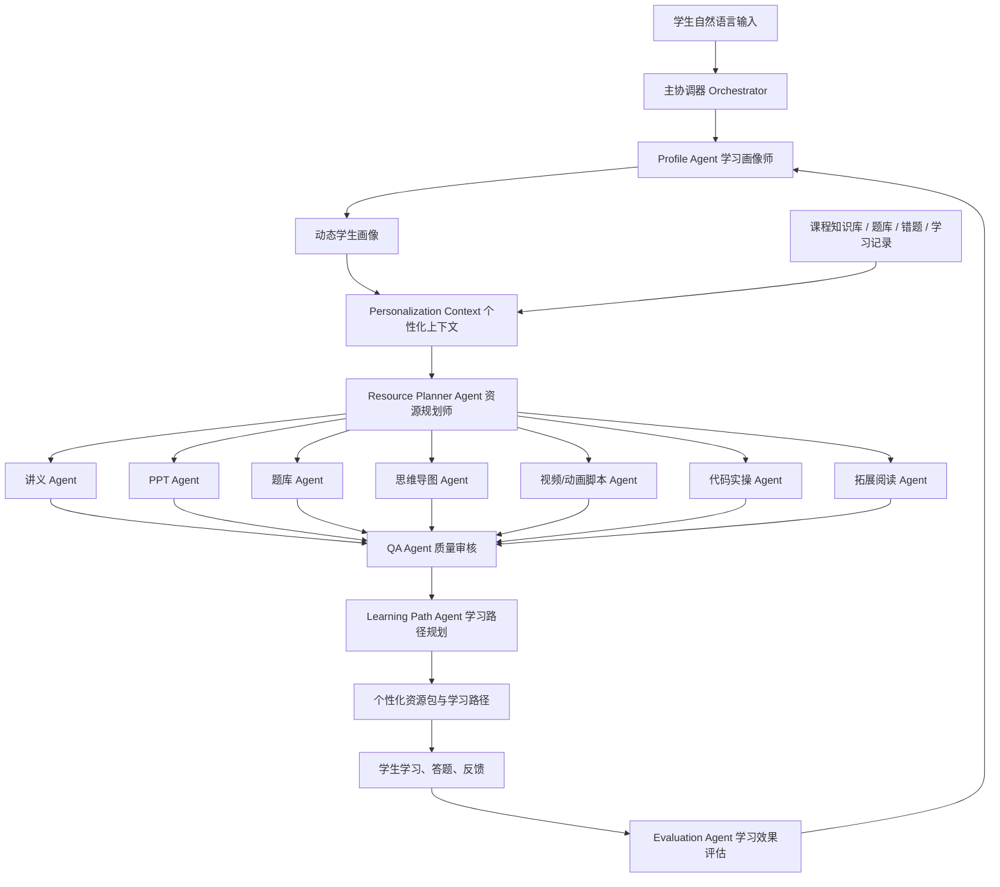

# 软件杯方案补充：动态学习画像驱动的个性化学习系统

> 适用项目：Sky Classroom / OpenMAIC  
> 面向赛题：新时代大学生个性化、多模态学习资源生成与智能辅导系统  
> 文档重点：如何基于用户画像让所有功能个性化，以及如何逐步收集画像让 AI 更有针对性  
> 日期：2026-07-01

## 1. 方案定位

本方案是软件杯参赛方案的个性化能力补充文档，核心回答两个问题：

1. 系统已经有了学生画像之后，如何让课程讲解、PPT、题库、思维导图、视频/动画、代码案例、学习路径、智能辅导和学习评估都变得个性化。
2. 系统如何通过自然语言对话、诊断测评、学习行为、错题记录和资源反馈逐步收集画像，让 AI 对学生越来越了解，推荐越来越准。

本系统不把画像做成一次性表单，而是把画像设计为贯穿全流程的学习中枢：

```text
对话建立画像 -> 多智能体生成资源 -> 学生学习与练习 -> 效果评估 -> 画像更新 -> 路径和资源重新调整
```

系统的核心亮点可以概括为：

> 以动态学习画像为中心，通过“对话抽取、诊断校准、行为追踪、结果反馈”持续更新画像，再由多智能体协同完成资源生成、路径规划、精准推送和效果评估，形成自适应学习闭环。

## 2. 赛题要求对应关系

| 赛题要求 | 本方案对应能力 | 展示重点 |
| --- | --- | --- |
| 对话式学习画像自主构建 | 自然语言对话抽取不少于 8 个画像维度 | 不填复杂表单，边聊边形成画像 |
| 多智能体协同资源生成 | Profile、Planner、Content、Quiz、PPT、Video、Code、QA 等 Agent 协作 | 展示 Agent 进度和分工 |
| 至少 5 类个性化资源 | 讲义、PPT、题库、思维导图、拓展阅读、视频脚本、代码案例 | 每个资源都有个性化理由 |
| 个性化学习路径与资源推送 | 根据画像、掌握度、错题、目标和时间生成路径 | 展示步骤顺序和推荐原因 |
| 智能辅导 | 根据当前卡点和历史错因给出文字、图解、代码、视频脚本式答疑 | 展示同一问题对不同学生的不同回答 |
| 学习效果评估 | 根据答题、资源使用、反馈和复习结果更新画像 | 展示“学习后画像变化” |

## 3. 总体架构



关键设计是：所有 Agent 在生成内容前都必须读取同一份 `PersonalizationContext`，避免每个功能各自个性化、逻辑分散。

## 4. 动态学习画像设计

### 4.1 画像维度

系统画像至少包含 8 个维度，超过赛题“不少于 6 个维度”的要求。

| 维度 | 含义 | 主要来源 | 驱动的个性化能力 |
| --- | --- | --- | --- |
| 专业背景 | 学生专业、课程方向、项目方向 | 对话、课程选择、账号信息 | 案例选择、项目主题、术语解释 |
| 学习目标 | 备考、补弱、项目实践、比赛、课程预习 | 对话、任务输入 | 学习路径终点、资源深度、时间安排 |
| 知识基础 | 已掌握点、薄弱点、先修知识缺口 | 诊断题、错题、测验、对话 | 讲解起点、补基础页面、题目难度 |
| 认知风格 | 偏图解、偏推导、偏案例、偏代码实践 | 对话、资源点击、停留、反馈 | 文档结构、PPT 图文比例、视频表现方式 |
| 易错模式 | 概念混淆、计算错误、推理跳步、代码调试弱 | 错题分析、测验结果、答疑记录 | 干扰项设计、避坑提示、专项练习 |
| 资源偏好 | 文档、PPT、视频、题库、思维导图、代码案例 | 对话、点击、收藏、完成率 | 资源优先级和默认生成组合 |
| 学习节奏 | 每日可学习时间、截止日期、复习频率 | 对话、学习行为、计划完成情况 | 每日任务量、路径密度、复习间隔 |
| 互动偏好 | 直接给步骤、先讲原理、苏格拉底追问、陪练 | 对话、答疑反馈 | 智能辅导语气、提示颗粒度 |
| 当前状态 | 焦虑、赶 ddl、备赛、复习疲劳、信心不足 | 对话语义、学习中断、反馈 | 降低解释负担、调整节奏和鼓励方式 |
| 学习效果 | 正确率、掌握度变化、资源使用效果 | 答题、复习、行为统计 | 路径调整、资源重排、难度升降 |

### 4.2 画像字段结构

画像不能只保存一个静态值，还需要保存置信度和证据，便于解释推荐原因。

```ts
interface ProfileDimension<T> {
  value: T;
  confidence: number; // 0-1
  evidence: string[]; // 支撑该判断的证据
  source: 'conversation' | 'diagnostic' | 'quiz' | 'mistake' | 'behavior' | 'feedback';
  updatedAt: string;
  expiresAt?: string; // 短期状态可自动衰减
}
```

示例：

```json
{
  "learningGoal": {
    "value": "两周内掌握 RAG 基础并完成一个课程项目",
    "confidence": 0.9,
    "source": "conversation",
    "evidence": ["用户说：我想两周内学会 RAG，做一个项目"],
    "updatedAt": "2026-07-01"
  },
  "resourcePreference": {
    "value": ["代码案例", "图解", "小测题"],
    "confidence": 0.82,
    "source": "conversation",
    "evidence": ["用户说：我喜欢代码案例，最好有图解"],
    "updatedAt": "2026-07-01"
  }
}
```

### 4.3 画像更新优先级

当不同来源信息冲突时，按以下优先级处理：

| 优先级 | 来源 | 说明 |
| --- | --- | --- |
| 最高 | 用户手动确认或修正 | 用户明确说“不对，改成这样”时直接覆盖 |
| 高 | 诊断测评和正式测验 | 能客观反映知识基础和掌握度 |
| 高 | 错题和答疑记录 | 能反映真实易错点 |
| 中 | 资源使用行为 | 点击、停留、跳过、收藏等行为可推断偏好 |
| 中 | 日常对话抽取 | 用于补充目标、偏好和当前状态 |
| 低 | 单次偶发表达 | 只作为短期上下文，不直接改长期画像 |

这样可以避免“学生自称基础很好，但诊断题连续错误”时画像失真。

## 5. 画像逐步收集机制

画像收集分为四个阶段：冷启动、诊断校准、学习中更新、阶段复盘。

### 5.1 第一阶段：对话冷启动

目标是用 3-5 轮自然语言对话建立初版画像，不让用户填写复杂表单。

推荐对话脚本：

1. 你最近最想提升哪门课或哪项能力？为什么现在想学？
2. 你现在大概卡在哪里？是完全没入门，还是有基础但做题或项目容易断？
3. 你更喜欢我怎么带你学？直接给步骤、先讲原理、用例子带，还是多给练习？
4. 这件事有没有时间压力？比如考试、作业、比赛、项目截止。
5. 我先按这个画像来：目标是 X，薄弱点是 Y，讲解方式偏 Z，先从 W 开始。对吗？

冷启动阶段可以抽取：

| 问题 | 抽取画像 |
| --- | --- |
| 想学什么、为什么学 | 学习目标、课程方向、动机 |
| 卡在哪里 | 知识基础、薄弱点、自我感受 |
| 喜欢怎么学 | 认知风格、资源偏好、互动偏好 |
| 是否有时间压力 | 学习节奏、路径密度 |
| 确认画像 | 提升置信度，减少误判 |

### 5.2 第二阶段：诊断校准

冷启动画像主要来自学生自述，必须用诊断题校准。

诊断题设计策略：

| 画像信息 | 诊断题校准方式 |
| --- | --- |
| 自称基础薄弱 | 出 3-5 道入门题定位先修缺口 |
| 自称有基础 | 混合基础题、迁移题和应用题 |
| 目标是项目实践 | 加入代码理解题和场景题 |
| 易错点不明确 | 通过不同错因类型的题目区分概念、推理、计算、代码问题 |

诊断结果会更新：

- `masteryByKnowledge`
- `weakPoints`
- `errorPatterns`
- `preferredDifficulty`
- `learningPath.next`

### 5.3 第三阶段：学习中隐式更新

系统不频繁打断学生，而是在学习过程中自动收集信号。

| 学习行为 | 画像更新 |
| --- | --- |
| 反复要求“再讲简单点” | 当前难度过高，降低讲解层级 |
| 反复要求“给代码” | 实践型认知风格增强 |
| 跳过长文档但看完视频 | 视频/短内容偏好增强 |
| 同一知识点多次答错 | 该知识点掌握度下降，加入薄弱点 |
| 答题正确但耗时很长 | 掌握不稳，加入巩固练习 |
| 收藏思维导图 | 图解型资源偏好增强 |
| 完成复习后正确率提升 | 掌握度上调，路径节点可推进 |
| 学习中断频繁 | 任务切分更小，减少单次资源长度 |

### 5.4 第四阶段：阶段复盘与主动确认

在完成一节课、一次测验或一组资源后，系统轻量追问：

> 这次你觉得最卡的是哪里？我会据此调整下一步安排。

如果系统判断的画像会显著影响后续推荐，应主动确认：

> 我发现你更适合“代码案例 + 图解”的学习方式，后面我按这个来安排，可以吗？

确认后的画像信号置信度更高，后续资源生成优先采用。

## 6. 画像如何驱动所有功能个性化

### 6.1 统一输入：PersonalizationContext

所有学习工具和资源生成 Agent 都不直接读取零散数据，而是先读取统一个性化上下文。

```ts
interface PersonalizationContext {
  userId: string;
  majorBackground?: string;
  learningGoal?: string;
  weakPoints: Array<{ knowledgePoint: string; mastery: number }>;
  strongPoints: string[];
  errorPatterns: Array<{ knowledgePoint: string; errorType: string; frequency: number }>;
  resourcePreference: string[];
  cognitiveStyle?: string;
  interactionPreference?: string;
  learningPace?: string;
  currentState?: string;
  preferredDifficulty: 'easy' | 'medium' | 'hard';
  learningPath?: {
    current?: string;
    next?: string;
    nodes: string[];
  };
}
```

现有项目可以基于以下能力继续扩展：

| 能力 | 现有位置 | 后续作用 |
| --- | --- | --- |
| 行为画像聚合 | `lib/student/profile-builder.ts` | 汇总掌握度、弱点、错因 |
| 对话画像抽取 | `lib/student/conversation-profile.ts` | 从自然语言中抽取画像补丁 |
| 个性化上下文 | `lib/cloud-mind/personalization-context.ts` | 给各工具统一注入画像 |
| 画像 API | `app/api/sky/student/profile/route.ts` | 返回学生画像 |
| 对话画像 API | `app/api/sky/student/profile/conversation/route.ts` | 冷启动和学习中画像抽取 |
| 学习路径 | `lib/teaching/learning-path-engine.ts` | 根据画像生成路径 |

### 6.2 各功能个性化映射

| 功能 | 画像输入 | 个性化表现 | 学习后回写 |
| --- | --- | --- | --- |
| 专业课程讲解文档 | 基础、目标、认知风格、专业背景 | 改变讲解起点、案例领域、术语密度、公式推导深度 | 阅读完成、反馈、追问点 |
| PPT 课件 | 资源偏好、认知风格、目标场景 | 图文比例、动画页、例题页、代码页数量不同 | 页面停留、导出、收藏 |
| 思维导图 | 知识基础、弱点、先修关系 | 高亮薄弱点、标出先修缺口和学习顺序 | 点击节点、复习完成 |
| 分层题库 | 掌握度、易错模式、近期正确率 | 自动调难度，针对错因设计干扰项 | 正确率、耗时、错因 |
| 拓展阅读 | 学习目标、专业方向、掌握度 | 区分补基础、项目实践、竞赛拔高、论文拓展 | 阅读偏好、收藏 |
| 视频/动画脚本 | 认知风格、当前状态、难点类型 | 用动画解释抽象概念，用代码演示实践流程 | 完播率、反馈 |
| 代码实操案例 | 专业背景、实践能力、学习目标 | 生成贴近专业的项目任务、代码骨架和评分标准 | 运行结果、提交反馈 |
| 智能辅导 | 当前问题、历史错因、互动偏好 | 同一问题可给步骤版、原理版、图解版、代码版 | 追问、满意度、是否解决 |
| 学习路径 | 目标、弱点、掌握度、时间压力 | 动态安排先学什么、复习什么、做什么项目 | 节点完成、测验结果 |
| 学习效果评估 | 学习行为、测验、资源反馈 | 生成阶段报告和下一步策略 | 更新画像、重排资源 |

### 6.3 个性化示例

同样是学习“RAG 检索增强生成”，不同画像下的资源会明显不同。

| 学生画像 | 系统生成策略 |
| --- | --- |
| 计算机专业，有 Python 基础，目标是做项目，喜欢代码案例 | 先生成 RAG 最小可运行代码案例，再配套架构图和调试题 |
| 非计算机专业，概念基础弱，偏图解 | 先生成图解讲义和生活类比视频脚本，再给少量概念题 |
| 备赛学生，时间紧，已经会基础概念 | 直接生成项目方案、评测指标、进阶题和答辩 PPT |
| 最近检索相似度相关题目错误多 | 推送向量相似度专项讲解、针对性练习和错因复盘 |

## 7. 多智能体分工

| Agent | 职责 | 输入 | 输出 |
| --- | --- | --- | --- |
| Orchestrator 主协调器 | 识别意图、拆分任务、调度 Agent | 用户请求、画像、课程知识 | 执行计划、Agent 任务流 |
| Profile Agent 学习画像师 | 抽取和更新画像 | 对话、测验、行为、反馈 | 画像补丁、证据、置信度 |
| Diagnostic Agent 诊断评估师 | 生成诊断题并定位基础 | 课程主题、画像 | 诊断题、掌握度、短板 |
| Course Agent 课程理解师 | 检索和组织课程知识 | 知识库、课程大纲 | 知识点、先修关系、重点难点 |
| Resource Planner 资源规划师 | 决定生成哪些资源和顺序 | 画像、课程知识、目标 | 资源生成方案 |
| Lecture Agent 讲义生成师 | 生成课程讲解文档 | 资源方案、画像、知识库 | 个性化讲义 |
| Slides Agent PPT 设计师 | 生成 PPT 大纲和页面 | 资源方案、画像、知识库 | PPT 内容和讲稿 |
| Quiz Agent 题库设计师 | 生成不同类型练习题 | 掌握度、错因、知识点 | 分层题库和解析 |
| Mind Map Agent 知识结构师 | 生成思维导图 | 知识图谱、弱点 | 知识点导图 |
| Video Agent 多模态讲解师 | 生成视频/动画脚本 | 难点、认知风格 | 分镜、旁白、关键帧 |
| Code Case Agent 实操教练 | 生成代码案例和项目任务 | 专业背景、实践目标 | 代码骨架、任务说明 |
| QA Agent 质量审核师 | 检查事实、难度、个性化匹配 | 所有资源 | 审核报告、修改意见 |
| Path Agent 路径规划师 | 编排学习步骤和资源推送 | 画像、资源包、掌握度 | 学习路径 |
| Evaluation Agent 效果评估师 | 评估学习效果并调整画像 | 行为、答题、反馈 | 评估报告、画像更新 |

## 8. 个性化学习路径规划

### 8.1 路径节点结构

```ts
interface PersonalizedPathNode {
  id: string;
  topic: string;
  reason: string;
  prerequisites: string[];
  resources: Array<{
    type: 'lecture' | 'slides' | 'quiz' | 'mind_map' | 'video' | 'code_case' | 'reading';
    title: string;
    personalizedReason: string;
  }>;
  targetMastery: number;
  estimatedMinutes: number;
  status: 'pending' | 'in_progress' | 'completed' | 'review';
}
```

### 8.2 路径排序策略

建议用可解释的打分机制生成路径：

```text
节点得分 =
  薄弱程度 * 0.30
  + 目标相关度 * 0.25
  + 先修紧迫度 * 0.15
  + 错因频率 * 0.15
  + 到期复习紧迫度 * 0.10
  + 资源偏好匹配度 * 0.05
```

系统不只告诉学生“学什么”，还要说明“为什么先学它”：

> 先学习“向量相似度”，因为它是 RAG 检索模块的先修知识，且你最近相关题目正确率较低，同时你偏好代码案例，所以优先推送“图解讲义 + Python 实操 + 5 道概念辨析题”。

### 8.3 动态调整规则

| 学习结果 | 路径调整 |
| --- | --- |
| 节点测验正确率高于 85% | 提前进入下一节点，减少基础练习 |
| 正确率低于 60% | 插入补基础节点和低难度例题 |
| 同一错因重复出现 | 插入专项错因训练 |
| 用户反馈太难 | 降低讲解深度，增加图解和例子 |
| 用户反馈太简单 | 增加拔高阅读和项目挑战 |
| 截止时间临近 | 压缩非核心资源，优先目标相关节点 |

## 9. 智能辅导个性化

智能辅导不是简单问答，而是读取画像后选择答疑策略。

| 画像特征 | 辅导策略 |
| --- | --- |
| 基础弱 | 先补概念，再给小例子，避免直接堆公式 |
| 偏代码实践 | 先给可运行代码，再解释关键步骤 |
| 偏图解 | 优先用流程图、结构图、类比说明 |
| 易错模式是概念混淆 | 对比相似概念，给反例和辨析题 |
| 易错模式是推理跳步 | 拆成更细步骤，并要求学生补中间步骤 |
| 当前状态焦虑 | 降低信息密度，给短步骤和明确下一步 |
| 时间紧 | 先给解决路径，再提供补充解释 |

示例：

```text
学生问：为什么 RAG 需要向量数据库？

基础弱 + 偏图解：
先用“图书馆找书”的类比解释，再给检索流程图。

计算机专业 + 偏代码：
先展示 embedding -> vector store -> similarity search 的最小代码，再解释原理。

备赛 + 时间紧：
先给答辩可用的三句话解释，再补系统架构图和优缺点。
```

## 10. 学习效果评估与画像回写

### 10.1 评估维度

| 评估维度 | 指标 |
| --- | --- |
| 知识掌握 | 知识点正确率、掌握度变化、错题减少 |
| 学习效率 | 完成时间、资源使用顺序、重复学习次数 |
| 资源适配 | 完成率、收藏率、跳过率、反馈 |
| 迁移能力 | 项目题、综合题、代码实操表现 |
| 稳定性 | 复习后保持率、间隔测试正确率 |
| 学习状态 | 中断次数、复盘反馈、求助频率 |

### 10.2 回写机制

```text
学生完成资源或测验
-> Evaluation Agent 分析行为和结果
-> 生成 ProfileSignal
-> 更新 StudentProfile / PersonalizationContext
-> 重新计算推荐资源和学习路径
```

回写示例：

| 事件 | 画像变化 | 后续动作 |
| --- | --- | --- |
| 向量相似度题目 5 道错 3 道 | 弱点加入“向量相似度”，掌握度下降 | 推送图解讲义和基础练习 |
| 看完代码案例并收藏 | 代码案例偏好增强 | 后续资源优先包含实操案例 |
| 视频看到 20% 就退出 | 当前视频资源适配度下降 | 改推短图解或文字摘要 |
| 复习卡连续答对 | 对应知识点掌握度上调 | 路径节点标记完成 |

## 11. 数据与接口建议

### 11.1 API 设计

| API | 方法 | 作用 |
| --- | --- | --- |
| `/api/sky/student/profile/conversation` | POST | 从自然语言对话抽取画像补丁 |
| `/api/sky/student/profile` | GET | 获取当前学生画像 |
| `/api/sky/student/profile/signals` | POST | 写入画像信号 |
| `/api/sky/cloud-mind/personalization-context` | GET | 获取工具生成使用的统一个性化上下文 |
| `/api/sky/resource-generation` | POST | 基于画像生成多类型资源 |
| `/api/sky/learning-path` | GET/POST/PATCH | 读取、生成、更新学习路径 |
| `/api/sky/learning-effect` | POST | 提交学习效果评估并回写画像 |

### 11.2 数据流

```text
conversation message
  -> conversation-profile extractor
  -> ProfileSignal
  -> StudentProfile aggregation
  -> PersonalizationContext
  -> resource generation prompts
  -> learning behavior
  -> Evaluation Agent
  -> ProfileSignal
```

### 11.3 Prompt 注入建议

所有资源生成 Agent 的系统提示词都应包含同一段个性化上下文：

```text
【学生画像】
- 专业背景：软件工程
- 学习目标：两周内掌握 RAG 并完成课程项目
- 当前薄弱点：向量相似度、召回率、评估指标
- 易错模式：概念边界混淆
- 资源偏好：代码案例、图解、小测题
- 推荐难度：中等

【生成要求】
1. 内容必须优先补齐薄弱点。
2. 案例尽量贴近软件工程和 AI 项目。
3. 每类资源都要给出“为什么适合该学生”的理由。
4. 题目干扰项要覆盖学生常见错因。
5. 资源完成后要给出可评估的学习任务。
```

## 12. 比赛演示闭环

推荐演示用例：

> 学生是计算机专业，想两周内学会 RAG，但向量检索和评估指标不懂，喜欢代码案例和图解。

演示流程：

1. 学生用自然语言输入学习需求。
2. Profile Agent 抽取 8 维画像，并展示证据和置信度。
3. Diagnostic Agent 生成 5 道小测，发现“向量相似度”和“召回率”薄弱。
4. Resource Planner 生成资源方案。
5. 多个 Agent 并行生成 6 类资源：
   - 个性化讲义
   - PPT
   - 思维导图
   - 分层题库
   - 视频/动画脚本
   - Python 代码实操案例
6. QA Agent 审核资源是否匹配画像和课程知识库。
7. Path Agent 生成学习路径：
   - 向量表示基础
   - 相似度检索
   - RAG 架构
   - 检索效果评估
   - 项目实操
8. 学生完成一组练习，系统发现“召回率”仍然错误较多。
9. Evaluation Agent 更新画像。
10. 系统自动重排下一步资源，推送“召回率图解 + 3 道辨析题 + 代码调参任务”。

答辩时可以强调：

> 系统不是一次性生成资源，而是根据学生学习过程持续更新画像，并动态改变后续资源和路径。

## 13. 实施路线

### P0：打通核心闭环

目标：让演示完整跑通“画像 -> 资源 -> 路径 -> 评估 -> 画像更新”。

任务：

1. 完善对话式画像抽取，输出 8 维画像、证据和置信度。
2. 将对话画像合入 `PersonalizationContext`。
3. 资源生成入口统一读取 `PersonalizationContext`。
4. 生成至少 5 类资源，并为每类资源展示个性化理由。
5. 学习路径根据弱点、目标、时间和资源偏好排序。
6. 测验或资源反馈后更新画像，并展示路径调整。

验收：

- 输入一段自然语言学习需求，能形成画像。
- 同一主题在不同画像下生成不同资源组合。
- 每个推荐资源都有明确理由。
- 学习后画像和路径能变化。

### P1：增强可信与效果评估

任务：

1. 增加 QA Agent，检查事实、引用、难度和个性化匹配。
2. 增加学习效果报告，展示掌握度变化和资源使用效果。
3. 增加用户修正画像能力。
4. 增加隐式行为采集，如点击、收藏、跳过、完成率。

验收：

- 资源生成后有审核结果。
- 学生可以看到“系统为什么这样推荐”。
- 用户修正画像后推荐立即变化。

### P2：增强多模态与长期学习

任务：

1. 视频/动画脚本进一步对接生成式视频或动画工具。
2. 学习路径支持周计划和长期复习。
3. 针对班级或课程构建群体画像，支持教师端分层教学。
4. 引入更细的掌握度模型和间隔复习策略。

验收：

- 支持长期路径和复习提醒。
- 支持更丰富的多模态资源。
- 可展示个人画像和班级群体趋势。

## 14. 风险与应对

| 风险 | 表现 | 应对 |
| --- | --- | --- |
| 画像不准 | 推荐资源不符合学生真实水平 | 引入诊断校准、证据展示、用户确认 |
| 画像收集打断学习 | 用户觉得系统一直问问题 | 只在冷启动和关键节点追问，其余隐式采集 |
| 个性化过度 | 用户临时想学别的内容被画像限制 | 所有默认值允许手动覆盖 |
| 数据冷启动 | 新用户没有历史记录 | 用自然语言对话和 5 道诊断题快速建立初版画像 |
| 资源生成幻觉 | 课程内容不准确 | 使用课程知识库、引用来源和 QA Agent 审核 |
| 多 Agent 流程耗时 | 等待时间长 | 流式输出、并行生成、先返回资源方案再补齐资源 |
| 隐私担忧 | 用户不愿被过度分析 | 展示画像证据，允许删除、修正和停用维度 |

## 15. 成功标准

### 产品成功标准

- 学生不需要填写复杂表单，也能建立不少于 8 个维度的画像。
- 系统至少生成 5 类个性化学习资源。
- 每个资源都能说明“为什么适合该学生”。
- 学习路径能根据画像和测验结果动态调整。
- 学习后能看到画像变化和下一步推荐变化。

### 技术成功标准

- `PersonalizationContext` 成为所有生成工具的统一输入。
- 对话画像、行为画像、错题画像可以合并到同一套画像信号模型。
- 资源生成 Agent、路径 Agent、评估 Agent 之间通过结构化数据传递。
- 测验和反馈能触发画像缓存失效或画像重建。
- 关键流程具备测试覆盖：空画像、初版画像、有错题、有路径、有反馈。

### 答辩成功标准

评委能在 3-5 分钟内看懂以下闭环：

```text
自然语言输入
-> 画像自动构建
-> 多 Agent 生成多模态资源
-> 个性化学习路径
-> 学生练习反馈
-> 画像更新
-> 下一轮资源和路径变化
```

如果演示能体现“同一课程，不同学生生成不同资源、不同路径、不同辅导方式”，就能有效突出系统的个性化和多智能体优势。

