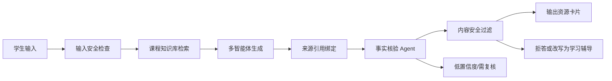

# 防幻觉与可信内容机制说明

## 目标

系统面向高校学习场景，生成内容会影响学生对知识的理解，因此必须避免“流畅但错误”的输出。可信机制的目标是让每个核心结论尽量可追溯、可核验、可复核。

## 可信生成流水线



## 核心机制

### 1. RAG 来源约束

生成课程讲义、题库、案例和答疑时，先检索《人工智能导论》知识库。输出内容绑定来源章节，例如：

- `chapters/04-machine-learning-basics.md`
- `chapters/10-large-models-and-agents.md`
- `question-bank.json`
- `cases/rag-course-assistant.md`

如果没有命中课程来源，系统应标记为“需人工复核”，不把该内容作为确定事实输出。

### 2. 事实核验 Agent

事实核验 Agent 对生成内容进行四类检查：

- 是否有来源支撑。
- 来源是否与结论匹配。
- 题目答案和解析是否一致。
- 是否存在绝对化、过度承诺或无依据断言。

输出字段建议：

```json
{
  "passed": true,
  "confidence": 0.89,
  "issues": [],
  "suggestions": ["保留来源片段和人工复核入口"]
}
```

### 3. 置信度分级

| 等级 | 条件 | 展示策略 |
| --- | --- | --- |
| 高 | 多个课程来源一致支撑，核验通过 | 正常展示，标注来源 |
| 中 | 有来源但覆盖不足或表述需谨慎 | 展示“建议复核”提示 |
| 低 | 无来源、来源不匹配或存在争议 | 不作为事实输出，要求补充资料 |

### 4. 内容安全过滤

过滤范围包括：

- 违法违规、暴力、色情、仇恨歧视内容。
- 隐私泄露，如身份证号、手机号、住址、学生敏感记录。
- 高风险专业建议，如医疗、法律、金融确定性建议。
- 学术作弊，如代写论文、代做作业、伪造实验结果。
- 未经来源支持的学术断言。

### 5. 学术诚信处理

对于“直接帮我写可提交作业/论文”等请求，系统不直接完成受评价任务，而是转为：

- 选题建议。
- 提纲结构。
- 概念解释。
- 参考阅读。
- 自查清单。
- 代码调试提示。

## 演示中的可信证据

当前已准备的演示数据：

- `data/demo/software-cup/generated-resources.json` 中每个资源包含 `sourceCitations` 和 `trust`。
- `data/course-knowledge/ai-intro/readings.md` 记录外部资料来源和使用边界。
- `data/source-materials/ai-intro/source-links.md` 记录 PDF、课程网页和官方文档来源。

这些文件可在答辩时证明系统不是纯模型凭空生成，而是由课程知识库和审核流程共同约束。
