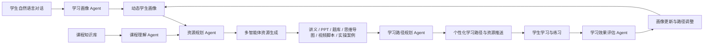
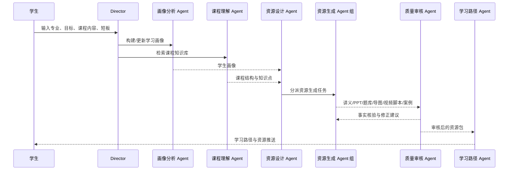
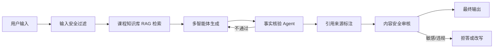

# 软件杯参赛方案：多智能体个性化学习资源生成系统

> 适用项目：天空课堂 / OpenMAIC 二次开发方向  
> 面向赛题：新时代大学生个性化、多模态学习资源生成与智能辅导系统  
> 方案版本：v1.0  
> 日期：2026-06-30

## 1. 方案定位

本方案面向中国大学生计算机设计大赛软件杯要求，建设一个面向高校专业课程学习的多智能体个性化学习资源生成系统。系统以学生自然语言对话为入口，自动构建动态学习画像，结合课程知识库、题库、学习行为、错题记录和多智能体协作流程，为大学生生成个性化、多模态、可验证的学习资源，并动态规划学习路径。

系统不定位为单一的课件生成工具，而是定位为：

> 面向高校专业课程的可信多智能体 AI 学习资源生成与个性化学习路径规划平台。

核心目标包括：

- 提升学生学习效率：减少搜索资料、整理课件、刷题规划的时间成本。
- 优化学习资源利用：将课程知识库转化为讲义、PPT、题库、思维导图、视频脚本、实操案例等多种资源。
- 增强学习效果：通过画像、路径、练习、评估、反馈形成持续优化闭环。
- 保证内容可信：通过 RAG、来源引用、事实核验 Agent、内容安全过滤降低幻觉风险。

## 2. 三组赛题要求拆解

### 2.1 核心功能要求

| 赛题要求 | 系统响应方案 | 优先级 |
| --- | --- | --- |
| 对话式学习画像自主构建 | 通过自然语言对话抽取专业、目标、基础、认知风格、易错点、资源偏好等维度，形成动态学生画像 | P0 |
| 多智能体协同资源生成 | 建立画像分析、课程理解、资源设计、题库生成、PPT 生成、实操案例、视频脚本、质量审核等 Agent | P0 |
| 至少 5 种个性化资源 | 生成讲义文档、PPT、题库、思维导图、拓展阅读、视频/动画脚本、代码实操案例 | P0 |
| 个性化学习路径规划与推送 | 结合画像、知识图谱、掌握度、错题和课程目标，生成动态路径和资源推荐 | P0 |
| 智能辅导 | 提供文字解答、图解说明、例题讲解、代码解释和短视频脚本 | P1 |
| 学习效果评估 | 跟踪练习、学习行为、资源反馈和掌握度变化，动态调整路径 | P1 |

### 2.2 产品体验、合规、安全与性能要求

| 赛题要求 | 系统响应方案 | 优先级 |
| --- | --- | --- |
| 界面美观、交互清晰 | 建设统一 AI 学习工作台，卡片化展示资源，支持流式输出、Markdown、公式、代码、多模态内容 | P0 |
| 标注开源项目与协议 | 增加开源项目与第三方依赖说明，显著标注 OpenMAIC、Next.js、React、LangGraph 等来源与协议 | P0 |
| 防幻觉与内容安全 | 建立输入过滤、RAG 检索、事实核验、引用来源、置信度、敏感内容过滤、拒答机制 | P0 |
| 响应时间合理 | 文本流式输出、资源分阶段返回、长任务异步生成、进度追踪、失败重试与取消 | P0 |

### 2.3 初始课程知识库要求

| 赛题要求 | 系统响应方案 | 优先级 |
| --- | --- | --- |
| 自行构造至少一门完整高校专业课程知识库 | 构建《人工智能导论》课程知识库，包含大纲、章节讲义、知识图谱、题库、案例、拓展阅读、媒体脚本、评价标准 | P0 |
| 作为系统输入 | 支持导入 RAG 知识库、绑定知识点图谱、驱动资源生成、防幻觉核验和学习路径规划 | P0 |
| 专业方向贴合 | 选择人工智能/计算机相关课程，增强赛题相关性和演示说服力 | P0 |

## 3. 总体业务闭环

系统业务闭环如下：



这个闭环可以在答辩中作为主线演示：

1. 学生输入学习目标和背景。
2. 系统自动构建学习画像。
3. 多智能体基于课程知识库协作生成资源。
4. 系统规划学习路径并推送资源。
5. 学生练习后系统评估学习效果。
6. 系统更新画像并调整下一步学习计划。

## 4. 核心模块设计

### 4.1 对话式学习画像模块

#### 目标

通过自然语言对话替代传统表单，自动抽取学生特征，构建不少于 6 个维度的动态学生画像，并随着学习行为持续更新。

#### 画像维度

| 维度 | 示例字段 | 数据来源 |
| --- | --- | --- |
| 专业背景 | 软件工程、电子信息、人工智能 | 对话抽取、账号信息 |
| 学习目标 | 备考、补弱、项目实践、课程预习 | 对话抽取 |
| 知识基础 | 已掌握知识点、薄弱知识点、先修课程 | 诊断题、错题、问答记录 |
| 认知风格 | 图像型、推导型、案例型、实践型 | 对话偏好、资源使用反馈 |
| 易错点偏好 | 概念混淆、计算错误、代码调试弱、推理跳步 | 错题分析、练习记录 |
| 学习节奏 | 每日可学时间、目标周期、复习频率 | 对话抽取、行为日志 |
| 资源偏好 | 文档、PPT、视频、题库、代码案例 | 点击、收藏、完成率 |
| 学习状态 | 最近正确率、掌握度变化、疲劳/中断情况 | 学习统计、练习结果 |

#### 输出结构

```json
{
  "userId": "student-001",
  "major": "软件工程",
  "learningGoal": "掌握人工智能导论中的机器学习基础",
  "knowledgeBase": {
    "strongPoints": ["Python 基础", "线性代数基础"],
    "weakPoints": ["模型评估", "过拟合与正则化"]
  },
  "cognitiveStyle": "案例驱动 + 代码实践",
  "errorPatterns": ["概念边界混淆", "公式含义理解不足"],
  "resourcePreference": ["图解讲义", "代码案例", "分层题库"],
  "pace": "每天 45 分钟，2 周完成一轮学习",
  "lastUpdated": "2026-06-30"
}
```

#### 动态更新机制

- 学生完成诊断题后，更新知识基础和弱点。
- 学生查看资源后，更新资源偏好。
- 学生提交练习后，更新易错点和掌握度。
- 学生反馈“太难/太简单/解释不清楚”后，调整路径和资源难度。
- 每次画像更新保留证据来源，便于解释推荐原因。

### 4.2 多智能体协同资源生成模块

#### Agent 角色分工

| Agent | 职责 | 主要输出 |
| --- | --- | --- |
| 主协调器 Director | 识别学生意图，拆分任务，调度 Agent | 任务计划、执行顺序 |
| 画像分析 Agent | 从对话和学习行为中抽取画像特征 | 学生画像、画像证据 |
| 课程理解 Agent | 解析课程知识库、章节、知识点关系 | 课程结构、重点难点 |
| 资源设计 Agent | 根据画像决定资源类型、难度、顺序 | 资源生成方案 |
| 讲义生成 Agent | 生成课程讲解文档 | Markdown 讲义 |
| PPT 生成 Agent | 生成演示课件和讲解脚本 | PPT 大纲、页面内容、导出文件 |
| 题库生成 Agent | 生成分层练习题和解析 | 题库、答案、错因标签 |
| 思维导图 Agent | 生成知识结构图 | Mermaid/JSON 思维导图 |
| 视频脚本 Agent | 生成短视频/动画分镜脚本 | 视频脚本、旁白、镜头设计 |
| 实操案例 Agent | 生成代码实验和项目材料 | Notebook/代码案例/项目任务 |
| 质量审核 Agent | 检查事实、引用、难度、敏感内容 | 审核报告、修正建议 |
| 学习路径 Agent | 编排学习步骤和资源推送 | 个性化学习路径 |
| 效果评估 Agent | 分析学习行为和练习结果 | 掌握度、改进建议 |

#### 协作流程



### 4.3 个性化资源生成模块

系统至少生成 7 类资源，覆盖赛题要求的“至少 5 种”：

| 资源类型 | 个性化依据 | 展示形式 |
| --- | --- | --- |
| 专业课程讲解文档 | 学生基础、目标、认知风格 | Markdown + 公式 + 代码块 |
| PPT 课件 | 课程章节、演示场景、资源偏好 | 课件卡片 + PPTX 导出 |
| 知识点思维导图 | 知识图谱、前置关系、弱点 | Mermaid 图 / 可交互图谱 |
| 分层练习题库 | 掌握度、错因、难度策略 | 单选、多选、简答、代码题 |
| 拓展阅读材料 | 目标方向、课程章节、知识短板 | 阅读卡片 + 来源链接 |
| 多模态视频/动画脚本 | 认知风格、难点类型 | 镜头脚本、旁白、关键帧 |
| 代码实操案例/项目 | 专业方向、实践能力、学习目标 | 代码案例、项目说明、评分标准 |

资源生成采用“先结构、后内容、再审核”的策略：

1. 先生成资源设计方案。
2. 再并行生成不同资源。
3. 由质量审核 Agent 统一检查。
4. 通过后进入学习路径和资源推送。

### 4.4 个性化学习路径与资源推送模块

#### 路径规划依据

- 学生画像：专业、目标、基础、偏好、时间。
- 课程知识图谱：前置知识、章节关系、知识点难度。
- 学习行为：资源查看、学习时长、练习完成情况。
- 错题记录：错因、知识点、复习状态。
- 测评结果：正确率、掌握度、置信度。

#### 路径节点结构

```json
{
  "nodeId": "ml-04-overfitting",
  "title": "过拟合与正则化",
  "prerequisites": ["训练集与测试集", "损失函数"],
  "resources": [
    { "type": "document", "title": "过拟合图解讲义" },
    { "type": "quiz", "title": "过拟合概念辨析题" },
    { "type": "code_case", "title": "用 sklearn 观察过拟合" }
  ],
  "masteryBefore": 42,
  "targetMastery": 80,
  "status": "in_progress"
}
```

#### 动态调整规则

- 正确率低于 60%：降低难度，插入补基础资源。
- 概念题连续错误：推送图解讲义和概念辨析题。
- 代码题错误多：推送分步实操案例和调试提示。
- 掌握度高于 85%：推送拓展阅读和项目任务。
- 复习到期：优先推送错题复盘和记忆卡片。

### 4.5 智能辅导与学习效果评估模块

#### 智能辅导

当学生遇到问题时，系统提供多模态辅导：

- 文字解释：分步骤讲解核心概念。
- 图解说明：生成流程图、概念图、对比表。
- 代码解释：逐行解释示例代码和错误原因。
- 视频脚本：生成 1-3 分钟短视频讲解脚本。
- 追问引导：根据学生回答逐步提示，而不是直接给最终答案。

#### 学习效果评估

系统从以下维度评估学习效果：

| 评估维度 | 指标 |
| --- | --- |
| 知识掌握 | 知识点掌握度、章节完成度、前置知识达标率 |
| 练习表现 | 正确率、题型分布、难度变化、错因分布 |
| 学习行为 | 学习时长、资源完成率、复习及时率 |
| 资源反馈 | 收藏、重看、跳过、难度反馈 |
| 学习效率 | 单位时间掌握度提升、反复错误次数 |

评估结果用于更新画像、调整路径、重新排序资源推送。

## 5. 产品体验方案

### 5.1 统一 AI 学习工作台

建议将比赛演示入口集中为一个“个性化学习生成台”，避免功能分散。

核心区域：

- 对话输入区：输入专业、课程、目标、短板、偏好。
- 画像面板：实时展示画像维度和证据来源。
- Agent 协作面板：展示各 Agent 的任务状态。
- 资源生成区：卡片化展示讲义、PPT、题库、导图、视频脚本、实操案例。
- 学习路径区：展示阶段计划、前置知识、推荐理由和进度。
- 安全审核区：展示引用来源、置信度、审核结果。

### 5.2 AI 产品交互规范

| 交互能力 | 设计要求 |
| --- | --- |
| 流式输出 | 讲义、答疑、题目解析按 token/段落逐步显示 |
| Markdown 渲染 | 支持标题、列表、表格、引用、代码块 |
| 公式渲染 | 支持 LaTeX / KaTeX |
| 代码高亮 | Python、JavaScript、SQL 等课程代码高亮 |
| 多模态卡片 | PPT、题库、导图、视频脚本、实操案例分卡片展示 |
| 生成进度 | 阶段进度条展示“画像分析、课程检索、资源生成、质量审核、路径规划” |
| 异常处理 | 支持失败提示、重试、取消、保留部分结果 |
| 智能优化 | 根据历史偏好自动推荐输入提示和资源类型 |

### 5.3 长任务体验

不同资源采用不同响应策略：

| 任务类型 | 策略 | 目标体验 |
| --- | --- | --- |
| 对话答疑 | SSE 流式输出 | 首 token 3 秒内 |
| 讲义生成 | 分章节流式输出 | 15-30 秒看到主要内容 |
| 题库生成 | 逐题返回 | 不等待整套题生成完 |
| 学习路径 | 先返回路径骨架，再补资源 | 10 秒内看到计划 |
| PPT 生成 | 异步 job + 进度轮询 | 可查看阶段进度 |
| 视频/动画 | 先脚本后生成 | 避免白屏等待 |

## 6. 防幻觉与内容安全方案

### 6.1 可信生成流水线



### 6.2 防幻觉机制

| 机制 | 实现方式 | 输出体现 |
| --- | --- | --- |
| RAG 检索 | 从课程知识库检索章节、定义、例题、案例 | 生成内容附参考来源 |
| 来源引用 | 每段关键结论绑定来源文档或章节 | 显示“来源：第 4 章 机器学习基础” |
| 事实核验 Agent | 检查生成内容是否和知识库冲突 | 审核通过/需修正 |
| 多 Agent 交叉检查 | 题库、讲义、代码案例由审核 Agent 二次检查 | 降低单模型错误 |
| 置信度标注 | 根据来源匹配度、模型一致性、知识库覆盖度评分 | 高/中/低置信度 |
| 不确定拒答 | 无来源或低置信度时提示需要补充资料 | 避免硬编 |
| 答案校验 | 对题库答案、公式、代码输出进行校验 | 生成答案解析和错因 |

### 6.3 内容安全过滤

系统需要覆盖以下风险：

- 敏感违法内容。
- 暴力、仇恨、歧视、色情等违规信息。
- 隐私泄露，如身份证、手机号、个人住址。
- 学术作弊，如代写论文、代做作业且不学习过程。
- 错误医学、法律、金融建议等高风险内容。
- 误导性学术结论和无来源断言。

处理策略：

- 明确拒答高风险请求。
- 将代写类请求转化为学习辅导、提纲建议、思路讲解。
- 对低置信度内容提示“不确定”并要求补充教材或资料。
- 对引用不足的内容标记为“需人工复核”。

## 7. 初始课程知识库方案

### 7.1 课程选择

建议构造课程：

> 《人工智能导论》

选择理由：

- 属于高校计算机/人工智能相关专业课程，贴合赛题方向。
- 便于展示文本、公式、图解、题库、代码、项目和视频脚本等多模态资源。
- 可自然覆盖大模型、智能体、RAG、安全伦理等前沿 AI 内容。
- 与系统本身“AI 学习智能体”形成主题一致性。

### 7.2 知识库目录结构

建议新增：

```text
data/course-knowledge/ai-intro/
├── course-meta.json
├── syllabus.md
├── chapters/
│   ├── 01-ai-overview.md
│   ├── 02-search-and-problem-solving.md
│   ├── 03-knowledge-representation.md
│   ├── 04-machine-learning-basics.md
│   ├── 05-supervised-learning.md
│   ├── 06-neural-networks.md
│   ├── 07-natural-language-processing.md
│   ├── 08-computer-vision.md
│   ├── 09-reinforcement-learning.md
│   ├── 10-large-models-and-agents.md
│   ├── 11-ai-safety-and-ethics.md
│   └── 12-course-project.md
├── knowledge-graph.json
├── question-bank.json
├── cases/
│   ├── knn-classification.md
│   ├── decision-tree-iris.md
│   ├── neural-network-mnist.md
│   └── rag-course-assistant.md
├── readings.md
├── media-scripts/
│   ├── chapter-01-animation.md
│   ├── chapter-04-video-script.md
│   └── chapter-10-agent-demo.md
└── assessment-rubric.md
```

### 7.3 课程章节规划

| 章节 | 主题 | 关键知识点 | 可生成资源 |
| --- | --- | --- | --- |
| 1 | 人工智能概述 | AI 定义、发展史、应用场景 | 概念讲义、发展时间轴 |
| 2 | 搜索与问题求解 | 状态空间、BFS、DFS、A* | 算法动画、代码案例 |
| 3 | 知识表示与推理 | 命题逻辑、产生式规则、本体 | 思维导图、推理题 |
| 4 | 机器学习基础 | 数据集、特征、训练、泛化 | 图解讲义、诊断题 |
| 5 | 监督学习 | 分类、回归、决策树、SVM | 题库、鸢尾花案例 |
| 6 | 神经网络与深度学习 | 感知机、反向传播、CNN | 动画脚本、MNIST 实验 |
| 7 | 自然语言处理 | 分词、词向量、Transformer | 文本分类案例 |
| 8 | 计算机视觉 | 图像分类、目标检测、特征提取 | 图像案例、流程图 |
| 9 | 强化学习 | 智能体、状态、动作、奖励 | 游戏化实验 |
| 10 | 大模型与智能体 | LLM、RAG、Agent、工具调用 | RAG 项目案例 |
| 11 | AI 安全与伦理 | 偏见、隐私、幻觉、安全对齐 | 辩论题、案例分析 |
| 12 | 综合项目 | 课程知识助手 | 项目任务书、评分 rubric |

### 7.4 知识点图谱字段

`knowledge-graph.json` 建议包含：

```json
{
  "nodes": [
    {
      "id": "ml-overfitting",
      "name": "过拟合",
      "chapter": "04-machine-learning-basics",
      "difficulty": 3,
      "prerequisites": ["训练集与测试集", "模型泛化"],
      "masteryCriteria": ["能解释过拟合现象", "能识别训练误差与测试误差差异"],
      "commonMisconceptions": ["认为训练集准确率越高模型越好"]
    }
  ],
  "edges": [
    {
      "from": "train-test-split",
      "to": "ml-overfitting",
      "relation": "prerequisite"
    }
  ]
}
```

### 7.5 题库字段

`question-bank.json` 建议包含：

```json
{
  "questions": [
    {
      "id": "ai-ml-001",
      "chapter": "04-machine-learning-basics",
      "knowledgePoints": ["过拟合", "泛化能力"],
      "type": "single_choice",
      "difficulty": "medium",
      "stem": "以下哪种现象最能说明模型发生了过拟合？",
      "options": ["训练集和测试集表现都差", "训练集表现好但测试集表现差", "训练集表现差但测试集表现好", "训练过程无法收敛"],
      "answer": "训练集表现好但测试集表现差",
      "explanation": "过拟合通常表现为模型记住训练数据细节，训练误差低但测试误差高。",
      "errorTags": ["概念混淆", "泛化理解不足"]
    }
  ]
}
```

### 7.6 与系统功能的连接

| 知识库内容 | 系统用途 |
| --- | --- |
| `syllabus.md` | 课程导入、整体路径规划 |
| `chapters/*.md` | RAG 检索、讲义生成、PPT 生成 |
| `knowledge-graph.json` | 前置知识判断、路径排序、弱点定位 |
| `question-bank.json` | 诊断测试、练习推送、效果评估 |
| `cases/*.md` | 代码实操案例、项目式学习资源 |
| `readings.md` | 拓展阅读推荐、来源引用 |
| `media-scripts/*.md` | 视频/动画脚本生成参考 |
| `assessment-rubric.md` | 学习效果评估、项目评分 |

## 8. 开源合规方案

### 8.1 显著标注内容

项目提交文档中需要显著标注：

- 本作品基于 OpenMAIC / 天空课堂项目进行二次开发。
- 原项目协议为 AGPL-3.0。
- 保留原项目版权声明和许可证文件。
- 说明本参赛作品新增/修改的功能范围。

### 8.2 建议新增文档

```text
OPEN_SOURCE_NOTICE.md
THIRD_PARTY_LICENSES.md
```

`OPEN_SOURCE_NOTICE.md` 建议包含：

| 名称 | 用途 | 来源 | 协议 |
| --- | --- | --- | --- |
| OpenMAIC | 基础多智能体课堂平台 | GitHub / 原开源项目 | AGPL-3.0 |
| Next.js | Web 框架 | Vercel | MIT |
| React | 前端框架 | Meta | MIT |
| Tailwind CSS | 样式框架 | Tailwind Labs | MIT |
| shadcn/ui | UI 组件方案 | shadcn | MIT |
| Radix UI | 无障碍组件基础 | Radix | MIT |
| LangGraph / LangChain | 多智能体编排 | LangChain | MIT |
| Vercel AI SDK | LLM 调用与流式输出 | Vercel | Apache/MIT，以实际依赖为准 |
| KaTeX / Shiki | 公式与代码渲染 | 开源社区 | MIT |

### 8.3 模型与服务说明

如使用商业或第三方 AI 服务，需要在提交材料中说明：

- 使用的模型或服务名称，如 OpenAI、DeepSeek、Qwen、MiniMax、GLM、Ollama 等。
- 使用方式，如 API 调用、本地部署、兼容 OpenAI 接口。
- 数据处理边界，如不上传敏感隐私数据、仅使用课程资料和学习输入。
- 生成内容由系统审核后展示，不直接作为最终事实结论。

## 9. 性能与响应时间方案

### 9.1 响应目标

| 场景 | 目标 |
| --- | --- |
| 普通问答首 token | 3 秒内 |
| 画像抽取 | 5-10 秒内返回初版 |
| 讲义生成 | 15-30 秒内看到主要内容 |
| 题库生成 | 每 3-5 秒返回一批题 |
| 学习路径规划 | 10 秒内返回骨架 |
| PPT 生成 | 异步任务，展示阶段进度 |
| 视频/动画生成 | 异步任务，先返回脚本和分镜 |

### 9.2 技术策略

- SSE 流式输出：用于答疑、讲义、题目解析。
- 异步任务队列：用于 PPT、多模态资源、视频脚本和大批量题库。
- 进度追踪：展示阶段、百分比、当前 Agent、已完成资源。
- 缓存复用：相同课程、相同章节、相似画像复用中间结果。
- 并行生成：不同资源类型由不同 Agent 并行处理。
- 降级策略：模型不可用时切换备用模型或返回结构化草稿。
- 部分结果保存：任务失败时保留已生成资源。

## 10. 数据结构与接口建议

### 10.1 学习画像接口

```text
POST /api/sky/student/profile/conversation
GET  /api/sky/student/profile
PATCH /api/sky/student/profile
```

用途：

- 从对话构建画像。
- 获取当前画像。
- 根据学习行为更新画像。

### 10.2 课程知识库接口

```text
POST /api/sky/course-knowledge/import
GET  /api/sky/course-knowledge/:courseId
POST /api/sky/course-knowledge/search
```

用途：

- 导入《人工智能导论》文档集。
- 检索课程章节和知识点。
- 为 RAG 和防幻觉审核提供证据。

### 10.3 资源生成接口

```text
POST /api/sky/resource-generation/jobs
GET  /api/sky/resource-generation/jobs/:jobId
GET  /api/sky/resource-generation/jobs/:jobId/stream
```

用途：

- 创建多智能体资源生成任务。
- 查询任务进度。
- 流式返回资源生成过程。

### 10.4 内容审核接口

```text
POST /api/sky/content-safety/check
POST /api/sky/content-safety/verify-academic
```

用途：

- 检查敏感违规内容。
- 对学术内容进行来源核验和置信度评分。

## 11. 实施路线

### 阶段一：比赛主线闭环

目标：先跑通最小完整演示链路。

- 建设统一“个性化学习生成台”页面。
- 实现自然语言画像抽取和画像展示。
- 构造《人工智能导论》课程知识库基础版。
- 接入 RAG 检索课程知识库。
- 支持生成讲义、题库、PPT 大纲、思维导图、实操案例。
- 实现学习路径规划和资源推送。
- 增加基础进度追踪。

### 阶段二：可信与产品体验增强

目标：满足安全、合规、体验和工程质量要求。

- 增加事实核验 Agent。
- 增加来源引用和置信度展示。
- 增加内容安全过滤和拒答机制。
- 完善流式输出、Markdown、公式、代码、多模态卡片。
- 增加失败重试、取消、部分结果保存。
- 补充开源协议说明文档。

### 阶段三：加分项与答辩增强

目标：增强演示冲击力和差异化。

- 增加多模态答疑：图解、视频脚本、动画分镜。
- 增加学习效果评估 dashboard。
- 增加 Agent 协作过程可视化。
- 增加课程项目式学习材料和评分 rubric。
- 增加演示模式：一键跑通从画像到资源到评估的完整流程。

## 12. 验收指标

### 12.1 功能验收

| 指标 | 验收标准 |
| --- | --- |
| 学习画像 | 至少 8 个维度，支持对话抽取和动态更新 |
| 资源类型 | 至少生成 5 类资源，建议达到 7 类 |
| 多智能体 | 至少展示 6 个 Agent 协同过程 |
| 学习路径 | 能根据画像和知识图谱生成步骤化路径 |
| 课程知识库 | 至少一门完整高校课程，含大纲、讲义、图谱、题库、案例 |
| 学习评估 | 能基于练习结果更新掌握度和推荐策略 |

### 12.2 体验验收

| 指标 | 验收标准 |
| --- | --- |
| 流式输出 | 答疑和讲义支持流式展示 |
| 多模态展示 | 资源以卡片化方式展示 |
| 长任务 | 有进度、阶段、失败、重试、取消 |
| 渲染能力 | Markdown、公式、代码块正常渲染 |
| 页面体验 | 无明显布局错乱、空白等待和功能错误 |

### 12.3 安全验收

| 指标 | 验收标准 |
| --- | --- |
| 来源引用 | 关键学术内容可追溯到课程知识库或参考资料 |
| 幻觉控制 | 低置信度内容不直接输出为事实 |
| 内容安全 | 敏感违规请求能拦截或改写 |
| 题库校验 | 题目答案与解析经过校验 |
| 开源合规 | 显著标注开源项目、来源和协议 |

## 13. 推荐演示脚本

### 演示场景

学生身份：

> 软件工程专业大二学生，正在学习《人工智能导论》，目标是在两周内掌握机器学习基础和大模型智能体基础。学生 Python 基础较好，但对过拟合、模型评估和 RAG 的理解较弱，偏好代码案例和图解。

### 演示步骤

1. 学生通过自然语言输入学习背景和目标。
2. 系统生成动态学习画像，展示 8 个维度和证据来源。
3. 系统从《人工智能导论》知识库检索相关章节。
4. Director 调度多个 Agent 并展示协作过程。
5. 系统生成：
   - 个性化讲义；
   - PPT 大纲；
   - 知识点思维导图；
   - 分层练习题；
   - RAG 实操案例；
   - 视频讲解脚本。
6. 质量审核 Agent 展示来源引用、置信度和审核结果。
7. 学习路径 Agent 生成两周学习路径。
8. 学生完成一组诊断题。
9. 效果评估 Agent 更新掌握度，推送下一步补弱资源。

### 演示亮点

- 自然语言画像构建，不需要填写复杂表单。
- 多智能体协同过程可见。
- 一门完整高校课程知识库驱动生成，不是纯大模型空想。
- 多种资源一次生成并按画像个性化。
- 内容有来源、有审核、有置信度。
- 长任务有进度，避免白屏等待。
- 学习后能自动更新画像和路径。

## 14. 交付物清单

### 系统交付物

- 个性化学习生成台页面。
- 学习画像构建与展示模块。
- 多智能体资源生成模块。
- 学习路径规划与资源推送模块。
- 学习效果评估模块。
- 内容安全与事实核验模块。
- 生成进度追踪与流式输出能力。

### 数据交付物

- 《人工智能导论》课程知识库。
- 课程章节讲义。
- 知识图谱 JSON。
- 题库 JSON。
- 代码实操案例。
- 拓展阅读材料。
- 视频/动画脚本。
- 评价 rubric。

### 文档交付物

- 项目方案说明书。
- 系统架构说明。
- 功能模块说明。
- 开源项目与第三方协议说明。
- 防幻觉与内容安全说明。
- 性能与响应时间说明。
- 演示流程说明。

## 15. 总结

本方案将三组赛题要求整合为一个可落地的比赛建设路线：以《人工智能导论》完整课程知识库为底座，以对话式学习画像为入口，以多智能体协作为核心，以多模态资源生成、学习路径规划、学习效果评估为主线，并通过防幻觉、安全过滤、流式输出、进度追踪和开源合规说明保证系统具备真实 AI 产品的完整度。

优先建设顺序建议为：

1. 先完成课程知识库和对话式画像。
2. 再完成多智能体资源生成和学习路径闭环。
3. 同步补齐流式体验、进度追踪和内容安全。
4. 最后增强评估 dashboard、Agent 可视化和多模态演示。

只要演示时能完整跑通“画像构建 -> 课程检索 -> 多智能体生成 -> 资源审核 -> 路径推送 -> 练习评估 -> 画像更新”这条链路，就能较好覆盖赛题核心评分点。
