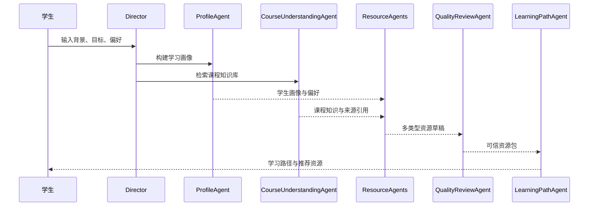

# 软件杯参赛提交文档设计稿

> 适用项目：天空课堂 / 智眸无界 软件杯参赛方向  
> 建议主文档名称：《多智能体个性化学习资源生成系统开发与测试说明书》  
> 建议交付形式：1 份主报告 + 若干附件材料  
> 设计目标：同时满足需求分析、技术开发、智能体设计、测试部署、数据案例支撑与可视化表达要求。

## 1. 文档定位

本提交文档不建议写成单纯的产品介绍，而应写成一份“标准软件工程文档 + 参赛亮点说明”的综合报告。评委阅读时应能快速看清三件事：

1. 系统为什么解决新时代大学生学习问题。
2. 系统怎样把前沿 AI 技术落到可运行的软件系统。
3. 系统是否有完整开发、测试、部署、演示和数据支撑。

建议采用“总分总”结构：

- 前 2 章回答“为什么做、需求是什么”。
- 中间 5 章回答“怎么设计、怎么实现、AI 怎么融合”。
- 后 3 章回答“怎么测试、怎么部署、效果如何”。
- 附录承接接口、数据、测试用例、开源合规和截图材料。

## 2. 推荐交付物体系

| 交付物 | 作用 | 建议来源 |
| --- | --- | --- |
| 主报告：《系统开发与测试说明书》 | 评审主入口，覆盖需求、设计、开发、测试、部署、案例 | 新建正式文档 |
| 附件 A：《需求规格说明书》 | 展开用户研究、需求分析、功能需求、非功能需求 | 汇总本设计稿第 3 章 |
| 附件 B：《系统设计说明书》 | 展开架构、模块、数据流、接口、部署 | 参考 `docs/PROJECT-REPORT.md` |
| 附件 C：《智能体设计说明书》 | 专门说明 Director 与各 Agent 的职责、输入输出、协作流程 | 参考 `docs/software-cup-solution-plan.md` |
| 附件 D：《测试说明书》 | 测试环境、测试范围、测试用例、结果与缺陷处理 | 参考 `tests/` 和 `docs/software-cup-performance.md` |
| 附件 E：《演示与案例说明》 | 固定答辩链路、样例学生、生成资源、截图清单 | 参考 `docs/software-cup-demo-script.md` |
| 附件 F：《开源合规与安全说明》 | 开源协议、第三方依赖、防幻觉、内容安全 | 参考 `OPEN_SOURCE_NOTICE.md`、`THIRD_PARTY_LICENSES.md` |

如果比赛只允许提交一份文档，可以把附件压缩成主报告附录。

## 3. 主报告建议目录

### 摘要

写 500-800 字，说明系统定位、核心能力、技术路线和实测支撑。

建议表述主线：

> 本系统面向高校专业课程学习场景，构建“对话式学习画像 -> 课程知识库检索 -> 多智能体资源生成 -> 可信审核 -> 个性化学习路径 -> 学习效果评估”的闭环，为大学生生成可信、个性化、多模态学习资源。

### 第 1 章 项目背景与需求分析

重点对应比赛“需求层面”的要求。

建议内容：

- 新时代大学生学习特征：自主学习时间碎片化、课程资源分散、AI 工具使用频繁但结果可信度不稳定。
- 典型痛点：不会规划学习路径、不会把概念和代码连接起来、资料搜索成本高、生成式 AI 容易幻觉。
- 用户画像：以软件工程/人工智能相关专业学生为核心用户。
- 需求调研方法：问卷、访谈、公开教育报告、课堂观察、竞品分析均可写入。
- 需求到功能映射：把“学习画像、资源生成、路径规划、智能辅导、效果评估”映射到系统模块。

建议图表：

- 大学生学习痛点统计图。
- 用户旅程图。
- 需求优先级矩阵。
- 赛题要求到系统功能映射表。

### 第 2 章 系统总体方案

说明系统不是单点工具，而是一个 AI 学习闭环平台。

建议内容：

- 一句话定位：面向高校专业课程的可信多智能体 AI 学习资源生成与个性化学习路径规划平台。
- 核心闭环：画像、知识库、生成、审核、路径、评估。
- 主要用户角色：学生、教师/课程建设者、管理员。
- 系统边界：Web 应用为主，移动端/PWA 可作为拓展形态。

建议放置 Mermaid 总流程图：


### 第 3 章 系统架构设计

重点体现技术深度。

建议内容：

- 前端架构：Next.js 16、React 19、TypeScript、Tailwind CSS、shadcn/Radix。
- AI 服务层：Vercel AI SDK、LangGraph、多模型 Provider 抽象、RAG 检索。
- 业务模块：天空课堂、云端智囊、天梯工坊、软件杯生成台、课程知识库。
- 数据层：课程知识库、题库、知识图谱、学生画像、生成任务、学习行为。
- 部署层：本地开发、Docker、Vercel/Node 服务、环境变量与模型密钥配置。

建议图表：

- 系统分层架构图。
- 前后端交互时序图。
- 数据流图。
- 部署拓扑图。

### 第 4 章 智能体设计与开发

这是文档的技术核心，需要单独成章。

建议说明以下 Agent：

| Agent | 职责 | 主要输入 | 主要输出 |
| --- | --- | --- | --- |
| Director | 识别意图、拆解任务、编排流程 | 用户目标、画像、课程上下文 | 任务计划、执行顺序 |
| ProfileAgent | 构建 8 维学习画像 | 自然语言输入、学习行为 | 画像字段、证据、置信度 |
| CourseUnderstandingAgent | 检索课程知识库 | 课程目标、薄弱点 | 命中文档、知识点、引用 |
| ResourceDesignAgent | 决定资源类型和难度 | 画像、课程结构 | 资源生成方案 |
| ResourceAgents | 生成讲义、PPT、题库、导图、代码案例、视频脚本 | 资源方案、知识库片段 | 多类型学习资源 |
| QualityReviewAgent | 检查事实、引用、安全、难度 | 生成资源、来源材料 | 审核结果、修正建议 |
| LearningPathAgent | 规划学习路径 | 画像、资源、知识图谱 | 阶段计划、推荐理由 |
| LearningEffectAgent | 评估学习效果 | 练习结果、资源反馈 | 掌握度、错因、画像更新 |

建议放置智能体时序图：



### 第 5 章 功能实现与系统集成

重点说明从设计到可运行系统的落地过程。

建议内容：

- 软件杯演示入口：`/sky/software-cup`。
- 核心 API：资源生成任务、画像对话、安全检查、学习效果评估、进度流。
- 前端交互：自然语言输入、Agent 进度、画像面板、资源卡片、路径时间线、审核结果。
- 生成任务机制：长任务异步执行、进度追踪、失败降级、演示 fallback。
- 系统集成：课程知识库、题库、知识图谱、学习画像、云端智囊、天梯工坊联动。

建议配图：

- 软件杯主页面截图。
- Agent 进度面板截图。
- 多模态资源卡片截图。
- 学习路径时间线截图。

### 第 6 章 前沿 AI 技术融合与创新实践

这一章要避免只罗列模型名，应该写清“技术-场景-实现-效果”。

建议写 5 个融合点：

| 技术 | 应用场景 | 实现方式 | 价值 |
| --- | --- | --- | --- |
| LLM | 画像抽取、资源生成、答疑 | Provider 抽象 + Prompt 模板 + JSON 修复 | 降低内容生产门槛 |
| RAG | 课程知识约束与来源引用 | 检索《人工智能导论》知识库片段 | 降低幻觉风险 |
| 多智能体编排 | 多任务协作生成 | Director-Agent 分工与状态流转 | 提升复杂任务稳定性 |
| 知识图谱 | 学习路径规划 | 知识点前置关系、掌握度、错因关联 | 让推荐可解释 |
| 内容安全与事实核验 | 可信生成 | 输入过滤、置信度、质量审核 Agent | 提升教育场景可靠性 |

创新点建议：

- 对话式学习画像替代表单式配置。
- 资源生成前先做课程知识检索和个性化资源设计。
- 生成结果附带来源、置信度和审核状态。
- 将一次性生成扩展为“学习-练习-评估-画像更新”的闭环。
- 支持现场演示 fallback，保证比赛展示稳定性。

### 第 7 章 用户界面与体验设计

重点对应“用户界面设计、用户体验提升策略”。

建议内容：

- 信息架构：输入区、画像区、Agent 协作区、资源区、路径区、审核区。
- 长任务体验：分阶段进度、Agent 状态、可见的生成过程。
- 可信体验：来源引用、置信度、审核结果不遮挡主内容。
- 学习体验：资源推荐理由、路径节点目标、下一步行动明确。
- 移动端拓展：移动 Web/PWA 适配，支持软件杯移动演示链路。

建议图表：

- 页面信息架构图。
- 用户操作流程图。
- 长任务状态机。

### 第 8 章 数据、案例与效果支撑

这一章解决“有充分的数据与案例支撑”的要求。

当前仓库可引用的支撑材料：

| 类型 | 当前证据 |
| --- | --- |
| 课程知识库 | 《人工智能导论》12 章讲义、4 个代码案例、3 个媒体脚本 |
| 知识图谱 | 48 个知识点节点、56 条关系边 |
| 题库 | 120 道题，覆盖章节、知识点、难度、解析与错因标签 |
| 学生画像样例 | 8 维画像，包含置信度和证据来源 |
| 生成结果样例 | 讲义、PPT、思维导图、题库、代码案例、视频脚本 6 类资源 |
| 学习路径样例 | 14 天学习路径，包含目标、资源和推荐理由 |
| 自动化测试 | 当前 `tests/` 下约 376 个测试文件，其中软件杯相关 7 个测试文件 |

建议案例主线：

> 软件工程大二学生，Python 基础较好，但对过拟合、模型评估和 RAG 薄弱，希望两周内补齐机器学习基础和大模型智能体能力，偏好图解、代码案例和分层练习题。

案例输出建议展示：

- 8 维画像表。
- Agent Trace 表。
- 6 类资源清单。
- 14 天路径时间线。
- 审核结果与来源引用。

### 第 9 章 测试说明

这一章要按标准测试说明书写，而不是只写“运行了测试”。

建议内容：

- 测试目标：功能正确性、AI 输出稳定性、内容可信、安全过滤、性能体验。
- 测试环境：Node、pnpm、浏览器、模型配置、数据库/存储配置。
- 测试范围：单元测试、API 测试、集成测试、E2E 测试、人工验收。
- 测试用例矩阵：画像、生成、审核、路径、安全、fallback、移动端。
- 缺陷管理：发现、定位、修复、回归验证。

建议测试命令：

```bash
pnpm check
pnpm lint
npx tsc --noEmit
pnpm test
pnpm test:e2e
```

建议测试用例表字段：

| 用例编号 | 模块 | 输入 | 预期结果 | 实际结果 | 状态 |
| --- | --- | --- | --- | --- | --- |
| TC-PROFILE-001 | 学习画像 | 学生自然语言背景 | 输出 8 维画像与证据 | 待填写 | 通过/失败 |
| TC-GEN-001 | 资源生成 | 画像 + 课程目标 | 输出不少于 5 类资源 | 待填写 | 通过/失败 |
| TC-SAFE-001 | 内容安全 | 代写/违规请求 | 拒答或改写为学习辅导 | 待填写 | 通过/失败 |
| TC-PATH-001 | 学习路径 | 薄弱点 + 资源包 | 输出可解释路径 | 待填写 | 通过/失败 |

### 第 10 章 部署与运行说明

建议内容：

- 本地开发环境：Node 20.9+、pnpm 10、环境变量。
- 依赖安装和构建流程。
- 模型 Provider 配置与多 key 轮转。
- Docker/Vercel/Node 部署方式。
- 运行监控、日志、降级策略。
- 数据备份与隐私保护。

建议放置部署流程图和环境变量表。

### 第 11 章 项目管理与开发过程

建议内容：

- 开发周期与里程碑。
- 模块拆分与任务编号。
- 代码规范：TypeScript strict、ESLint、Prettier、Zod。
- 版本管理与分支策略。
- 团队协作与分工。

可以引用 `docs/software-cup-execution-plan.md` 中的 Week 1-6 路线。

### 第 12 章 总结与展望

建议收束到三个关键词：

- 深度：多智能体、RAG、知识图谱、可信审核。
- 广度：画像、资源、路径、辅导、评估、移动端拓展。
- 可落地：有可运行系统、有测试、有数据、有演示链路。

后续展望：

- 接入更多课程知识库。
- 扩展教师端课程建设工具。
- 引入真实学习行为数据评估推荐效果。
- 支持移动端、小程序端或校园平台集成。

## 4. 附录设计

| 附录 | 内容 |
| --- | --- |
| 附录 A API 接口清单 | 路由、方法、输入、输出、错误码 |
| 附录 B 数据结构 | 学习画像、资源、知识图谱、题库、学习路径 |
| 附录 C Prompt 与 Agent 配置 | 各 Agent 的输入输出约束和提示词原则 |
| 附录 D 测试用例与结果 | 完整测试用例、截图、日志、缺陷记录 |
| 附录 E 系统截图 | 首页、生成台、画像、资源、路径、审核、移动端 |
| 附录 F 开源合规 | 开源项目、许可证、第三方依赖、模型服务说明 |

## 5. 建议页数分配

| 章节 | 建议页数 |
| --- | --- |
| 摘要、目录 | 2 |
| 背景与需求分析 | 6-8 |
| 总体方案与架构 | 8-10 |
| 智能体设计与 AI 技术融合 | 10-14 |
| 功能实现与 UI/UX | 8-10 |
| 数据与案例支撑 | 6-8 |
| 测试说明 | 6-8 |
| 部署、管理、总结 | 5-7 |
| 附录 | 按提交限制取舍 |

主报告建议控制在 45-65 页；若比赛限制较严，可压缩到 25-35 页，把细节放入附件。

## 6. 写作注意事项

- 每章开头先回答“本章解决哪个评审问题”。
- 技术章节不要只列技术栈，要写清为什么选、怎么接、解决了什么问题。
- AI 能力必须绑定教育场景，例如画像、路径、资源、审核，而不是泛泛写“调用大模型”。
- 所有亮点最好配一张图、一张表或一个真实案例。
- 测试章节必须包含失败、降级、安全边界，体现工程可信度。
- 开源合规要显著标注 智眸无界、AGPL-3.0 和第三方依赖来源。
- 文档风格建议“工程严谨 + 答辩友好”：标题清楚、图表多、每章有小结。

## 7. 当前材料复用建议

| 已有材料 | 可复用位置 |
| --- | --- |
| `docs/software-cup-solution-plan.md` | 第 1、2、4、6、8 章 |
| `docs/software-cup-execution-plan.md` | 第 5、9、11 章 |
| `docs/PROJECT-REPORT.md` | 第 3、5、10 章 |
| `docs/software-cup-demo-script.md` | 第 8 章与附件 E |
| `docs/software-cup-safety-and-trust.md` | 第 6、9 章与附件 F |
| `docs/software-cup-content-safety.md` | 第 6、9 章与附件 F |
| `docs/software-cup-performance.md` | 第 7、9、10 章 |
| `MOBILE_APP_PLAN.md` | 第 7、12 章移动端拓展 |
| `data/course-knowledge/ai-intro/` | 第 8 章数据支撑 |
| `data/demo/software-cup/` | 第 8 章案例支撑 |
| `tests/software-cup/` | 第 9 章测试支撑 |

