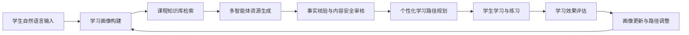
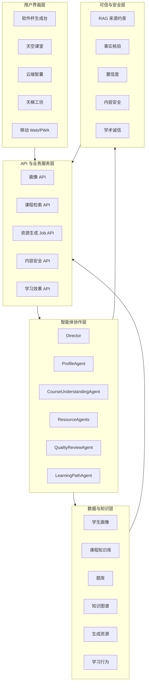
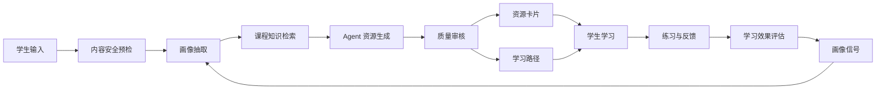
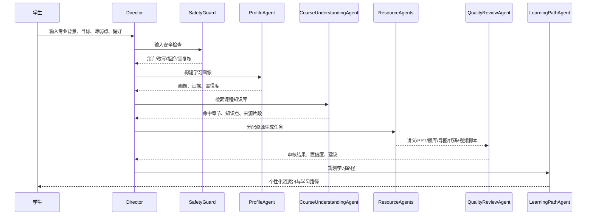
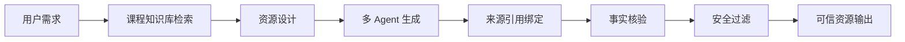
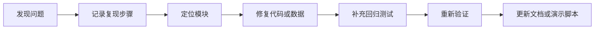
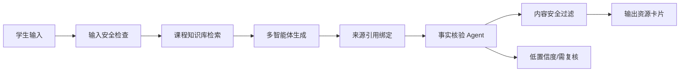

# 多智能体个性化学习资源生成系统开发与测试说明书

> 参赛方向：中国大学生计算机设计大赛软件系统类  
> 系统名称：天空课堂（Sky Classroom）/ OpenMAIC 软件杯参赛版本  
> 文档版本：v1.0  
> 生成日期：2026-07-07  
> 开发类型：Web 应用为主，支持移动 Web/PWA 拓展  
> 技术栈：Next.js 16、React 19、TypeScript、Vercel AI SDK、LangGraph、RAG、知识图谱、多智能体协作

## 摘要

本系统面向新时代大学生在专业课程学习中的个性化、自主化、智能化需求，建设一个“可信多智能体 AI 学习资源生成与个性化学习路径规划平台”。系统以学生自然语言输入为入口，通过学习画像 Agent 抽取专业背景、学习目标、知识基础、认知风格、易错点、资源偏好、学习节奏、当前状态等维度，结合《人工智能导论》课程知识库、题库、知识图谱和学习行为数据，由 Director 统一编排多个专业智能体，完成课程检索、资源设计、讲义生成、PPT 大纲生成、题库生成、思维导图生成、代码案例生成、视频脚本生成、事实核验、内容安全检查和学习路径规划。

系统不是单一课件生成工具，而是围绕大学生学习全过程构建闭环：对话式学习画像 -> 课程知识库检索 -> 多智能体资源生成 -> 可信审核 -> 个性化学习路径 -> 学习效果评估 -> 画像更新。该闭环既回应大学生“资料多但不成体系、生成式 AI 内容不稳定、学习路径难规划、概念与实践脱节”等痛点，也体现前沿 AI 技术在教育场景中的可落地融合。

当前项目已具备可演示的软件杯主线：在 `/sky/software-cup` 页面输入典型学生学习背景后，系统可生成 8 维学习画像，展示 6 个阶段的 Agent 协作轨迹，返回讲义、PPT、思维导图、题库、代码案例、视频脚本等 6 类学习资源，并生成 14 天个性化学习路径。系统同时准备了《人工智能导论》课程知识库，包含 12 章课程讲义、4 个代码实操案例、3 个媒体脚本、48 个知识图谱节点、56 条知识关系和 120 道题库数据，为 RAG 检索、事实核验和学习路径规划提供支撑。

文档按照软件系统标准交付要求组织，覆盖需求分析、总体设计、智能体设计、技术实现、界面体验、数据案例、测试说明、部署说明、开源合规和后续演进，可作为参赛提交主文档，也可拆分为需求规格说明书、系统设计说明书、智能体设计说明书、测试说明书和演示说明书等附件。

## 目录

1. 项目背景与需求分析
2. 系统总体方案
3. 系统架构设计
4. 智能体设计与开发
5. 核心功能实现
6. 前沿 AI 技术融合与创新实践
7. 用户界面与体验设计
8. 数据、案例与效果支撑
9. 测试说明
10. 部署与运行说明
11. 开源合规、安全与可信机制
12. 项目管理与开发过程
13. 总结与展望
14. 附录

## 1. 项目背景与需求分析

### 1.1 背景说明

随着大模型、智能体、知识增强生成、多模态生成等 AI 技术快速发展，大学生的学习方式正在发生变化。学生不再只依赖课堂、教材和搜索引擎，而是越来越多使用 AI 工具辅助理解概念、生成资料、规划学习、完成练习和调试代码。

但在真实学习场景中，通用 AI 工具仍存在明显不足：

- 生成内容容易脱离课程大纲和教师要求。
- 学生很难判断生成内容是否真实可靠。
- AI 往往只回答单次问题，不持续理解学生画像。
- 学习资源生成后缺少学习路径和练习反馈。
- 课程知识、题库、错题、学习记录之间没有形成闭环。

因此，本系统选择“高校专业课程学习”作为核心场景，以人工智能导论课程为示范课程，将多智能体协作、RAG、知识图谱、学习画像和可信审核机制结合，构建一个可运行、可演示、可扩展的智能学习平台。

### 1.2 用户群体

系统主要面向以下用户：

| 用户类型 | 典型需求 | 系统响应 |
| --- | --- | --- |
| 大学生学习者 | 快速理解课程重点，获得适合自己的资源和路径 | 对话式画像、多资源生成、个性化路径、智能辅导 |
| 课程教师 | 将课程资料转化为可学习资源，辅助答疑和练习设计 | 课程知识库、题库生成、PPT 大纲、学习效果反馈 |
| 教学管理者 | 了解学生学习状态和资源使用效果 | 学习统计、掌握度、错因分析、路径调整 |
| 竞赛评审 | 关注技术创新、工程完整性、用户价值和可演示性 | 多智能体闭环、可信机制、数据案例、完整测试与部署说明 |

### 1.3 大学生学习痛点分析

面向新时代大学生，系统重点关注以下学习痛点：

| 痛点 | 具体表现 | 对系统的要求 |
| --- | --- | --- |
| 资源分散 | 教材、课件、网课、博客和代码资料分散，筛选成本高 | 需要课程知识库统一管理，并能自动组织成学习资源 |
| 学习路径不清 | 不知道先学什么、后学什么，薄弱点难定位 | 需要学习画像、知识图谱和路径规划能力 |
| AI 内容不可信 | 通用模型可能生成流畅但错误的解释 | 需要 RAG、来源引用、事实核验和置信度展示 |
| 概念与实践脱节 | 理论懂一点，但不会对应到代码和项目 | 需要代码案例、项目任务、图解讲义和分层练习 |
| 个性化不足 | 同一份资料无法适配不同基础和目标 | 需要根据专业、基础、偏好、节奏动态生成资源 |
| 学习反馈弱 | 做题后不知道错因，也不会自动调整复习计划 | 需要学习效果评估、错因分析和画像更新 |

### 1.4 需求研究方法

本项目采用“场景研究 + 竞品分析 + 典型案例建模 + 系统闭环验证”的需求分析方法：

1. 场景研究：围绕高校专业课程学习过程，拆分课前预习、课堂学习、课后复习、刷题练习、项目实践和考试备考等场景。
2. 竞品分析：分析通用问答工具、课件生成工具、在线题库、知识图谱学习工具的优势和不足。
3. 典型案例建模：构造“软件工程大二学生学习人工智能导论”的典型用户案例。
4. 系统闭环验证：通过软件杯演示页面验证画像、知识库、生成、审核、路径和评估能否串联。

### 1.5 功能需求

| 编号 | 功能需求 | 优先级 | 当前实现或材料依据 |
| --- | --- | --- | --- |
| FR-01 | 支持自然语言构建学习画像 | P0 | `lib/software-cup/demo-service.ts`、`data/demo/software-cup/student-profile-sample.json` |
| FR-02 | 支持课程知识库检索 | P0 | `data/course-knowledge/ai-intro/`、`app/api/sky/course-knowledge/search/route.ts` |
| FR-03 | 支持多智能体协同生成资源 | P0 | `lib/software-cup/demo-service.ts`、`components/sky/software-cup/software-cup-page.tsx` |
| FR-04 | 至少生成 5 类个性化资源 | P0 | 当前样例生成 6 类资源 |
| FR-05 | 支持可信审核与防幻觉 | P0 | `lib/software-cup/quality-review.ts`、`docs/software-cup-safety-and-trust.md` |
| FR-06 | 支持个性化学习路径规划 | P0 | `data/demo/software-cup/generated-resources.json` |
| FR-07 | 支持学习效果评估 | P1 | `lib/software-cup/learning-effect.ts` |
| FR-08 | 支持长任务进度展示 | P1 | `buildSoftwareCupProgressEvents()`、资源生成 job API |
| FR-09 | 支持移动端/PWA 演示拓展 | P1 | `MOBILE_APP_PLAN.md` |

### 1.6 非功能需求

| 类型 | 要求 | 设计响应 |
| --- | --- | --- |
| 可用性 | 学生无需填写复杂表单，通过自然语言进入学习流程 | 对话输入、默认样例、一键生成 |
| 性能 | 长任务不应白屏等待 | 异步 job、进度追踪、fallback 数据 |
| 可信性 | 输出需可追溯、可核验 | 来源引用、质量审核、置信度展示 |
| 安全性 | 拒绝违规、隐私和学术作弊请求 | 输入过滤、内容安全策略、改写为学习辅导 |
| 可维护性 | 模块清晰、可测试、可扩展 | TypeScript、Zod、模块化服务、测试覆盖 |
| 可部署性 | 支持本地、容器和云端部署 | Next.js、Docker、环境变量配置 |

## 2. 系统总体方案

### 2.1 系统定位

本系统定位为：

> 面向高校专业课程的可信多智能体 AI 学习资源生成与个性化学习路径规划平台。

与普通 AI 问答工具相比，本系统更强调三点：

1. 课程约束：以课程知识库、题库、知识图谱作为生成依据。
2. 个性化：以学习画像和学习行为驱动资源类型、难度和路径。
3. 可信闭环：以 RAG、来源引用、事实核验、内容安全和学习效果反馈降低风险。

### 2.2 核心业务闭环



闭环说明：

1. 学生输入专业背景、课程目标、薄弱点、资源偏好和时间安排。
2. 系统抽取学习画像，并为每个关键字段保留证据和置信度。
3. 系统根据画像检索课程知识库和知识图谱。
4. Director 编排多个 Agent 生成多类型学习资源。
5. QualityReviewAgent 对资源进行事实核验、来源检查和内容安全过滤。
6. LearningPathAgent 生成可解释的学习路径和推荐理由。
7. 学生完成学习和练习后，系统根据效果评估更新画像。

### 2.3 系统能力地图

| 能力层 | 主要能力 | 对应模块 |
| --- | --- | --- |
| 用户入口层 | 首页、软件杯生成台、云端智囊、天梯工坊、移动端入口 | `app/sky/`、`components/sky/` |
| 学习理解层 | 对话式画像、偏好抽取、学习状态识别 | `lib/student/`、`lib/software-cup/` |
| 知识支撑层 | 课程知识库、题库、知识图谱、拓展阅读 | `data/course-knowledge/ai-intro/` |
| 智能体协作层 | Director、画像、课程理解、资源生成、审核、路径规划 | `lib/orchestration/`、`lib/software-cup/` |
| 资源生成层 | 讲义、PPT、题库、思维导图、代码案例、视频脚本 | `lib/generation/`、`lib/slides/` |
| 可信安全层 | RAG、引用、质量审核、内容安全、学术诚信 | `lib/software-cup/quality-review.ts` |
| 效果评估层 | 练习结果、掌握度、错因、路径调整 | `lib/software-cup/learning-effect.ts` |

### 2.4 与赛题要求的对应关系

| 赛题核心要求 | 系统响应 | 文档章节 |
| --- | --- | --- |
| 深入了解新时代大学生学习需求 | 学习痛点、典型画像、场景闭环、需求矩阵 | 第 1 章 |
| 明确 AI 技术与需求结合点 | LLM、RAG、知识图谱、多智能体、质量审核与教育场景绑定 | 第 6 章 |
| 阐述智能体设计、开发、测试、部署全流程 | Director-Agent 设计、功能实现、测试说明、部署说明 | 第 4、5、9、10 章 |
| 说明 UI 设计、功能实现、系统集成和优化 | 软件杯生成台、Agent 进度、资源卡片、学习路径、性能策略 | 第 5、7 章 |
| 体现创新实践和用户体验提升 | 对话式画像、可信资源、可解释路径、长任务进度、fallback | 第 6、7、8 章 |
| 具备数据与案例支撑 | 课程知识库、知识图谱、题库、学生画像、生成资源、测试资产 | 第 8、9 章 |

## 3. 系统架构设计

### 3.1 技术架构

系统采用 Next.js App Router 单仓架构，前端、API 路由、AI 服务、数据访问和导出能力集中在一个 TypeScript monorepo 中。核心技术栈如下：

| 层级 | 技术 |
| --- | --- |
| 前端框架 | Next.js 16.1.2、React 19.2.3、TypeScript 5 |
| UI 与交互 | Tailwind CSS 4、Radix UI、shadcn、lucide-react、Motion |
| AI 接入 | Vercel AI SDK、OpenAI/Anthropic/Google 等 Provider 抽象 |
| 智能体编排 | LangGraph、Director-Agent 状态机 |
| 数据与状态 | Zustand、IndexedDB/Dexie、Supabase、MySQL2、文件型课程知识库 |
| 资源生成 | Markdown、PPTX、HTML、题库、思维导图、代码案例 |
| 数学与图表 | KaTeX、Temml、ECharts、@xyflow/react |
| 测试 | Vitest、Playwright、Testing Library |
| 部署 | Node.js、Docker、Vercel、环境变量配置 |

### 3.2 分层架构图



### 3.3 主要目录结构

| 目录 | 作用 |
| --- | --- |
| `app/` | Next.js App Router 页面与 API 路由 |
| `components/` | React UI 组件，包含软件杯页面、天空课堂组件和通用 UI |
| `lib/ai/` | LLM Provider 抽象、密钥池、模型调用 |
| `lib/orchestration/` | LangGraph 多智能体课堂编排 |
| `lib/software-cup/` | 软件杯演示服务、质量审核、学习效果、长期学习增强 |
| `lib/generation/` | 课堂与资源生成流程 |
| `lib/slides/` | PPT/幻灯片生成 Agent 与导出 |
| `data/course-knowledge/ai-intro/` | 《人工智能导论》课程知识库 |
| `data/demo/software-cup/` | 软件杯演示输入、画像和生成资源 fallback |
| `tests/` | 单元测试、集成测试和软件杯相关测试 |
| `docs/` | 项目文档、比赛方案、可信机制、性能说明 |

### 3.4 数据流设计



关键数据对象：

- `SoftwareCupStudentProfile`：学生画像，包含 8 个维度、置信度、证据和更新规则。
- `GeneratedResource`：生成资源，包含类型、标题、个性化理由、来源引用、内容预览、可信状态。
- `LearningPathNode`：学习路径节点，包含日期范围、目标、资源和推荐理由。
- `ReviewResult`：质量审核结果，包含是否通过、置信度、问题和建议。
- `AgentTraceItem`：Agent 协作轨迹，包含 Agent 名称、状态、输出和进度。

## 4. 智能体设计与开发

### 4.1 智能体总体设计

系统采用 Director-Agent 协作模式。Director 作为主协调器负责识别用户意图、拆解任务、安排 Agent 执行顺序和整合输出。专业 Agent 负责画像、课程理解、资源生成、质量审核、路径规划和效果评估。

这种设计的原因是，学习资源生成不是单一问答任务，而是包含理解学生、理解课程、设计资源、生成内容、审核可信度、规划路径等多个子任务。通过 Agent 分工，系统可以把复杂任务拆成可控流程，提高输出稳定性、可解释性和可测试性。

### 4.2 Agent 职责表

| Agent | 职责 | 输入 | 输出 |
| --- | --- | --- | --- |
| Director | 拆解任务、调度 Agent、整合结果 | 用户输入、画像、课程上下文 | 执行计划、阶段状态、最终响应 |
| SafetyGuard | 检查输入风险和学术诚信风险 | 用户输入 | 风险等级、处理动作、提示信息 |
| ProfileAgent | 构建学习画像 | 自然语言输入、学习行为、练习结果 | 8 维画像、证据、置信度 |
| CourseUnderstandingAgent | 检索和理解课程知识库 | 学习目标、薄弱点、关键词 | 命中文档、知识点、来源片段 |
| ResourceDesignAgent | 规划资源类型、难度和结构 | 画像、知识点、学习目标 | 资源生成方案 |
| LectureAgent | 生成图解讲义 | 课程片段、画像偏好 | Markdown 讲义 |
| SlidesAgent | 生成 PPT 大纲或课件 | 课程结构、演示目标 | PPT 大纲、页面内容 |
| QuizAgent | 生成或筛选题库 | 知识点、薄弱点、难度 | 分层练习题、答案、解析 |
| MindMapAgent | 生成知识导图 | 知识图谱、课程章节 | Mermaid/JSON 导图 |
| CodeCaseAgent | 生成代码案例 | 专业方向、实践目标 | 代码案例、实验任务 |
| VideoScriptAgent | 生成短视频/动画脚本 | 难点类型、认知风格 | 分镜、旁白、关键帧 |
| QualityReviewAgent | 检查事实、来源、安全和难度 | 生成资源、来源材料 | 审核报告、修正建议 |
| LearningPathAgent | 规划学习路径 | 画像、资源、知识图谱 | 路径节点、推荐理由 |
| LearningEffectAgent | 评估学习效果 | 练习结果、行为反馈 | 掌握度、错因、画像更新信号 |

### 4.3 协作流程



### 4.4 画像 Agent 设计

画像 Agent 的核心任务是把学生自然语言转化为结构化学习画像。当前软件杯样例中，画像包含 8 个维度：

| 维度 | 示例值 | 作用 |
| --- | --- | --- |
| 专业背景 | 软件工程大二学生 | 决定案例方向和解释深度 |
| 学习目标 | 两周内补上机器学习基础和大模型智能体 | 决定路径周期和资源重点 |
| 知识基础 | Python 基础较好，线性代数不熟 | 决定前置知识补齐策略 |
| 认知风格 | 图解 + 代码案例驱动 | 决定资源形式 |
| 易错点 | 概念边界混淆、公式与代码连接弱 | 决定练习与讲解重点 |
| 资源偏好 | 图解讲义、代码案例、分层练习题 | 决定资源生成类型 |
| 学习节奏 | 每天约 45 分钟，两周完成 | 决定路径粒度 |
| 当前状态 | 机器学习评估与 RAG 薄弱 | 决定推荐优先级 |

画像数据保留 `confidence` 和 `evidence` 字段，便于解释系统为什么给出某项推荐。

### 4.5 质量审核 Agent 设计

QualityReviewAgent 面向教育场景中的“可信问题”，主要检查：

- 资源是否绑定课程来源。
- 来源是否支撑生成结论。
- 题目答案和解析是否一致。
- 是否存在无依据断言、绝对化表述或过度承诺。
- 是否涉及隐私、违规内容或学术作弊。

审核结果包含：

```json
{
  "passed": true,
  "confidence": 0.89,
  "issues": [],
  "suggestions": ["后续接入真实模型时应保留来源片段和人工复核入口。"]
}
```

## 5. 核心功能实现

### 5.1 软件杯生成台

系统提供 `/sky/software-cup` 作为比赛主线演示入口。页面由 `components/sky/software-cup/software-cup-page.tsx` 实现，面向评委展示一条完整闭环：

1. 输入学生背景和学习目标。
2. 展示安全检查、画像构建、课程检索、资源生成、质量审核、路径规划等阶段。
3. 展示 8 维学习画像。
4. 展示课程知识库命中结果。
5. 展示 Agent Trace。
6. 展示 6 类个性化学习资源。
7. 展示可信审核结果和学习路径。

页面默认输入为：

> 我是软件工程大二学生，正在学人工智能导论。Python 基础还可以，线性代数学过但不太熟。现在最困惑的是过拟合、模型评估和 RAG，不太会把概念和代码联系起来。希望两周内补上机器学习基础和大模型智能体，偏好图解、代码案例和分层练习题。每天大概能学 45 分钟，希望系统帮我规划学习顺序并生成资料。

该输入对应新时代大学生典型场景：专业课程任务明确、基础不均衡、希望 AI 帮助整理路径和资料，同时需要理论与实践结合。

### 5.2 资源生成任务 API

软件杯资源生成通过 API 路由与后端服务衔接：

| API | 方法 | 作用 |
| --- | --- | --- |
| `/api/sky/resource-generation/jobs` | POST | 创建资源生成任务 |
| `/api/sky/resource-generation/jobs/[jobId]` | GET | 获取任务结果 |
| `/api/sky/resource-generation/jobs/[jobId]/stream` | GET | 获取 Agent 进度事件 |
| `/api/sky/student/profile/conversation` | POST | 生成对话式学习画像 |
| `/api/sky/course-knowledge/search` | GET/POST | 检索课程知识库 |
| `/api/sky/content-safety/check` | POST | 输入内容安全检查 |
| `/api/sky/content-safety/verify-academic` | POST | 学术内容可信核验 |
| `/api/sky/learning-effect/evaluate` | POST | 学习效果评估 |

### 5.3 多类型学习资源

当前演示资源包包含 6 类资源，超过“至少 5 类个性化资源”的要求：

| 资源类型 | 示例标题 | 个性化依据 |
| --- | --- | --- |
| 图解讲义 | 从过拟合到 RAG：可信 AI 学习闭环 | 学生薄弱点为过拟合、模型评估和 RAG |
| PPT 大纲 | 机器学习基础与 RAG 智能体复习课 | 适合课程复习和课堂展示 |
| 思维导图 | 过拟合、评价指标与 RAG 知识导图 | 学生偏好图解 |
| 题库 | 机器学习评估与 RAG 诊断题 | 用于诊断薄弱点 |
| 代码案例 | RAG 课程问答助手最小案例 | 学生希望连接概念和代码 |
| 视频脚本 | 如何判断模型过拟合 | 用短视频讲清难点 |

### 5.4 学习路径规划

系统根据画像、知识图谱和资源包生成 14 天学习路径。示例路径如下：

| 时间 | 学习目标 | 推荐资源 | 推荐理由 |
| --- | --- | --- | --- |
| Day 1-2 | 补齐训练集、验证集、测试集概念 | 图解讲义、诊断题 | 这是理解过拟合和模型评估的前置知识 |
| Day 3-5 | 掌握过拟合诊断和评价指标 | 视频脚本、思维导图 | 学生对评估薄弱，先建立判断能力 |
| Day 6-9 | 完成 KNN 或决策树代码案例 | 代码案例 | 用代码把概念落到实验 |
| Day 10-12 | 理解 RAG 流程和来源引用 | RAG 案例、PPT 大纲 | 进入大模型智能体主题，并强化防幻觉意识 |
| Day 13-14 | 完成课程问答助手小项目 | 评价 rubric、项目章节 | 用项目输出检验学习效果 |

### 5.5 进度追踪与降级

系统避免长任务白屏等待，采用：

- Agent 阶段状态展示。
- 异步 job 返回任务结果。
- stream 接口返回进度事件。
- 模型不可用时使用 `data/demo/software-cup/generated-resources.json` 作为 fallback。
- 单项资源失败时保留已生成结果。

## 6. 前沿 AI 技术融合与创新实践

### 6.1 技术与学习需求结合点

| AI 技术 | 学习需求 | 系统实现 | 效果 |
| --- | --- | --- | --- |
| LLM | 自然语言输入、资源生成、答疑 | Provider 抽象、Prompt 模板、JSON 修复 | 降低资料整理成本 |
| RAG | 生成内容需要可靠来源 | 检索课程知识库并绑定引用 | 降低幻觉风险 |
| 多智能体 | 复杂学习任务需要分工 | Director 编排画像、检索、生成、审核、路径 Agent | 提高流程可解释性 |
| 知识图谱 | 学习路径需要前置关系 | 48 个知识点、56 条关系边 | 推荐更符合认知顺序 |
| 质量审核 Agent | 学习内容需要可信 | 来源检查、置信度、问题与建议 | 适合教育场景 |
| 学习画像 | 资源需要个性化 | 8 维画像、证据和更新规则 | 推荐理由可解释 |

### 6.2 创新实践

#### 6.2.1 对话式学习画像

传统学习系统常通过表单收集学生信息，填写成本高，更新频率低。本系统通过自然语言对话提取画像，并保留证据来源和置信度。学生可以直接描述“我是谁、想学什么、哪里不会、喜欢什么资源”，系统自动转化为结构化数据。

#### 6.2.2 先检索、再生成、后审核

系统不是直接把用户问题发给模型，而是采用：



这种流程把课程材料、学生画像和可信审核纳入生成链路，更符合教育系统对准确性和可解释性的要求。

#### 6.2.3 可解释的学习路径

学习路径不只是列出任务，而是说明推荐理由、对应资源和前置知识。例如先补训练集/验证集/测试集，再学习过拟合和评价指标，最后进入 RAG 与智能体项目，符合人工智能导论课程的知识依赖关系。

#### 6.2.4 竞赛演示稳定性设计

考虑比赛现场可能存在网络、模型服务、API key 不稳定等问题，系统准备了 fallback 数据：

- `data/demo/software-cup/student-profile-sample.json`
- `data/demo/software-cup/generated-resources.json`

即使真实模型调用不可用，也能展示完整闭环，保证演示稳定。

## 7. 用户界面与体验设计

### 7.1 信息架构

软件杯生成台按照学习任务流程组织界面：

| 区域 | 内容 | 用户价值 |
| --- | --- | --- |
| 输入区 | 学生背景、课程目标、薄弱点、偏好、时间 | 快速进入个性化流程 |
| 阶段区 | 安全检查、画像、检索、生成、审核、路径 | 看见 AI 正在做什么 |
| 画像区 | 8 维画像、证据、置信度 | 理解系统如何认识自己 |
| 检索区 | 命中课程材料、片段、分数 | 证明生成不是凭空产生 |
| 资源区 | 讲义、PPT、导图、题库、代码、视频脚本 | 直接用于学习 |
| 路径区 | 14 天计划、目标、资源、理由 | 明确下一步行动 |
| 审核区 | 置信度、问题、建议 | 增强可信感 |

### 7.2 长任务体验

生成多个学习资源属于长任务。系统采用阶段化体验：

1. 立即显示输入和待执行阶段。
2. 每个 Agent 阶段显示等待、运行、完成或失败状态。
3. 部分结果可先展示，避免用户长时间等待。
4. 审核信息与主内容分层展示，不遮挡学习资料。
5. 失败时保留已完成内容，并允许重试或查看 fallback。

### 7.3 移动端拓展

系统当前以 Web 应用为主，并规划移动 Web/PWA 形态。移动端主线仍保持：

```text
登录 -> 首页 -> 个性化学习工作台 -> 对话画像 -> 课程知识库
  -> 多智能体资源生成 -> 可信审核 -> 学习路径 -> 练习/复习 -> 画像更新
```

移动端适合比赛现场快速展示，也适合学生碎片化学习。

## 8. 数据、案例与效果支撑

### 8.1 课程知识库数据

系统选择《人工智能导论》作为示范课程。当前课程知识库包括：

| 数据类型 | 数量 | 位置 |
| --- | --- | --- |
| 课程讲义 | 12 章 | `data/course-knowledge/ai-intro/chapters/` |
| 代码案例 | 4 个 | `data/course-knowledge/ai-intro/cases/` |
| 媒体脚本 | 3 个 | `data/course-knowledge/ai-intro/media-scripts/` |
| 知识图谱节点 | 48 个 | `knowledge-graph.json` |
| 知识图谱关系 | 56 条 | `knowledge-graph.json` |
| 题库题目 | 120 道 | `question-bank.json` |
| 课程大纲 | 1 份 | `syllabus.md` |
| 评价 rubric | 1 份 | `assessment-rubric.md` |

### 8.2 典型学生案例

案例用户：

| 字段 | 内容 |
| --- | --- |
| 专业与年级 | 软件工程大二 |
| 课程 | 人工智能导论 |
| 强项 | Python 基础 |
| 薄弱点 | 线性代数熟练度、过拟合、模型评估、RAG |
| 学习目标 | 两周内补上机器学习基础和大模型智能体 |
| 偏好 | 图解、代码案例、分层练习题 |
| 学习节奏 | 每天约 45 分钟 |

该案例覆盖了大学生在 AI 专业课程学习中的典型问题：理论概念、工程实践和学习规划之间缺少连接。

### 8.3 Agent Trace 示例

| Agent | 状态 | 输出摘要 |
| --- | --- | --- |
| Director | completed | 拆解为画像构建、课程检索、资源生成、审核、路径规划五个阶段 |
| ProfileAgent | completed | 生成 8 维学习画像，识别过拟合、模型评估、RAG 为薄弱点 |
| CourseUnderstandingAgent | completed | 命中机器学习基础、大模型与智能体、AI 安全等章节 |
| ResourceDesignAgent | completed | 选择讲义、PPT、题库、思维导图、代码案例、视频脚本六类资源 |
| QualityReviewAgent | completed | 核心事实绑定课程章节，标记为高置信 |
| LearningPathAgent | completed | 生成 14 天学习路径 |

### 8.4 生成资源可信信息

每个生成资源包含：

- `sourceCitations`：来源文件，如 `chapters/04-machine-learning-basics.md`。
- `trust.confidence`：置信度。
- `trust.status`：审核状态。
- `personalizationReason`：个性化推荐理由。

这使评委可以清楚看到资源从哪里来、为什么推荐、是否通过审核。

## 9. 测试说明

### 9.1 测试目标

测试目标包括：

- 验证学习画像能从自然语言输入中抽取关键字段。
- 验证课程知识库检索能返回相关章节和知识点。
- 验证资源生成结果不少于 5 类。
- 验证质量审核能发现低置信度和不安全内容。
- 验证学习路径能够基于画像和知识图谱生成。
- 验证接口、页面和 fallback 机制可用。

### 9.2 测试范围

| 测试类型 | 范围 |
| --- | --- |
| 单元测试 | 画像、质量审核、学习效果、资源个性化、知识图谱、Provider 抽象 |
| API 测试 | 资源生成、画像对话、安全检查、学习效果评估 |
| 集成测试 | 软件杯闭环、课程知识库、Agent Trace、fallback |
| UI 测试 | 软件杯页面、课程工作台、移动端布局 |
| E2E 测试 | 从输入到生成资源和路径的完整链路 |
| 人工验收 | 答辩演示脚本、截图清单、安全边界场景 |

### 9.3 测试资产现状

当前仓库测试资产包括：

| 指标 | 数量 |
| --- | --- |
| `tests/` 下测试文件 | 约 376 个 |
| 软件杯相关测试文件 | 7 个 |
| 软件杯测试覆盖方向 | RAG 生成、质量审核、资源个性化、长期学习、学习效果 |

软件杯相关测试文件包括：

- `tests/software-cup/llm-rag-generation.test.ts`
- `tests/software-cup/p1-quality-review.test.ts`
- `tests/software-cup/resource-personalization.test.ts`
- `tests/software-cup/p2-long-term-learning.test.ts`
- `tests/software-cup/learning-effect-report.test.ts`
- `tests/software-cup/learning-effect-signals.test.ts`

### 9.4 推荐测试命令

提交前建议按以下顺序执行：

```bash
pnpm check
pnpm lint
npx tsc --noEmit
pnpm test
pnpm test:e2e
```

### 9.5 核心测试用例

| 用例编号 | 模块 | 输入 | 预期结果 |
| --- | --- | --- | --- |
| TC-PROFILE-001 | 学习画像 | 典型学生自然语言输入 | 输出 8 维画像、证据和置信度 |
| TC-SEARCH-001 | 课程检索 | 过拟合、模型评估、RAG | 命中机器学习、大模型与智能体相关章节 |
| TC-GEN-001 | 资源生成 | 学习画像 + 课程命中结果 | 输出不少于 5 类资源 |
| TC-REVIEW-001 | 质量审核 | 生成资源包 | 输出 passed、confidence、issues、suggestions |
| TC-PATH-001 | 路径规划 | 画像 + 资源 + 知识图谱 | 输出包含目标、资源和推荐理由的路径 |
| TC-SAFE-001 | 内容安全 | 代写作业请求 | 拒绝直接代写，改写为学习辅导 |
| TC-FALLBACK-001 | 降级机制 | 模型不可用 | 返回 demo fallback，页面仍可演示 |
| TC-UI-001 | 用户界面 | 打开 `/sky/software-cup` | 页面展示输入区、进度区、资源区、路径区 |

### 9.6 缺陷处理流程



## 10. 部署与运行说明

### 10.1 环境要求

| 项目 | 要求 |
| --- | --- |
| Node.js | >= 20.9.0 |
| 包管理器 | pnpm 10.x |
| 浏览器 | Chrome/Edge 最新版本 |
| 模型配置 | 至少配置一个 LLM Provider key |
| 可选服务 | Supabase、MySQL、图片/视频模型、TTS/ASR |

### 10.2 本地运行

```bash
pnpm install
cp .env.example .env.local
pnpm dev
```

启动后访问：

```text
http://localhost:3000/sky/software-cup
```

### 10.3 生产构建

```bash
pnpm build
pnpm start
```

### 10.4 环境变量

关键配置包括：

| 类型 | 示例 |
| --- | --- |
| LLM | `OPENAI_API_KEY`、`ANTHROPIC_API_KEY`、`GOOGLE_API_KEY` |
| 默认模型 | `DEFAULT_MODEL=provider:model-id` |
| 数据库 | Supabase 或 MySQL 连接配置 |
| TTS/ASR | 语音服务 Provider 配置 |
| 图片/视频 | 多模态生成服务配置 |

环境变量优先级高于 `server-providers.yml`。

### 10.5 部署方式

| 方式 | 说明 |
| --- | --- |
| 本地 Node | 适合开发和现场演示 |
| Docker | 适合统一环境和内网部署 |
| Vercel | 适合快速云端展示 |
| 校园服务器 | 适合实际教学场景接入 |

### 10.6 降级策略

- 模型不可用：使用 demo fallback 数据。
- 长任务失败：保留已生成资源，并允许重试。
- 来源不足：标记为需复核，不作为确定事实。
- 敏感请求：拒答或改写为学习辅导方向。

## 11. 开源合规、安全与可信机制

### 11.1 开源合规

系统基于 OpenMAIC 二次开发，采用 AGPL-3.0 许可证。提交材料中应显著说明：

- 原项目：OpenMAIC。
- 许可证：AGPL-3.0。
- 前端框架：Next.js、React。
- AI 编排：LangGraph、Vercel AI SDK。
- UI 组件：Radix UI、shadcn。
- 主要依赖来源：详见 `THIRD_PARTY_LICENSES.md`。
- 开源说明：详见 `OPEN_SOURCE_NOTICE.md`。

### 11.2 内容安全

系统安全策略包括：

- 输入安全检查。
- 输出内容过滤。
- 学术诚信处理。
- 隐私信息识别。
- 低置信度内容复核。
- 拒答或改写为学习辅导。

对于“代写论文、代做作业、伪造实验结果”等请求，系统不直接生成可提交成果，而是提供提纲、概念解释、参考阅读、自查清单和调试建议。

### 11.3 防幻觉机制

系统采用可信生成流水线：



置信度分级：

| 等级 | 条件 | 展示策略 |
| --- | --- | --- |
| 高 | 多个课程来源一致支撑，核验通过 | 正常展示，标注来源 |
| 中 | 有来源但覆盖不足或表述需谨慎 | 展示“建议复核”提示 |
| 低 | 无来源或来源不匹配 | 不作为事实输出，要求补充资料 |

## 12. 项目管理与开发过程

### 12.1 开发阶段

项目按照以下阶段推进：

| 阶段 | 目标 |
| --- | --- |
| 阶段一 | 明确参赛定位，确定“画像 -> 知识库 -> 多智能体生成 -> 路径 -> 评估”主线 |
| 阶段二 | 构建《人工智能导论》课程知识库 |
| 阶段三 | 实现对话式学习画像与资源生成 |
| 阶段四 | 加入可信审核、内容安全和学习路径 |
| 阶段五 | 完成软件杯生成台、演示脚本、测试说明和部署材料 |

### 12.2 工程规范

| 方面 | 规范 |
| --- | --- |
| 语言 | TypeScript strict mode |
| 格式 | Prettier，100 字符宽度，单引号，尾随逗号 |
| 静态检查 | ESLint、TypeScript |
| 状态管理 | Zustand |
| 数据校验 | Zod |
| 测试 | Vitest、Playwright |
| 文档 | Markdown，按模块和功能归档 |

### 12.3 版本与协作

建议比赛提交前固定以下材料：

- 源代码仓库。
- 可运行构建版本。
- 演示账号和演示输入。
- 主报告和附件。
- 开源合规说明。
- 测试记录。
- 系统截图。
- 答辩演示脚本。

## 13. 总结与展望

本系统围绕新时代大学生专业课程学习需求，构建了一个以多智能体协作为核心的个性化学习资源生成平台。系统的主要价值体现在：

1. 需求深度：从大学生真实学习痛点出发，覆盖画像、资源、路径、辅导、评估全过程。
2. 技术深度：融合 LLM、RAG、LangGraph 多智能体、知识图谱、质量审核和内容安全。
3. 工程完整性：具备前端页面、API 路由、课程数据、测试资产、部署说明和 fallback 机制。
4. 案例说服力：以《人工智能导论》课程为例，提供课程知识库、题库、知识图谱和完整学生案例。
5. 可扩展性：后续可扩展到更多课程、教师端工具、移动端、小程序和校园平台。

后续演进方向：

- 接入更多高校专业课程知识库。
- 增强教师端课程建设和审核能力。
- 引入真实学习行为数据，优化路径推荐算法。
- 扩展多模态资源生成，如视频、语音讲解和交互实验。
- 支持移动端、小程序端和校园 LMS 集成。

## 14. 附录

### 附录 A：关键文件索引

| 文件 | 说明 |
| --- | --- |
| `docs/software-cup-solution-plan.md` | 软件杯总体方案 |
| `docs/software-cup-execution-plan.md` | 软件杯落地执行计划 |
| `docs/software-cup-demo-script.md` | 答辩演示脚本 |
| `docs/software-cup-safety-and-trust.md` | 防幻觉与可信内容机制 |
| `docs/software-cup-content-safety.md` | 内容安全策略 |
| `docs/software-cup-performance.md` | 响应时间与生成进度机制 |
| `docs/software-cup-submission-document-design.md` | 参赛提交文档设计稿 |
| `components/sky/software-cup/software-cup-page.tsx` | 软件杯页面 |
| `lib/software-cup/demo-service.ts` | 软件杯核心服务 |
| `lib/software-cup/quality-review.ts` | 质量审核逻辑 |
| `lib/software-cup/learning-effect.ts` | 学习效果评估 |
| `data/course-knowledge/ai-intro/` | 《人工智能导论》课程知识库 |
| `data/demo/software-cup/` | 演示画像与生成资源 |

### 附录 B：参赛提交检查清单

| 检查项 | 状态说明 |
| --- | --- |
| 主报告 | 本文档可作为主报告基础 |
| 需求分析 | 已覆盖学习痛点、用户群体、功能与非功能需求 |
| 技术设计 | 已覆盖架构、数据流、Agent、AI 技术融合 |
| 功能实现 | 已覆盖软件杯生成台、API、资源、路径、进度 |
| 测试说明 | 已覆盖测试目标、范围、资产、用例、命令 |
| 部署说明 | 已覆盖环境、运行、构建、部署、降级 |
| 数据案例 | 已覆盖课程知识库、题库、图谱、画像、资源、路径 |
| 安全可信 | 已覆盖防幻觉、内容安全、学术诚信 |
| 开源合规 | 已说明 OpenMAIC、AGPL-3.0 和依赖说明 |
| 可视化图表 | 已包含业务闭环、架构、数据流、协作流程、审核流程 |

### 附录 C：建议答辩主线

1. 说明系统定位：面向高校专业课程的可信多智能体 AI 学习平台。
2. 展示学生输入：软件工程大二学生，两周补强人工智能导论。
3. 展示画像：8 个维度、证据、置信度。
4. 展示课程检索：命中机器学习、大模型与智能体、AI 安全章节。
5. 展示 Agent 协作：Director、ProfileAgent、CourseUnderstandingAgent、ResourceDesignAgent、QualityReviewAgent、LearningPathAgent。
6. 展示 6 类资源：讲义、PPT、导图、题库、代码案例、视频脚本。
7. 展示可信审核：来源引用、置信度、审核结果。
8. 展示 14 天路径：目标、资源和推荐理由。
9. 说明测试、部署、开源合规和后续扩展。

